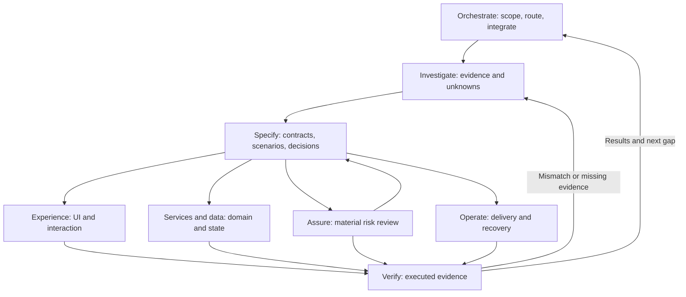

# Architecture and execution model

The library has eight skills and one shared artifact contract. The boundaries follow
decisions and owned outputs, rather than technologies or job titles. The source analysis
and coverage matrix explain what is preserved and why the source is reorganized.

## Dependency map

Arrows represent artifact handoffs, not a compulsory waterfall. A small source change can
reuse an existing specification and move directly to its owning implementation skill and
verification. Assure and operate can introduce constraints early. A source-only analysis
does not require an implementation or deployment stage.

Installation dependencies are simpler: seven specialists depend on the coordinator's shared
references. The whole library is installed together. Feedback loops above are intentional;
the installation dependency graph is acyclic and machine-checked in the
[skill map](../skills/reconstruct-orchestrate/references/skill-map.json).

## Why these boundaries

Services and data stay together because transaction boundaries, domain invariants, retries,
and side effects are one coherent behavior. Conditional AI, mobile, desktop, and asynchronous
guidance lives behind that skill rather than in separate micro-skills. Assure selects and
reviews risk controls; verify owns the experimental evidence. Operate owns the replacement's
delivery and recovery model, without inventing the reference's private infrastructure.

Performance crosses boundaries: specify defines the workload and target, verify measures,
implementation owners fix bottlenecks, and operate observes capacity. Documentation travels
with each deliverable; a separate documentation skill would create an unnecessary handoff.

## Shared state and context

The coordinator owns the artifact index and integration. Project-native documentation remains
authoritative where it already exists. A small new project can use a scope document and
`reconstruction/state.json`; larger projects link contracts, ADRs, API schemas, state diagrams,
runbooks, and results from that index. The library does not force ten duplicate Markdown files.

Records use stable IDs for evidence, requirements, decisions, scenarios, runs, unknowns, and
differences. Each current run binds a target version, replacement revision, scenario contract
digest, and retained output hash. Requirement status does not replace test evidence. The
[schema guide](../skills/reconstruct-orchestrate/references/state-format.md) defines exact
fields and validation rules; the helper is the only executable implementation of those rules.

Load names/descriptions first, then one relevant skill, then the needed references. At a
context boundary preserve identities, active slice, linked evidence, results, unresolved
decisions, and the next executable action. Recheck identities on resume; do not treat old
chat summaries as current test results.

## Task scheduling and conflict resolution

Select work by consequence, dependency impact, information gain, effort, and reachability.
These are judgment inputs, not a universal mathematical priority score. A task is ready
when its required artifacts exist and high-impact assumptions are explicit. The entire
earlier phase need not be finished.

When parallel work is available, give workers bounded questions, immutable input identities,
file ownership, allowed actions, outputs, and acceptance checks. Workers do not concurrently
edit the shared state. The integrator checks evidence and contract versions, reconciles
conflicting findings, merges changes, and executes integration tests. Dependent work waits;
independent work continues. One agent follows the same handoffs sequentially.

Conflicting observations first trigger a version, role, fixture, and environment comparison.
If conflict remains, run a discriminating experiment or preserve the disagreement as unknown.
Architecture changes require updated decisions and affected scenarios; do not let an agent
silently override a shared interface.

## Gates and recovery

The coordinator defines qualitative entry gates. The helper checks the final finite record:
nonempty established scope; required verified requirements; current supporting evidence;
linked design/implementation; every acceptance scenario's latest current passing result;
matching contract/output hashes; no unresolved consequential blockers affecting required scope.
Inference may support independently tested design, but cannot establish reference equivalence.

Missing tools cause a capability-specific fallback. Missing reference access narrows claims.
Failed tests become differences and regression cases. Changed evidence or contracts invalidate
affected results. An interrupted operation leaves a checkpoint and a concrete recovery action.
External effects require the task's actual authorization, not a skill-generated approval loop.

## Deliberate limits

The library is an instruction system with local consistency tools, not a hosted scheduler,
database, credential manager, model runtime, or guarantee of skill invocation. It cannot
authenticate logs, prove comprehensive discovery, detect changed source when a revision
label is improperly reused, or validate an untested deployment. Analysis-only completion
is assessed against question coverage, not a false implementation readiness gate.
