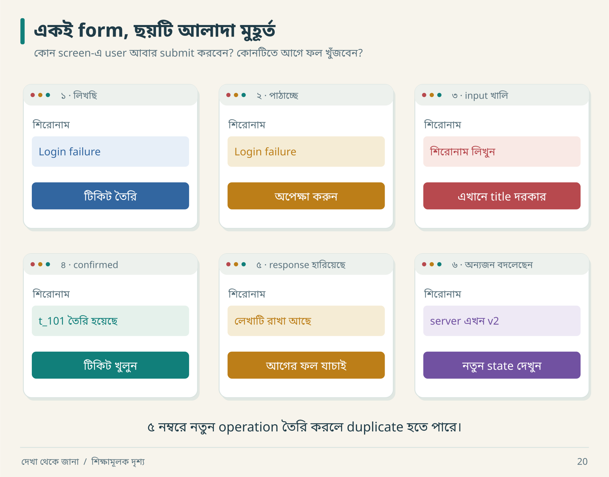
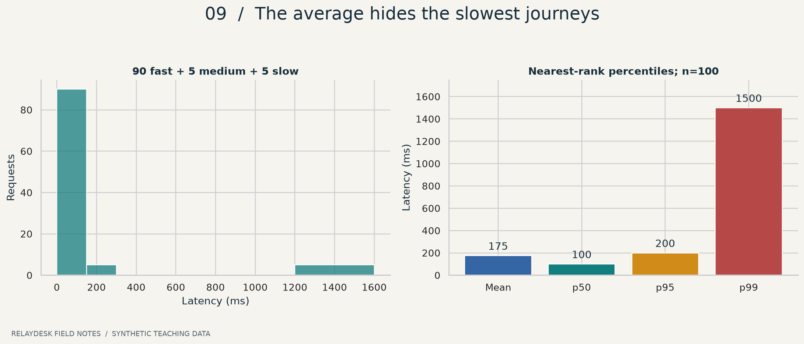

# দেখা থেকে জানা
## Reverse Engineering-এর বাংলা দৃশ্যপাঠ

**দ্বিতীয় সংস্করণ · দৃশ্য ও উদাহরণ**

আরিফ ticket তৈরি করল। Refresh দিতেই সেটি উধাও। কেন? তোমার [INSTRUCTION.md](INSTRUCTION.md)-এর ২৪ অধ্যায় ধরে এমন ছোট ঘটনা দিয়ে পড়া এগিয়েছে: screen দেখবে, পরের ফল অনুমান করবে, তারপর JSON, table বা lab দিয়ে ঘটনাটি খুলবে।

> **পড়ার জন্য কিছু install করতে হবে না।** [সম্পূর্ণ PDF বই](Reverse-Engineering-Bangla.pdf) · [অফলাইন বই খুলুন — book.html](book.html) · [একটানা Markdown — TUTORIAL.md](TUTORIAL.md) · [প্রথম অধ্যায়](chapters/01-surface-system.md)

PDF-তে বাংলা font embedded, পৃষ্ঠা নম্বরসহ clickable সূচি, সব চার্ট এবং workbook-এর সব উত্তর আছে। [Lab ও source resource pack](RelayDesk-Book-Resources.zip) আলাদাভাবে এবং PDF attachment হিসেবেও দেওয়া আছে।



Submit-এর পরে তিনটি আলাদা খবর আসতে পারে: ভুল input, নিশ্চিত save, অথবা ফল এখনও অজানা। [অধ্যায় ৬](chapters/06-ui-state.md)-এ একই form-এর এই বদলগুলো আছে। HTML-এ ছবিতে চাপলে বড় করে দেখা যাবে।

### কী থাকছে

| উপকরণ | ব্যবহার |
|---|---|
| **২৪টি অধ্যায়** | foundation → behavior → implementation → verification |
| **৩৬টি visual** | ২২টি নতুন বাংলা দৃশ্য + ১৪টি chart/diagram; সবগুলোর PNG, SVG ও Python source |
| **চারটি পরিশিষ্ট** | glossary, উত্তরসহ workbook, prompts, sources |
| **১৪টি executable contract test** | duplicate, persistence, permission, conflict ও recovery |
| **JSON/CSV/template pack** | নিজের project-এর evidence ও decision খাতা শুরু |
| **৩০ দিনের practice plan** | প্রতিদিন একটি concrete artifact |
| **এক ফাইলের offline HTML** | ছবিতে চাপ দিয়ে zoom, chapter filter, font size, theme, print |

## কোথা থেকে শুরু করবে

**একদম শুরু:** অধ্যায় ১ → ৩ → ৫ → ৬ → ৭ পড়ো। তারপর ১৬-এর lab চালাও। কঠিন অংশে আটকে গেলে glossary দেখো; সব একদিনে শেষ করতে হবে না।

**AI দিয়ে project বানাচ্ছ:** ১ → ৩ → ১৬ → ১৭ → ১৯ → ২১। সঙ্গে [agent prompts](appendices/C-prompts.md) ও [project control template](templates/project-control.md) রাখো।

**Backend/reliability গভীরে বুঝতে চাও:** ৮ → ৯ → ১০ → ১২ → ১৩ → ১৪ → ২০। Diagram-এর timeline কাগজে এঁকে নিজের ভাষায় ব্যাখ্যা করো।

প্রতি অধ্যায়ের শেষে `Q01`–`Q24` অনুশীলন আছে। আগে উত্তর লিখে পরে [workbook](appendices/B-workbook.md) খোলো। সাধারণ coding ধারণা থাকলে সুবিধা হবে; advanced distributed systems জানা প্রয়োজন নেই।

## অধ্যায়সূচি

| অধ্যায় | বিষয় | যা হাতে পাবে |
|---:|---|---|
| ০১ | [চেহারার নিচে যে সিস্টেম](chapters/01-surface-system.md) | observable behavior ও fidelity scope |
| ০২ | [অজানা রিপোজিটরিতে প্রথম অভিযান](chapters/02-reconnaissance.md) | reconnaissance ও baseline |
| ০৩ | [প্রমাণের খাতা ও অনুমানের সীমানা](chapters/03-evidence.md) | evidence ledger ও traceability |
| ০৪ | [পাতার তালিকা থেকে আচরণের মানচিত্র](chapters/04-product-map.md) | feature card ও dependencies |
| ০৫ | [গোয়েন্দার মতো পরীক্ষা সাজাও](chapters/05-experiments.md) | hypothesis, control ও experiment priority |
| ০৬ | [একটি বাটনের আট রকম জীবন](chapters/06-ui-state.md) | UI state ও unresolved outcome |
| ০৭ | [API-এর প্রতিশ্রুতি পড়তে শেখা](chapters/07-api-contract.md) | request/error contract ও pagination |
| ০৮ | [ব্যবসার নিয়মকে পরীক্ষাযোগ্য করা](chapters/08-domain-rules.md) | state machine, invariant, decision table |
| ০৯ | [ডেটার মালিক, কপি ও বিদায়](chapters/09-data-lifecycle.md) | authority, deletion ও projection |
| ১০ | [একই সময়ে দুজন: সময়ের ফাঁদ](chapters/10-time-concurrency.md) | concurrency, idempotency, outbox |
| ১১ | [নেটওয়ার্কের চিহ্ন কী বলে](chapters/11-network.md) | fingerprint ও streaming-এর সীমা |
| ১২ | [পরিচয় আছে, অনুমতি আছে কি](chapters/12-security.md) | multi-tenant authorization |
| ১৩ | [সিস্টেমের গল্প শোনার যন্ত্র](chapters/13-observability.md) | logs, metrics, traces, SLI |
| ১৪ | [গড়ের আড়ালে ধীর মানুষগুলো](chapters/14-performance.md) | percentile, queue, retry plots |
| ১৫ | [প্রয়োজন থেকে স্থাপত্য](chapters/15-architecture.md) | architecture trade-off ও ADR |
| ১৬ | [একটি সম্পূর্ণ slice ও চলমান lab](chapters/16-vertical-lab.md) | runnable Python/SQLite experiments |
| ১৭ | [দুই সিস্টেমের মুখোমুখি পরীক্ষা](chapters/17-verification.md) | oracle ও differential verification |
| ১৮ | [দোকান, সম্পাদক, AI ও অফলাইন জীবন](chapters/18-four-worlds.md) | চারটি domain-এর case study |
| ১৯ | [AI agent-কে কার্যকরভাবে পরিচালনা](chapters/19-agent-direction.md) | scope, steering, handoff ও ownership |
| ২০ | [চালু হয়েছে থেকে চালিয়ে রাখা](chapters/20-production.md) | migrations, restore ও operations |
| ২১ | [কতটা হলো: সৎ হিসাবের ভাষা](chapters/21-fidelity.md) | denominator ও release gates |
| ২২ | [৩০ দিনের কাজভিত্তিক অনুশীলন](chapters/22-practice-plan.md) | daily deliverable plan |
| ২৩ | [প্রতিদিনের ছোট engineering সভা](chapters/23-daily-loop.md) | daily review ও persistent memory |
| ২৪ | [মাঠের খাতা: ২৫টি স্মরণসূত্র](chapters/24-field-guide.md) | দ্রুত review প্রশ্ন |

## পরিশিষ্ট ও কাজের উপকরণ

| উপকরণ | লিংক |
|---|---|
| ধারণার বাংলা–ইংরেজি অভিধান | [পরিশিষ্ট A](appendices/A-glossary.md) |
| ২৪ প্রশ্নের উত্তর, detective challenge ও capstone | [পরিশিষ্ট B](appendices/B-workbook.md) |
| আটটি ব্যবহারযোগ্য AI-agent prompt | [পরিশিষ্ট C](appendices/C-prompts.md) |
| মূল লেখার mapping ও authoritative references | [পরিশিষ্ট D](appendices/D-sources.md) |
| কপি করে ব্যবহারযোগ্য project notebook | [project-control.md](templates/project-control.md) |
| Evidence / unknown / experiment | [evidence.json](examples/evidence.json) · [unknowns.json](examples/unknowns.json) · [experiment.json](examples/experiment.json) |
| API contract / architecture decision | [api-contract.json](examples/api-contract.json) · [adr.json](examples/adr.json) |

## ছবি ধরে পড়ার ছোট পথ

একবারে সব technical অংশ পড়তে হবে না। নিচের দৃশ্য থেকে শুরু করে ছবির পরের ছোট উদাহরণটি পড়তে পারো।

| আগে দেখো | ঘটনাটি কী | তারপর পড়ো |
|---|---|---|
| [Refresh-এর আগে–পরে](assets/figures/15-refresh-reveal.png) | একই screen, ফিরে খুললে ভিন্ন ফল | [অধ্যায় ১](chapters/01-surface-system.md) |
| [API-এর খাম](assets/figures/21-api-envelope.png) | request-এর কোন অংশ কোন কাজে লাগে | [অধ্যায় ৭](chapters/07-api-contract.md) |
| [একই রসিদ আবার](assets/figures/24-retry-receipts.png) | একই key, বদলানো payload ও নতুন key | [অধ্যায় ১০](chapters/10-time-concurrency.md) |
| [দুই workspace-এর দরজা](assets/figures/26-workspace-doors.png) | login থাকলেও অন্যের ticket দেখা যায় না | [অধ্যায় ১২](chapters/12-security.md) |
| [এক ticket, দুই নাম](assets/figures/30-cache-before-after.png) | details বদলেছে, list-এর cache বদলায়নি | [অধ্যায় ১৭](chapters/17-verification.md) |
| [Agent-এর সঙ্গে কথোপকথন](assets/figures/32-agent-conversation.png) | scope, expected result ও test এক নির্দেশে | [অধ্যায় ১৯](chapters/19-agent-direction.md) |
| [ছয়টি স্মরণকার্ড](assets/figures/36-memory-postcards.png) | বই বন্ধ করে নিজের project-এর গল্প বলো | [অধ্যায় ২৪](chapters/24-field-guide.md) |

নতুন সংস্করণে প্রতিটি অধ্যায়ে অন্তত একটি visual আছে। একই সঙ্গে পুনরাবৃত্ত অধ্যায়-ভূমিকা কমানো হয়েছে; pagination-এ duplicate, এক stock-এ দুই buyer, `CAT`-এ concurrent edit ও বাসে offline note-এর মতো ছোট dry run যোগ হয়েছে।

### সংখ্যা দিয়ে দেখা



এই ছবিতে mean ১৭৫ ms হলেও পাঁচটি request ১,৫০০ ms নিয়েছে। সংখ্যা হাতে গুনে ও Python দিয়ে একই ফল বের করার পদ্ধতি [অধ্যায় ১৪](chapters/14-performance.md)-তে আছে।

| বোঝার বিষয় | Visual |
|---|---|
| Claim থেকে result | [Evidence chain](assets/figures/02-evidence-chain.png) |
| কোন unknown আগে | [Priority](assets/figures/03-experiment-priority.png) |
| Timeout-এর পরে state | [UI state](assets/figures/04-ui-state.png) |
| Data copies | [Data map](assets/figures/05-data-map.png) |
| Stale write | [Concurrency timeline](assets/figures/06-concurrency.png) |
| Commit/send/ack | [Outbox](assets/figures/07-outbox.png) |
| Request বনাম worker সময় | [Trace](assets/figures/08-trace.png) |
| Queue কেন বাড়ে | [Backlog](assets/figures/10-queue.png) |
| Retry কেন একসঙ্গে জমে | [Jitter](assets/figures/11-retries.png) |
| কোন dimension যাচাই বাকি | [Verification matrix](assets/figures/12-verification.png) |
| ৮৪% কোন অর্থে | [Fidelity](assets/figures/13-fidelity.png) |
| ৩০ দিনের কাজ | [Practice timeline](assets/figures/14-practice.png) |

একই basename-এর `.svg` file-ও `assets/figures/`-এ আছে। নতুন ২২টি দৃশ্যের label বাংলায়; statistical chart-এ technical English রাখা হয়েছে। সব ছবির বাংলা ব্যাখ্যা ও descriptive alt text আছে। [Figure manifest](assets/figures/manifest.json)-এ conceptual, synthetic ও executed lab result-এর পরিচয় আলাদা।

## Lab চালাও

Repository root থেকে Python 3.10+ দিয়ে:

```bash
python3 lab/run_lab.py --output reports/lab-results.json
python3 -m unittest discover -s lab -p 'test_*.py' -v
```

Windows-এ `python3`-এর জায়গায় `py -3` বা `python` ব্যবহার করতে পারো। Lab-এর জন্য বাইরের package, account বা network দরকার নেই। এটি temporary SQLite database ও fake provider ব্যবহার করে; real email পাঠায় না।

**যাচাইযোগ্য ফল:** একই key replay-এ এক ticket; changed payload-এ conflict; cross-workspace access denied; stale update rejected; send-এর পরে acknowledgement হারালেও duplicate-safe fake provider-এ effect একবার। [সম্পূর্ণ lab guide](chapters/16-vertical-lab.md) · [Actual demo output](reports/lab-results.json) · [Verification report](reports/verification.md)

## ছবি ও বই আবার তৈরি করো

এটি optional। আগে থেকে তৈরি ছবি ও বই পড়তে এগুলো চালাতে হবে না। Build-এর জন্য Python 3.11+ ব্যবহার করো; tested dependency versions lock file-এ আছে।

```bash
python3 -m venv .venv
.venv/bin/python -m pip install -r requirements-lock.txt
.venv/bin/python -m pip install -r requirements-visuals.txt
.venv/bin/python scripts/make_figures.py
.venv/bin/python scripts/make_visual_stories.py
.venv/bin/python scripts/build_book.py
.venv/bin/python scripts/verify_book.py
```

Windows-এ virtual environment interpreter হবে `.venv\Scripts\python.exe`। নতুন দৃশ্য render করতে Cairo shared library প্রয়োজন; WSL/Linux-এ build করা সহজ। বাংলা ও fallback font, সঙ্গে license, `assets/fonts/`-এ দেওয়া আছে। Markdown chapter edit করলে `build_book.py` চালিয়ে `TUTORIAL.md` ও `book.html` নতুন করে তৈরি করবে। Figure-এর data বদলাতে [data guide](data/README.md) দেখো।

Node.js থাকলে optional `node scripts/check_reader.cjs` দিয়ে HTML-এর embedded latency calculator-এর পাঁচটি numeric case পরীক্ষা করা যায়। এটি browser rendering test নয়।

### PDF আবার তৈরি করা

```bash
.venv/bin/python -m pip install -r requirements-pdf.txt
.venv/bin/python scripts/build_pdf.py
.venv/bin/python scripts/verify_pdf.py
```

PDF renderer-এর জন্য Linux-এ Pango/Harfbuzz system libraries প্রয়োজন। বাংলা font ও license `assets/fonts/`-এ দেওয়া আছে। Export-এর সময় `book.html` থেকে সব অধ্যায় নেওয়া হয়; PDF-এর static latency example HTML slider-এর বিকল্প পাঠ হিসেবে যুক্ত হয়।

## ফাইলের মানচিত্র

```text
README.md                 ← শুরু ও navigation
INSTRUCTION.md            ← তোমার দেওয়া মূল লেখা, অক্ষত
TUTORIAL.md               ← সব অধ্যায় একসঙ্গে
book.html                 ← ছবি-সহ standalone offline reader
chapters/                 ← ২৪টি সম্পাদনাযোগ্য অধ্যায়
appendices/               ← glossary, workbook, prompts, sources
assets/figures/           ← PNG + SVG + provenance manifest
data/                     ← synthetic CSV ও calculated summary
examples/                 ← JSON records ও design examples
templates/                ← project control notebook
lab/                      ← service, demo ও contract tests
scripts/                  ← figure generation, book build, validation
reports/                  ← actual results ও validation evidence
```

## প্রমাণের পরিচয় ও বইয়ের সীমা

এখানে **conceptual diagram**, **synthetic data** এবং **executed local result** আলাদা চিহ্নিত। RelayDesk-এর endpoint, schema ও timeline শিক্ষামূলক; কোনো বাস্তব সেবার discovered internals নয়। Lab service-level behavior দেখায়—পূর্ণ UI, HTTP authentication, real provider, production deployment বা load benchmark নয়।

এই বইয়ের উদ্দেশ্য product behavior ও reconstruction judgment উন্নত করা। Native binary/firmware reverse engineering-এর পূর্ণ কোর্স এটি নয়। [উৎস ও সীমার বিস্তারিত](appendices/D-sources.md) পড়লে কোন জ্ঞান কোথা থেকে এসেছে তা পরিষ্কার থাকবে।

**তোমার প্রথম কাজ:** [অধ্যায় ১](chapters/01-surface-system.md) পড়ে নিজের পরিচিত app-এর একটি button বেছে নাও। “এটি কাজ করে” বাক্যটিকে পাঁচটি পরীক্ষাযোগ্য দাবিতে ভাঙো।

