<a id="top"></a>

# দেখা থেকে জানা: Reverse Engineering-এর বাংলা দৃশ্যপাঠ

তোমার INSTRUCTION.md অবলম্বনে ২৪ অধ্যায়, চার পরিশিষ্ট ও ৩৬টি visual। [মূল সূচি](README.md) · [অফলাইন interactive বই](book.html)

## অধ্যায়সূচি
- [চেহারার নিচে যে সিস্টেম](#01-surface-system)
- [অজানা রিপোজিটরিতে প্রথম অভিযান](#02-reconnaissance)
- [প্রমাণের খাতা ও অনুমানের সীমানা](#03-evidence)
- [পাতার তালিকা থেকে আচরণের মানচিত্র](#04-product-map)
- [গোয়েন্দার মতো পরীক্ষা সাজাও](#05-experiments)
- [একটি বাটনের আট রকম জীবন](#06-ui-state)
- [API-এর প্রতিশ্রুতি পড়তে শেখা](#07-api-contract)
- [ব্যবসার নিয়মকে পরীক্ষাযোগ্য করা](#08-domain-rules)
- [ডেটার মালিক, কপি ও বিদায়](#09-data-lifecycle)
- [একই সময়ে দুজন: সময়ের ফাঁদ](#10-time-concurrency)
- [নেটওয়ার্কের চিহ্ন কী বলে](#11-network)
- [পরিচয় আছে, অনুমতি আছে কি](#12-security)
- [সিস্টেমের গল্প শোনার যন্ত্র](#13-observability)
- [গড়ের আড়ালে ধীর মানুষগুলো](#14-performance)
- [প্রয়োজন থেকে স্থাপত্য](#15-architecture)
- [একটি সম্পূর্ণ slice ও চলমান lab](#16-vertical-lab)
- [দুই সিস্টেমের মুখোমুখি পরীক্ষা](#17-verification)
- [দোকান, সম্পাদক, AI ও অফলাইন জীবন](#18-four-worlds)
- [AI agent-কে কার্যকরভাবে পরিচালনা](#19-agent-direction)
- [চালু হয়েছে থেকে চালিয়ে রাখা](#20-production)
- [কতটা হলো: সৎ হিসাবের ভাষা](#21-fidelity)
- [৩০ দিনের কাজভিত্তিক অনুশীলন](#22-practice-plan)
- [প্রতিদিনের ছোট engineering সভা](#23-daily-loop)
- [মাঠের খাতা: ২৫টি স্মরণসূত্র](#24-field-guide)
- [বাংলা–ইংরেজি ধারণার অভিধান](#A-glossary)
- [অনুশীলন, উত্তর ও capstone rubric](#B-workbook)
- [সরাসরি ব্যবহারযোগ্য agent prompts](#C-prompts)
- [উৎস, সীমা ও মূল লেখার মানচিত্র](#D-sources)


---

<a id="01-surface-system"></a>

# ০১ · চেহারার নিচে যে সিস্টেম

রাত ২টা ১৭। আরিফ AI-কে বলল, “এই support app-টা বানাও।” একটু পর sidebar, ticket list, search—সব হাজির। সে আনন্দে চা আনতে গেল। ফিরে এসে refresh দিল। Ticket উধাও। চা গরম, database ঠান্ডা—কারণ database-ই ছিল না!

নীরা বলল, “তোমার বাটন একটি ছবি বদলেছে। আমরা চেয়েছিলাম একটি নির্ভরযোগ্য ঘটনা ঘটুক।” এই বইয়ে তাদের সঙ্গে আমরা **RelayDesk** নামের কাল্পনিক support system তৈরি করার যুক্তি শিখব। আরিফের ভুলগুলো তোমার অনুশীলনের সুযোগ। এখানে কোনো বাস্তব RelayDesk সেবার গোপন তথ্য আবিষ্কারের দাবি নেই।

## দৃশ্য ১: একই স্ক্রিন, আলাদা সত্য

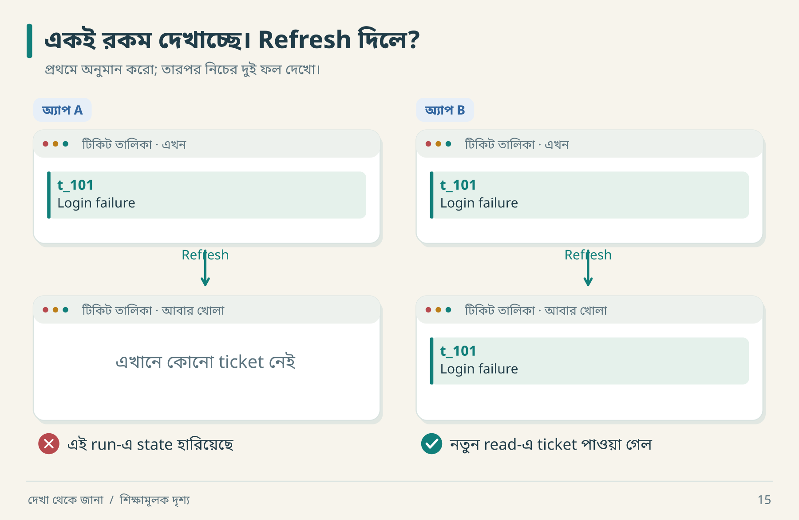

ওপরের দুই screen-এ তফাত নেই। নিচে Refresh-এর ফল দেখা যাচ্ছে। অ্যাপ A-তে ticket উধাও; B-তে নতুন read-এ সেটি পাওয়া গেছে। প্রথম screenshot থেকে এই পার্থক্যটি ধরতে পারতে?

এবার নিজের app-এ একই খেলা: একটি item তৈরি করো, তার ID লিখে রাখো, তারপর page আবার খোলো। “দেখাচ্ছে” থেকে “ফিরে পাওয়া যাচ্ছে”—দুটি ছোট কিন্তু আলাদা observation হলো।

| ঘটনা | সংস্করণ A | সংস্করণ B | কী পরীক্ষা করবে |
|---|---|---|---|
| Create চাপলে ticket দেখা যায় | browser memory-তে object | server-confirmed record | নতুন session-এ পড়া |
| আরেক workspace-এর ID দেওয়া | সব record ফেরত | permission যাচাই | অন্য test actor দিয়ে read |
| response হারিয়ে retry | নতুন ticket | একই logical operation replay | count ও ID তুলনা |
| email provider বন্ধ | save-ও ব্যর্থ | ticket থাকে, delivery pending | আলাদা failure injection |

এই টেবিলের B আমাদের সম্ভাব্য design; original-এর আবিষ্কৃত আচরণ নয়। কোনো ছোট prototype-এ A-ও যথার্থ হতে পারে, যদি scope-এ persistence না থাকে। ভুলটি হলো scope না বলে “সব complete” ঘোষণা করা।

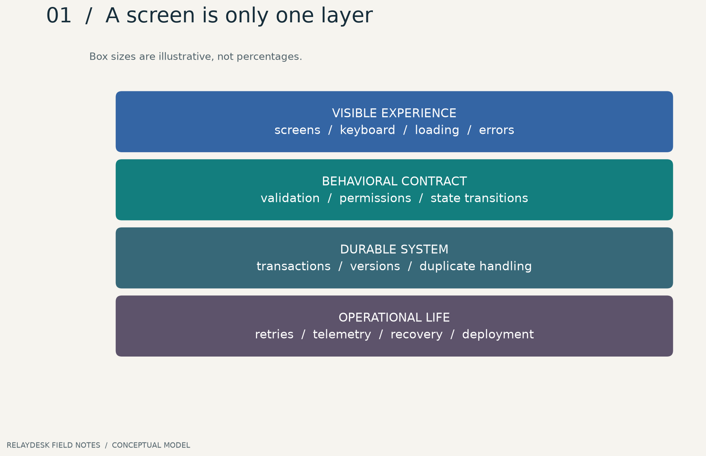

**ছবি পড়ো:** ওপরের স্তর দেখা সহজ; নিচের স্তরের জন্য আলাদা প্রশ্ন প্রয়োজন। বাক্সের আকার complexity-এর শতাংশ বোঝায় না। কোনো সর্বজনীন “৫% UI, ৯৫% backend” মাপ এখানে নেই।

## Reverse engineering বলতে এখানে কী বোঝাচ্ছি

একটি অজানা সফটওয়্যারের **পর্যবেক্ষণযোগ্য নিয়ম** বুঝে একটি পরীক্ষাযোগ্য model তৈরি করা। তারপর সেই model অনুযায়ী replacement বানানো হলো reconstruction। Source analysis, browser observation, protocol inspection ও binary analysis প্রমাণের ভিন্ন পথ; সব কাজেই সব পথ দরকার হয় না।

এই বইয়ের কেন্দ্র product behavior এবং AI-assisted reconstruction। Assembly, exploit development বা firmware decompilation-এর পূর্ণ কোর্স এটি নয়। ওই পথে গেলেও “প্রমাণ কোথায়?” প্রশ্নটি কাজে লাগবে।

**Behavioral equivalence** মানে নির্দিষ্ট input, state ও condition-এ দরকারি output সমতুল্য। Original PostgreSQL ব্যবহার করেছে কি না অজানা হলেও replacement SQLite দিয়ে একটি ছোট শিক্ষামূলক contract পূরণ করতে পারে। একই technology ব্যবহার করলেই একই আচরণ হবে, এমন নিশ্চয়তাও নেই।

## নিজের fidelity চুক্তি বানাও

ধরা যাক, তোমার লক্ষ্য শুধু ticket তৈরি ও পড়া। তাহলে লিখতে পারো:

```text
Included: create, list, refresh persistence, workspace isolation
Visual target: layout ও readable states
Excluded: real email, billing, mobile offline sync
Critical gate: অন্য workspace-এর ticket প্রকাশ পাবে না
Evidence boundary: অনুমোদিত demo accounts এবং local repository
```

এবার এই scope ধরে চারটি check চালাবে: create, list, reload এবং অন্য workspace দিয়ে read। Email পাঠানোর কাজটি এই iteration-এ নেই।

## ক্ষুদ্র dry run

১. একটি ticket তৈরি করলে UI-তে `t_101` এলো। লিখলে: “এই session-এ item দৃশ্যমান।”  
২. Refresh-এর পরও item আছে। লিখলে: “এই reload-এ state টিকে আছে।”  
৩. Browser storage মুছে অন্য অনুমোদিত session-এ একই ID এলো। Server persistence-এর পক্ষে evidence আরও শক্ত হলো।  
৪. তবু “database engine PostgreSQL” বলা গেল না। Observable ফল দিয়ে অদৃশ্য implementation-এর সব পথ আলাদা করা যায় না।

**নিজে করো—Q01:** success toast দেখেছ। “ডেটা স্থায়ী হয়েছে” দাবিটি যাচাই করতে পরের দুটি পরীক্ষা কী হবে? [উত্তর পরে দেখো](#B-workbook)।


---

<a id="02-reconnaissance"></a>

# ০২ · অজানা রিপোজিটরিতে প্রথম অভিযান

নীরা আরিফকে একটি repository দিল। “প্রথম আধঘণ্টায় কিছু বানাবে না; কী আছে বোঝো।” আরিফের AI ইতিমধ্যে `NewSuperTicketEngineFinalV2` নামের পরিকল্পনা করছিল। নীরা বলল, “নামের মধ্যে Final থাকলে investigation শেষ হয় না।”

## প্রথম ৩০ মিনিটের অভিযান

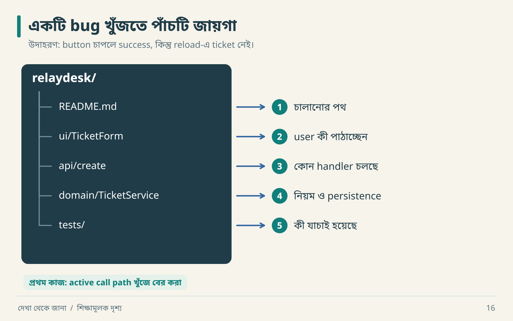

ধরো, `TicketForm` সঠিক payload পাঠাচ্ছে। Handler-ও চলছে। কিন্তু `TicketService` শুধু একটি memory array-তে item যোগ করে। এখন refresh bug-এর জন্য sidebar rewrite করতে হবে? পথ ধরে পড়লে কাজটি service-এর persistence অংশে এসে ছোট হয়ে যায়।

| সময় | কাজ | হাতে আসবে |
|---|---|---|
| ০–৫ মিনিট | instructions, README, git status | নিয়ম ও existing changes |
| ৫–১২ মিনিট | package/config/test structure | কীভাবে build ও run হয় |
| ১২–২০ মিনিট | একটি workflow-এর call path | UI → handler → service → store |
| ২০–৩০ মিনিট | ছোট baseline check | command, result, known failure |

এটি অনুশীলনের সময়বণ্টন, সব repository-এর deadline নয়। বড় project-এ একই প্রশ্নের উত্তর পেতে বেশি সময় লাগবে।

```bash
pwd
git status --short
rg --files -g 'AGENTS.md' -g 'README*' -g 'package.json' -g 'pyproject.toml'
rg -n 'createTicket|create_ticket|TicketService' src tests
```

শেষ command-এর directory নিজের repository অনুযায়ী বদলাবে। এখানে `rg` কেবল text খোঁজে; matching symbol দেখেই runtime call প্রমাণ হয় না। Call site, route registration ও tests মিলিয়ে দেখতে হবে। `.env`-এর secret value report-এ কপি না করে প্রয়োজনীয় configuration **নাম** লিখবে।

## একটি request-এর পায়ের ছাপ

```text
TicketForm.onSubmit
  → POST /tickets
  → route handler
  → TicketService.create
  → repository.insert
  → response mapper
```

এটি একটি candidate call chain। প্রতিটি arrow-এর পাশে file path বা runtime evidence যোগ করো। Source-এ function আছে কিন্তু route-এ ব্যবহার হয় না—এমন code-কে active behavior বললে ভুল model তৈরি হবে।

## Tool নির্বাচন: প্রশ্ন আগে

| তোমার প্রশ্ন | উপযোগী evidence source | কী জানা যাবে না |
|---|---|---|
| Browser কী request পাঠায়? | DevTools network capture | অদেখা server internals |
| Permission check কোথায়? | authorized source + execution | unexecuted branch ঠিক কি না |
| Packaged app-এ কী আছে? | উপযুক্ত artifact inspection | সব remote backend rule |
| Refresh-এ কী থাকে? | controlled UI/API observation | backup recovery guarantee |

REA বা অন্য tool-এর নাম বড় হলেই তার capability অসীম হয় না। Tool unavailable হলে “source inspect করা যায়নি” লিখে browser evidence নিয়ে এগোনো যায়। Tool চালানো ও প্রশ্নের উত্তর পাওয়া একই ঘটনা নয়।

## Baseline খাতা

```json
{
  "target": "local teaching checkout",
  "command": "python3 -m unittest discover -s tests",
  "execution_status": "NOT_RUN",
  "reason": "example record; replace after actual execution",
  "existing_changes": "inspect before editing",
  "next_action": "locate test entry point"
}
```

`NOT_RUN` ইচ্ছাকৃত। বানানো output দিয়ে baseline পূরণ করলে পরের improvement-এর হিসাবও বানানো হয়ে যায়। Test fail করলে আগে দেখো failure আগেই ছিল কি না। নতুন code-কে সব দোষ দেওয়া বা সব পুরোনো failure উপেক্ষা করা—দুটিই diagnosis নষ্ট করে।

**নিজে করো—Q02:** code-এ একটি `TicketService` পেয়েছ। Agent দ্বিতীয় service বানাতে চায়। সিদ্ধান্ত নেওয়ার আগে কোন তিনটি তথ্য চাইবে? [উত্তর](#B-workbook)।


---

<a id="03-evidence"></a>

# ০৩ · প্রমাণের খাতা ও অনুমানের সীমানা

আরিফ বলল, “Assign করার পর নাম বদলেছে, কাজেই database update হয়েছে।” নীরা বলল, “তোমার বাক্যের প্রথম অংশ observation; দ্বিতীয় অংশ আরও প্রমাণ চায়।” এক বাক্যে দুই ধরনের জ্ঞান লুকিয়ে ছিল।

## ছয়টি ঘর, ছয়টি অর্থ


একই দৃশ্য থেকে তিনটি বাক্য বের হলো। প্রথমটি এখনই খাতায় লেখা যায়। দ্বিতীয়টির জন্য নতুন read দরকার। তৃতীয়টির উত্তর screen-এ নেই। নিচের ছয়টি label এই বাক্যগুলোকে গুছিয়ে রাখার নামমাত্র।

| শ্রেণি | সাধারণ ভাষায় | RelayDesk উদাহরণ |
|---|---|---|
| `OBSERVED` | সরাসরি দেখেছি | request body-তে `assignee_id` ছিল |
| `DERIVED` | দেখা data থেকে হিসাব | ১০টির মধ্যে ৮টির error shape এক |
| `INFERRED` | evidence-সমর্থিত ব্যাখ্যা | request path-এ কোনো permission enforcement আছে |
| `ASSUMED` | কাজের জন্য ধরে নিচ্ছি | replacement-এ single region যথেষ্ট |
| `UNKNOWN` | এখনো জানি না | original queue provider |
| `CONTRADICTED` | নতুন evidence-এ আগের দাবি টেকেনি | “search সঙ্গে সঙ্গে update হয়” |

এই শ্রেণিগুলো quality rank নয়। সুন্দরভাবে লেখা `UNKNOWN` অনেক সময় ভিত্তিহীন `OBSERVED`-এর চেয়ে মূল্যবান। আর `DERIVED` দাবি নির্ভর করে input data ও calculation ঠিক থাকার ওপর।


**ছবি পড়ো:** প্রতিটি node-এর নিজস্ব ID আছে। শেষ test পাস হলেও প্রথম evidence-এর scope বেড়ে যায় না। Local lab-এর result দিয়ে real target-এর contract প্রমাণিত হয় না।

## একটি ভালো record খুলে দেখা

```json
{
  "id": "E-017",
  "question": "Assignment reload-এর পর থাকে?",
  "classification": "OBSERVED",
  "context": {"build": "demo-v3", "actor": "member_A", "workspace": "ws_a"},
  "method": "assign → hard reload → read details",
  "finding": "নতুন assignee দেখা গেছে",
  "limitations": ["দ্বিতীয় device পরীক্ষা হয়নি", "concurrent update হয়নি"],
  "artifact": "captures/E-017.json",
  "requirement": "REQ-ASSIGN-02"
}
```

এটি শিক্ষামূলক record; ওই capture এই repository-তে নেই। বাস্তবে artifact path সত্যিই থাকা চাই। এই বইয়ের থাকা উদাহরণটি [examples/evidence.json](examples/evidence.json), যা local lab report-এর দিকে নির্দেশ করে।

## Confidence নিয়ে একটি সতর্ক হিসাব

“Confidence ৯৭%”—কীসের probability? কোন model? কোন sampling process? উত্তর না থাকলে সংখ্যাটি সাজসজ্জা। বরং লেখো: “একই build-এ তিন account-এ পুনরাবৃত্ত হয়েছে; permission revoke case অদেখা।” এতে reader জানবে কোথায় বিশ্বাস করবেন, কোথায় পরীক্ষা করবেন।

দুটি observer একই ফল পেয়েছেন বলেই independent evidence হয় না। দুজন যদি একই cached response দেখেন, তাদের ভুলও একই উৎস থেকে আসতে পারে। Evidence-এর **স্বাধীনতা** এবং **প্রাসঙ্গিকতা** গুরুত্বপূর্ণ।

## দাবি বদলানোর dry run

| ধাপ | কী পাওয়া গেল | খাতায় কী বদলাবে |
|---|---|---|
| ১ | Update-এর পর search-এ পুরোনো title | `OBSERVED` timing record |
| ২ | ২ সেকেন্ড পরে নতুন title | immediate consistency claim `CONTRADICTED` |
| ৩ | দুই session-এ একই delay | async projection একটি `INFERRED` explanation |
| ৪ | worker code পাওয়া যায়নি | queue technology `UNKNOWN` থাকবে |

Search delay দেখেই “Elasticsearch আছে” লেখা যায় না। একই ফল database replica, cache, debounce, periodic refresh বা index pipeline থেকেও আসতে পারে।

## Traceability: AI-কে accountable করার সহজ পথ

```text
E-017 → REQ-ASSIGN-02 → ADR-004 → assignment_service.py
      → TEST-RELOAD-02 → RUN-2026-10-29
```

Source evidence নেই, কিন্তু product requirement আছে? সেটিও বৈধ requirement। উৎস লিখবে `product decision`। Source fidelity এবং replacement improvement যেন এক ঘরে মিশে না যায়।

**নিজে করো—Q03:** `Server: nginx` header দেখে “backend Python” লিখলে কোন শ্রেণি হওয়া উচিত? ওই claim-এর সমস্যাটি কী? [উত্তর](#B-workbook)।


---

<a id="04-product-map"></a>

# ০৪ · পাতার তালিকা থেকে আচরণের মানচিত্র

“Dashboard, Tickets, Settings—তিন page। তিন দিনে শেষ?” আরিফের হিসাব মন্দ নয়, যদি page-গুলো ক্যালেন্ডারের পাতা হয়। Software page-এর মধ্যে অনেক state, permission ও failure লুকিয়ে থাকে।

## একটি feature card


দ্বিতীয় frame-এ network কেটে দাও। User শুধু জানেন তিনি পাঠিয়েছেন; ticket তৈরি হয়েছে কি না এখনও জানেন না। তাই feature card-এ “create” লিখলেই শেষ হয় না—এই মাঝের অবস্থাটি থেকে ফেরার পথও লাগে।

| ক্ষেত্র | Assign Ticket-এর প্রস্তাবিত contract |
|---|---|
| Actor | workspace-এর assignment permission থাকা member |
| Entry point | ticket details-এর assignee menu |
| Preconditions | ticket আছে; assignee একই workspace-এর eligible member |
| Input | ticket ID, assignee ID, expected version |
| Durable result | assignee বদলাবে; version বাড়বে |
| Side effect | activity; notification pending হতে পারে |
| Failure | forbidden, invalid assignee, stale version |
| Recovery | conflict-এ নতুন state পড়ে সিদ্ধান্ত |
| Verification | অন্য member দিয়ে read, refresh, invalid actor, stale write |

Card-এর প্রত্যেক requirement-এর source যোগ করতে হবে। এই card আমাদের teaching design; মূল target-এর প্রত্যক্ষ evidence নয়।

## Dependency-র তিন রং

```text
Identity → Authorization → Domain validation → Ticket write
                                                   │
                                      একই transaction-এ outbox
                                                   │
                                              পরে worker
                                                ↙     ↘
                                       notification   search projection
```

**আগে দরকার:** identity ও authorization। **একসঙ্গে commit দরকার:** ticket ও সংশ্লিষ্ট outbox record, যদি সেই pattern বাছাই করো। **পরে হতে পারে:** notification বা search update, যদি contract eventual consistency অনুমোদন করে।

সব arrow এক ধরনের relationship নয়। “A ছাড়া B শুরু হয় না”, “A ও B atomically commit হয়”, “A থেকে B পরে derive হয়”—আলাদা লিখলে architecture discussion অনেক নির্দিষ্ট হয়।

## Journey matrix বানাও

| Journey | New member | Existing member | Revoked member | Network failure |
|---|---|---|---|---|
| Create | onboarding policy | allowed | reject | outcome uncertain হলে reconcile |
| Assign | role-dependent | permission-dependent | reject | current assignee যাচাই |
| Search | tenant scoped | tenant scoped | access removed | stale/error state |

এখানে `role-dependent` মানে কাজ অসম্পূর্ণ নয়; rule এখনো নির্দিষ্ট করতে হবে। Matrix-এর ফাঁকা ঘর investigation-এর কাজ প্রকাশ করে।

## Scope ছোট করার ভালো পদ্ধতি

প্রথম slice-এ attachment বাদ দিতে পারো। কিন্তু attachment button রেখে fake upload success দেখানো হলে reader ভুল contract শিখবে। Scope-এ বাদ দেওয়া outcome UI-তেও সত্যভাবে প্রকাশ করতে হবে।

একটি dependency graph থেকে plan বের করো: create ticket পরীক্ষা করতে authentication-এর production provider দরকার নাও হতে পারে; lab-এ trusted actor fixture যথেষ্ট। কিন্তু fixture-কে বাস্তব login security বলা যাবে না।

**নিজে করো—Q04:** “Search” feature-এর জন্য তিনটি hidden dependency ও দুটি failure case লেখো। [উত্তর](#B-workbook)।


---

<a id="05-experiments"></a>

# ০৫ · গোয়েন্দার মতো পরীক্ষা সাজাও

আরিফ দুবার click করল, একটি ticket দেখল। “Server deduplicate করে!” নীরা browser network panel খুলল। দ্বিতীয় request-ই যায়নি। গোয়েন্দা একটি সন্দেহভাজনকে না দেখেই নির্দোষ ঘোষণা করেছিল।

## প্রশ্নকে hypothesis-এ ভাঙো

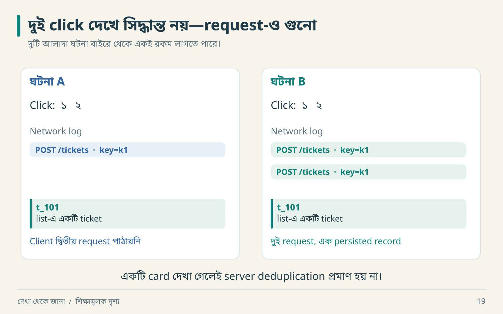

দুইবার click করে একটি card দেখলে ছবির A ও B—দুটিই সম্ভব। Network log খুলে request গুনলেই তাদের আলাদা করা শুরু হয়। এরপর persisted ID ও count দেখবে; list-ও duplicate লুকিয়ে রাখতে পারে।

প্রশ্ন: একই submission আবার এলে কী হয়?

| Hypothesis | কী ব্যাখ্যা করে | আলাদা করার পরীক্ষা |
|---|---|---|
| H1: client দ্বিতীয় click আটকায় | একটি visible ticket | actual request count |
| H2: server একই operation replay করে | দুই request, এক record | same key + payload |
| H3: UI duplicate লুকায় | list-এ একটি item | authorized API count/IDs |
| H4: কেবল sequential retry নিরাপদ | ধীরে retry-এ এক record | overlapping requests |

“আরও screenshot” সব hypothesis আলাদা করবে না। কী মাপলে ব্যাখ্যাগুলো আলাদা ফল predict করে, সেই observation খোঁজো।

## EXP-001: শুকনো মহড়া

নিচের ফল **কল্পিত expected result**, real capture নয়।

| ধাপ | Actor | Key | Title | H2 হলে response | মোট ticket |
|---|---|---|---|---|---:|
| ১ | alice | k1 | Login failure | t1 | ১ |
| ২ | alice | k1 | Login failure | t1 replay | ১ |
| ৩ | alice | k2 | Login failure | t2 | ২ |
| ৪ | alice | k1 | Changed title | conflict | ২ |

Control: একই workspace, actor, application version। Variable: key; চতুর্থ ধাপে payload mismatch আলাদা subcase। Observe: request সংখ্যা, response ID, persisted count, outbox count। Reset: প্রতিটি independent run-এর আগে নতুন fixture। পূর্ণ card: [experiment.json](examples/experiment.json)।

## কোন পরীক্ষা আগে করবে

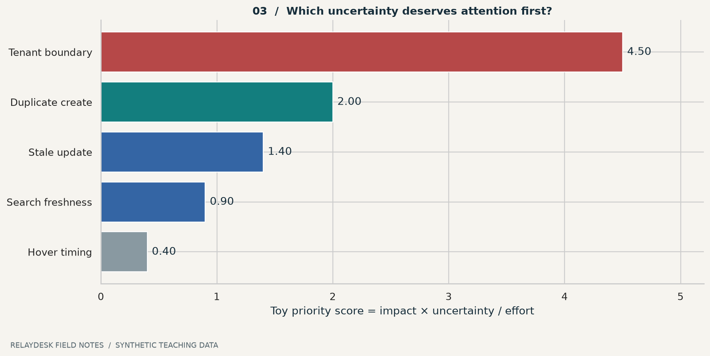

**ছবি পড়ো:** toy score = impact × uncertainty ÷ effort। Impact ১–৫, uncertainty ০–১, effort ঘণ্টায়। এটি সিদ্ধান্ত-সহায়ক অনুমান, পরিসংখ্যানগত probability বা universal law নয়। Tenant leak-এর মতো critical boundary score কম হলেও release gate থাকতে পারে।

মূল লেখায় impact, uncertainty, consequence ও information gain-সহ সমৃদ্ধ heuristic আছে। কাজে impact ও consequence একই অর্থে ব্যবহার করলে double-counting হয়। তাই এই চার্টে ছোট model নিয়েছি; বেশি factor নিলে প্রত্যেকটির পৃথক অর্থ লিখতে হবে।

## গভীরে যাও: information gain-এর অর্থ

ধরো, H1 ও H2 দুটিই বর্তমান screenshot-এর সঙ্গে মিলে যায়। নতুন screenshot দুটির জন্যই একই রকম হবে; তাই আলাদা করার ক্ষমতা কম। Network request count H1-এর ক্ষেত্রে ১ এবং H2-এর ক্ষেত্রে ২ predict করলে পরীক্ষাটি বেশি তথ্যবহুল।

Formal probability model থাকলে entropy দিয়ে uncertainty মাপা যায়। এখানে probability distribution নেই; তাই “information gain ৮৭%” বানাচ্ছি না। **Competing explanation বাদ দেওয়ার ক্ষমতা** হিসেবে ধারণাটি ব্যবহার করছি।

## Experiment নষ্ট হওয়ার চারটি পথ

- একই সঙ্গে role, payload ও environment বদলালে ফলের কারণ আলাদা করা কঠিন।
- প্রথম run-এর data পরের run-এ থাকলে duplicate policy ভুল বোঝা যায়।
- UI cache-কে durable store মনে করলে wrong oracle হয়।
- একটি timeout-কে server failure ধরে নিলে ইতিমধ্যে committed operation চোখ এড়িয়ে যায়।

**নিজে করো—Q05:** search stale। Cache delay ও asynchronous index—এই দুই explanation আলাদা করতে কী evidence চাইবে? শুধু delay দিয়ে কী বলতে পারবে না? [উত্তর](#B-workbook)।


---

<a id="06-ui-state"></a>

# ০৬ · একটি বাটনের আট রকম জীবন

আরিফ একটি সবুজ toast বানিয়েছে: “Saved!” Request তখনও যাচ্ছে। নীরা বলল, “তোমার toast ভবিষ্যৎ বলতে পারে। আমাদের server পারে না।”

## Submit-এর state machine


তুমি user হলে ৩ নম্বরে title লিখতে। ৪ নম্বরে ticket খুলতে। কিন্তু ৫ নম্বরে আবার নতুন ticket বানানোর আগে আগেরটির ফল খুঁজতে। এই ছোট UI পার্থক্যের পেছনেই নিচের state machine।

**একবার নিজে বলো:** ৫ নম্বর screen থেকে input মুছে দিলে কী হারাবে? উত্তরটি শুধু text নয়—pending operation-এর সঙ্গে user-এর সম্পর্কও হারাতে পারে।

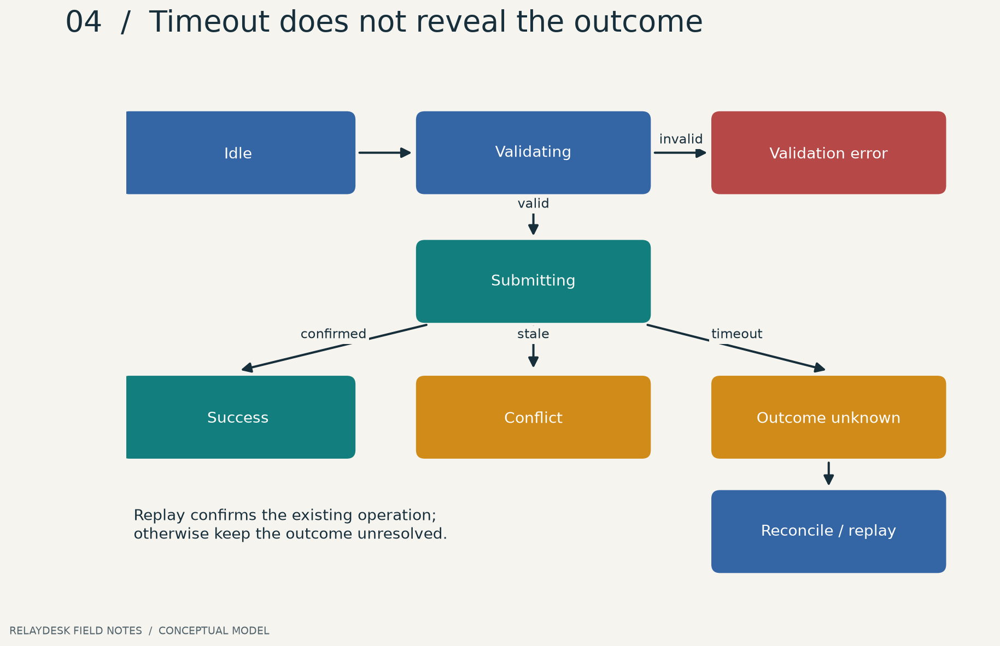

**ছবি পড়ো:** response পাওয়া এবং operation হওয়া আলাদা ঘটনা। Timeout-এর পরে এখানে `outcome_unknown` আছে। Server commit করেছে কি না জানা না থাকলে “ব্যর্থ” বলে নতুন operation তৈরি করানো duplicate ঘটাতে পারে।

| বর্তমান state | ঘটনা | পরের state | UI কী বলবে |
|---|---|---|---|
| idle | Submit | validating | input পরীক্ষা |
| validating | empty title | validation_error | field-এর কাছে কারণ |
| validating | valid | submitting | কাজ চলছে |
| submitting | confirmed response | success | server-confirmed ফল |
| submitting | stale version | conflict | নতুন state পড়ে সিদ্ধান্ত |
| submitting | response timeout | outcome_unknown | “ফল যাচাই করা হচ্ছে” |
| outcome_unknown | safe replay confirms | success | আগের operation-এর ফল |
| outcome_unknown | still unresolved | outcome_unknown | request reference ও recovery |

UI disabled করলেই duplicate-এর সব উৎস বন্ধ হয় না। Browser retry, app reconnect বা অন্য client একই operation পাঠাতে পারে। Server contract-এর প্রয়োজন এখানেই।

## চার ধরনের state-এর ছোট নাটক

```json
{
  "local_ui": {"menu_open": true},
  "server": {"assignee": "nira", "version": 8},
  "client_cache": {"assignee": "arif", "version": 7},
  "derived": {"assigned_to_nira_count": 12}
}
```

Menu খোলা local UI state। Assignee-এর durable truth server-এর। Cache পুরোনো হলে list ভুল দেখাতে পারে। Count কোন projection থেকে এসেছে, তা জানা না থাকলে ১২ ঠিক কি না বলা যাবে না। “সব state reset করে দাও” সমাধানে unsaved draft-ও হারাতে পারে।

## Optimistic update-এর dry run

১. Server version ৭; assignee আরিফ।  
২. Client নীরাকে নির্বাচন করে; UI সাময়িকভাবে নীরা দেখায়।  
৩. Server conflict দেয়, কারণ অন্য actor version ৮ করেছে।  
৪. Client নিজের pending change আলাদা রাখে, current state আনে এবং conflict দেখায়।  
৫. User নতুন state দেখে পুনরায় প্রয়োগ করবেন কি না ঠিক করেন।

Blind rollback-ও বিপজ্জনক: এই সময়ে অন্য successful update এসে থাকলে পুরো পুরোনো object বসিয়ে সেটি মুছে দিতে পারো। Mutation identity ও version মিলিয়ে cache update করা প্রয়োজন।

## Visual comparison-কে পুনরাবৃত্তিযোগ্য করো

একই viewport, font, browser, data, role, locale এবং loading state ব্যবহার করো। Random avatar ও চলমান clock screenshot diff-এ noise তৈরি করে। Normalize করতে পারো, কিন্তু actual error message বা permission-dependent button বাদ দেবে না।

Mouse বাদ দিয়ে Tab, Enter, Space ও Escape দিয়ে journey চালাও। Keyboard দিয়ে কার্যকারিতা পাওয়া accessibility-এর একটি মৌলিক দাবি; শুধু tab order পরীক্ষা পূর্ণ accessibility audit নয়। [W3C keyboard guidance](https://www.w3.org/WAI/WCAG22/Understanding/keyboard.html)।

বাংলা UI-তে দীর্ঘ label, mixed বাংলা–English ID, সংখ্যা, narrow screen ও ২০০% zoom পরীক্ষা করো। `Save` সুন্দর দেখালেও “পরিবর্তন সংরক্ষণ করুন” button থেকে বেরিয়ে যেতে পারে।

**নিজে করো—Q06:** timeout-এর পর input মুছে “Failed” দেখানো কেন ক্ষতিকর হতে পারে? [উত্তর](#B-workbook)।


---

<a id="07-api-contract"></a>

# ০৭ · API-এর প্রতিশ্রুতি পড়তে শেখা

API হলো দুই পক্ষের যোগাযোগের নিয়ম। একটি successful request সেই নিয়মের একটি উদাহরণ; সব বৈধ input, failure ও ordering-এর পূর্ণ তালিকা নয়।

## একটি প্রস্তাবিত create contract


খামটি খুলে চারটি অংশ আলাদা করো। `ws_a` বলে কাজটি কোথায়; trusted session বলে কে করছেন; `k1` বলে কোন operation; body বলে কী তৈরি হবে। একই title হলেও `k2` হলে সেটি আরেকটি submission হতে পারে।

```http
POST /api/workspaces/ws_a/tickets
Content-Type: application/json
Idempotency-Key: op-001

{"title":"Login failure"}
```

```json
{
  "id": "ticket_001",
  "workspace_id": "ws_a",
  "title": "Login failure",
  "status": "open",
  "version": 1
}
```

এটি আমাদের API design example। বইয়ের Python lab সরাসরি service function চালায়; এই HTTP route চালু করে না। `Idempotency-Key` এখানে বেছে নেওয়া application contract; প্রতিটি server স্বয়ংক্রিয়ভাবে এটি সমর্থন করে না।

## Request-এর বাইরে যে প্রশ্নগুলো থাকে

| বিষয় | নির্দিষ্ট প্রশ্ন | উদাহরণ সিদ্ধান্ত |
|---|---|---|
| Identity | actor কোথা থেকে আসে? | trusted session context |
| Validation | whitespace title বৈধ? | trim-এর পরে ১–১২০ character |
| Replay | একই key-তে payload বদলালে? | conflict |
| Ordering | একই timestamp হলে sort? | `(created_at, id)` tie-breaker |
| Pagination | cursor পুরোনো হলে? | contract অনুযায়ী error/continuation |
| Errors | machine-readable code আছে? | `version_conflict` |
| Compatibility | unknown field কী হবে? | গ্রহণ/ignore/reject লিখে দাও |

Character limit মানে bytes, Unicode code points, নাকি user-perceived grapheme clusters—এটিও contract। Lab-এর Python `len()` Unicode code points গুনছে; বাংলা যুক্তাক্ষরের দৃশ্যমান দৈর্ঘ্যের সমান নাও হতে পারে।

## Status code যথেষ্ট নয়

HTTP-এর idempotent method semantics intended server effect নিয়ে কথা বলে; একই response body ফেরত আসবেই—এমন দাবি নয়। `POST`-এর duplicate safety তোমার operation contract দিয়ে যোগ করতে হতে পারে। Conditional request-এ `If-Match` precondition ব্যর্থ হলে 412-এর মতো নির্দিষ্ট semantics আছে। [RFC 9110](https://www.rfc-editor.org/rfc/rfc9110.html)।

আমাদের service lab `version_conflict` দেয়। HTTP adapter লিখলে body-level expected version-এর জন্য 409 বেছে নিতে পারো; `If-Match` ব্যবহার করলে তার protocol semantics মানতে হবে। Code mapping যেন কেবল পছন্দের সংখ্যা না হয়।

```json
{
  "type": "https://example.invalid/problems/version-conflict",
  "title": "Ticket version conflict",
  "status": 409,
  "detail": "Read the current ticket before applying this change.",
  "instance": "/requests/req_007",
  "code": "version_conflict"
}
```

এটি Problem Details ধরনে error উদাহরণ; `code` extension field। বাস্তবে HTTP status ও body status সামঞ্জস্যপূর্ণ রাখতে হবে, sensitive internals প্রকাশ করা যাবে না। [RFC 9457](https://www.rfc-editor.org/rfc/rfc9457.html)।

## Pagination-এর ফাঁদ: হাতে গুনে দেখো

শুরুতে newest-first list: `[D,C,B,A]`। Page size ২। প্রথম page `[D,C]`। মাঝখানে `E` তৈরি হলো। Offset ২ দিয়ে পরের page নিলে `[C,B]`—C আবার এলো।

```text
আগে:      [ D  C ]  B  A       ← প্রথম page শেষ
নতুন E:   E  D  [ C  B ]  A    ← offset 2 এখন এখানে
                    ↑
                  C আবার!
```

Array-তে আঙুল দিয়ে দুই ঘর সরিয়ে দেখো। Offset একই থাকলেও তালিকার অবস্থান বদলে গেছে।

Cursor `(created_at,id)`-এর পরে continuation দিতে পারে। কিন্তু cursor ব্যবহার করলেই snapshot consistency নিশ্চিত নয়। Update/delete বা backdated record-এর policy আলাদা করে নির্ধারণ করতে হয়। “Pagination আছে” বলার চেয়ে “একই record দুবার আসবে কি?” ভালো প্রশ্ন।

## Boundary test menu

```text
Title lengths: 0, 1, 120, 121
Whitespace-only / wrong type / missing field
Member / nonmember / revoked member
Same key same payload / same key different payload
No records / one page / exact full page / last partial page
```

**নিজে করো—Q07:** একই idempotency key দিয়ে title বদলে দিলে পুরোনো success ফেরত দেওয়া কেন বিভ্রান্তিকর? [উত্তর](#B-workbook)।


---

<a id="08-domain-rules"></a>

# ০৮ · ব্যবসার নিয়মকে পরীক্ষাযোগ্য করা

Database-এ status string রাখা সহজ। কোন actor কখন কোন status দিতে পারেন, সেটিই business logic। `UPDATE tickets SET status = ...` নিজে কোনো product policy জানে না।

## তিনটি আলাদা যন্ত্র


আরিফ `open` ticket-কে এক লাফে `closed` করতে চায়। ছবির লাল shortcut-টি আমাদের lab-এ বন্ধ। কিন্তু `resolved` থেকে আবার `in_progress`-এ ফেরা যায়। একই “status change” কথার মধ্যে তাই বৈধ ও অবৈধ—দুই ধরনের move আছে।

| যন্ত্র | প্রশ্ন | উদাহরণ |
|---|---|---|
| State machine | কোথা থেকে কোথায় যাব? | open → in_progress |
| Invariant | কোন শর্ত ভাঙা যাবে না? | ticket-এর workspace অবশ্যই নির্দিষ্ট |
| Decision table | একাধিক শর্তে সিদ্ধান্ত কী? | valid actor + current version + allowed transition |

Lab-এর transition contract:

```text
open → in_progress → resolved → closed
                       │
                       └────────→ in_progress
```

Closed terminal। Reopen করতে হলে নতুন product decision ও test প্রয়োজন। Original product-এ closed reopen হতে পারে; এই teaching rule-কে তার ওপর চাপানো যাবে না।

## Transition table থেকে test

| From | To | Lab-এর ফল | কেন |
|---|---|---|---|
| open | in_progress | allow | কাজ শুরু |
| open | closed | reject | মধ্যবর্তী নিয়ম এড়িয়ে যায় |
| resolved | in_progress | allow | পুনরায় কাজ প্রয়োজন |
| closed | open | reject | terminal contract |
| in_progress | in_progress | reject | self-transition সংজ্ঞায়িত নয় |

একই state আবার set করলে no-op হবে, event হবে, নাকি reject হবে—তিনটিই সম্ভাব্য design। না লিখলে agent নিজের মতো বেছে নেবে। এই lab reject করেছে।

## Decision table: ভুলের অগ্রাধিকার

| Actor member? | Resource in requested workspace? | Version current? | Transition valid? | Result |
|---|---|---|---|---|
| না | — | — | — | forbidden |
| হ্যাঁ | না | — | — | not_found |
| হ্যাঁ | হ্যাঁ | না | — | version_conflict |
| হ্যাঁ | হ্যাঁ | হ্যাঁ | না | invalid_transition |
| হ্যাঁ | হ্যাঁ | হ্যাঁ | হ্যাঁ | update + version increment |

`—` মানে ওই সিদ্ধান্তের জন্য আর পরীক্ষা দরকার নেই। এই precedence আমাদের design। একটি request-এ একাধিক ভুল থাকলে কোন error দেখানো হবে, সেটিও observable behavior।

## Invariant: scope না বললে বাক্য অসম্পূর্ণ

“একই request-এ একটিই ticket”—কোন request identity? Lab-এ scope হলো `(actor, workspace, key)`। একই title দিয়ে নতুন key দিলে নতুন ticket বৈধ। Title-কে duplicate identity করলে দুইজনের একই সমস্যা report করা আটকে যাবে।

“Version বাড়বে”—সব read-এ নয়; accepted transition-এ এক বাড়বে। Failed transition-এ state অপরিবর্তিত থাকবে। এই negative condition test-এ লেখা জরুরি।

```text
Given: ticket open, version=1, actor authorized
When: expected_version=1 দিয়ে in_progress করা হয়
Then: status=in_progress, version=2
And: expected_version=1 দিয়ে পরের update প্রত্যাখ্যাত
And: failed update version বা status বদলায় না
```

## নতুন তথ্য এলে নিয়ম বদলাও

ধরা যাক, real observation-এ closed ticket-এ comment করলে reopen হয়। তাহলে `comment` শুধু CRUD নয়; status transition trigger। Inventory, state machine, audit behavior ও regression test—সবগুলো update করতে হবে। একটি জায়গায় code patch করলেই knowledge model সঠিক হয় না।

**নিজে করো—Q08:** “Ticket delete হলে আর দেখা যাবে না”—বাক্যটির কোন তিনটি scope নির্দিষ্ট করা প্রয়োজন? [উত্তর](#B-workbook)।


---

<a id="09-data-lifecycle"></a>

# ০৯ · ডেটার মালিক, কপি ও বিদায়

নীরা প্রশ্ন করল, “Ticket কোথায়?” আরিফ বলল, “Database-এ।” কিন্তু title ছিল browser cache-এ, search index-এ, email-এ, backup-এও। একই তথ্যের অনেক জীবন আছে।

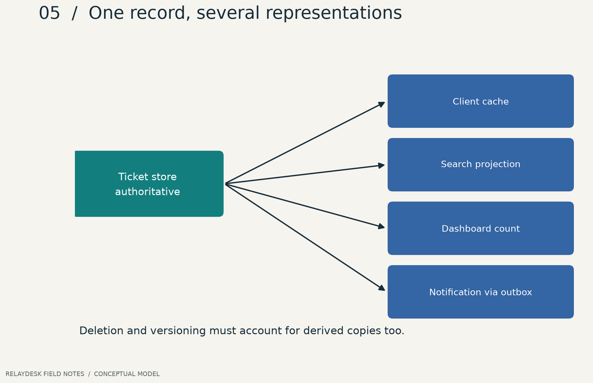

**ছবি পড়ো:** তীর মানে তথ্যের প্রবাহ; সব store সমান authority নয়। এটি candidate replacement model, original physical schema নয়।

## Conceptual model আগে

```text
User ── Membership ── Workspace ── Ticket ── Comment
                                     └──── Attachment
Ticket change ── Activity / Outbox ── Derived views
```

একজন user একাধিক workspace-এর member হতে পারেন। তাই user table-এ একটিমাত্র `workspace_id` বসানো আমাদের এই requirement পূরণ করবে না। UI-তে workspace switcher আছে বলে exact schema জানা যায় না; তবে বহু workspace membership-এর আচরণ model করা যায়।

## একটি assignment-এর তিনটি ঘড়ি

| সময় | Durable ticket | Details cache | Search projection |
|---:|---|---|---|
| t=0 | arif, v7 | arif, v7 | arif, v7 |
| t=100ms | nira, v8 | arif, v7 | arif, v7 |
| t=150ms | nira, v8 | nira, v8 | arif, v7 |
| t=1500ms | nira, v8 | nira, v8 | nira, v8 |

এটি বানানো timeline। এই সময়গুলো benchmark নয়। এখানে stale search দিয়ে database failure ঘোষণা করা ভুল; আবার search latency contract ভাঙলে “database ঠিক আছে” বলেও user impact অস্বীকার করা যাবে না।

## Delete একটি বহু-ধাপের ঘটনা

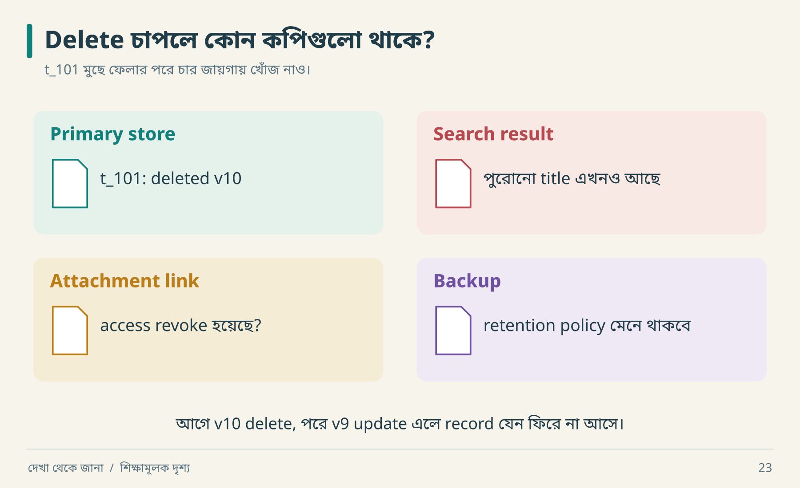

Primary store-এ `deleted v10`, অথচ search-এ পুরোনো title। এবার worker দেরিতে `updated v9` পেল। Version না দেখে সেটি লিখলে ticket আবার “জীবিত” দেখাতে পারে। ছবির চারটি ঘরের জন্য আলাদা cleanup বা retention rule লাগবে।

| কপি | সম্ভাব্য প্রয়োজন | যাচাই |
|---|---|---|
| Primary record | tombstone বা hard delete | normal read-এ unavailable |
| Search | document removal | query-তে আর ফেরে না |
| Cache | invalidate বা expiry | পুরোনো response আর accessible নয় |
| Attachment | access revoke / purge policy | direct URL-এর access |
| Audit | প্রয়োজনীয় সীমিত history | sensitive payload minimization |
| Backup | retention ও restore handling | restore-এর পরে deletion পুনঃপ্রয়োগের policy |

Retention product ও প্রযোজ্য requirements অনুযায়ী ঠিক করতে হয়; এখানে নির্দিষ্ট আইন বা সময়সীমা নির্ধারণ করা হচ্ছে না। “Soft delete আছে” মানে privacy lifecycle সম্পন্ন নয়।

## Out-of-order event-এর dry run

Worker প্রথমে `ticket.updated v9` পেল, পরে দেরিতে `v8`। যদি প্রতিবার অন্ধভাবে projection overwrite করে, search পিছিয়ে যাবে। একটি design হলো per-ticket version দেখে পুরোনো update উপেক্ষা করা। তবে partial event payload হলে “বড় version পেলেই যথেষ্ট” সব সময় ঠিক নয়; snapshot event বনাম delta event-এর semantics জানতে হবে।

Delete tombstone-এর version ১০। দেরিতে version ৯-এর update এলে deleted ticket আবার জীবিত করা যাবে না। এই resurrection bug সাধারণ create/read test-এ ধরা পড়ে না।

## কোন প্রশ্ন agent-কে করবে

“এই field-এর source of truth কোনটি? কোন কপি rebuild করা যায়? কোন event হারালে data irrecoverable? Deletion হলে derived copy কীভাবে পরিষ্কার হবে?” উত্তরগুলো data ownership design-এর ভিত্তি।

**নিজে করো—Q09:** database থেকে ticket মুছে search-এ রেখে দিলে কী কী mismatch হয়? [উত্তর](#B-workbook)।


---

<a id="10-time-concurrency"></a>

# ১০ · একই সময়ে দুজন: সময়ের ফাঁদ

আরিফ আর নীরা একই ticket খুলল। দুজনের কাছে version ১। নীরা status বদলাল; আরিফ পুরোনো form থেকে title বদলে পুরো object পাঠাল। Title ঠিক হলো, status আবার পুরোনো। Software-এ time travel ঘটেছে, কিন্তু product requirement-এ ছিল না।

## ১০.১ Lost update হাতে চালাও


| ধাপ | আরিফ | নীরা | Durable state |
|---|---|---|---|
| ১ | পড়ে: open, v1 | | open, v1 |
| ২ | | পড়ে: open, v1 | open, v1 |
| ৩ | | in_progress save | in_progress, v2 |
| ৪ | v1 copy পাঠায় | | conflict অথবা lost update |

Version-based design-এ update condition হবে current version == expected version।

```sql
UPDATE tickets
SET status = :new_status, version = version + 1
WHERE id = :ticket_id
  AND workspace = :workspace
  AND version = :expected_version;
```

Affected row ০ হলে কারণ জানতে হবে: stale version, missing resource, নাকি scope mismatch? Lab membership ও lookup আগে করে, transaction-এর মধ্যে compare করে; update-এর row count-ও পরীক্ষা করে। SQL fragment একা পূর্ণ authorization implementation নয়।

একটি গুরুত্বপূর্ণ ফাঁদ: `SELECT version` করে transaction/atomic condition ছাড়া পরে unconditional `UPDATE` করলে মাঝের সময়ে আরেক write ঢুকতে পারে। Check এবং effect-এর সম্পর্কই correctness নির্ধারণ করে।

**গভীর সীমা:** প্রতি-record version check সব multi-record invariant রক্ষা করে না। “দুই doctor-এর অন্তত একজন on-call থাকবেন” নিয়মে দুজন আলাদা row update করলে প্রত্যেকে নিজের version ঠিক পেয়েও যৌথ নিয়ম ভাঙতে পারেন। Isolation, locks বা constraint কী লাগবে তা invariant অনুযায়ী ঠিক করতে হয়। PostgreSQL-এর isolation level ও serialization retry সম্পর্কে তার নিজস্ব semantics পড়তে হবে; SQLite lab-এর ফল সেখানে সরাসরি প্রতিস্থাপন করা যায় না। [PostgreSQL transaction isolation](https://www.postgresql.org/docs/current/transaction-iso.html)।

## ১০.২ Idempotency: click count নয়, logical operation


একটি রসিদ হারিয়ে আবার তার copy চাইলে নতুন কেনাকাটা হয় না। ছবির দ্বিতীয় row-তে সেটাই হচ্ছে। তৃতীয় row-তে একই রসিদে অন্য জিনিস চাওয়া হয়েছে; চতুর্থ row-তে রসিদই নতুন। এবার key ও payload-এর আলাদা ভূমিকা দেখা যাচ্ছে।

**ছবির ফল ঢেকে বলো:** `k1 / Changed title`-কে চুপচাপ `t_101` ফেরত দিলে user কী ভুল বুঝবেন? তিনি ভাবতে পারেন নতুন title-টি সংরক্ষিত হয়েছে।

Lab identity = `(actor, workspace, key)`। Fingerprint = normalized title payload-এর hash।

```text
alice / ws_a / k1 / title=A → create t1, store original response
alice / ws_a / k1 / title=A → replay t1
alice / ws_a / k1 / title=B → conflict
alice / ws_a / k2 / title=A → create t2
bob   / ws_b / k1 / title=A → separate operation
```

Key browser refresh-এ বদলে ফেললে timeout retry নতুন operation হয়ে যাবে। আবার প্রতিটি আলাদা submission-এ একই key পুনর্ব্যবহার করলেও ভুল। User intent থেকে key lifecycle তৈরি করতে হবে।

**আরও চারটি contract প্রশ্ন:** key কতদিন রাখা হবে? In-flight duplicate এলে wait নাকি conflict? প্রথম failure replay হবে কি? Actor permission revoke হলে পুরোনো response replay করা যাবে কি? Lab-এ replay-এর আগেও membership check আছে; key expiry নেই। এটি ছোট lab-এর সীমা।

Lab original response সংরক্ষণ করে। Create-এর পরে status version ২ হয়ে গেলেও create replay version ১-এর response দিতে পারে; current resource জানতে read করবে। “Replay result” ও “current state” আলাদা endpoint semantics হতে পারে।

## ১০.৩ Outbox: দুই write-এর মাঝের গর্ত

খারাপ sequence: ticket commit → process crash → notification event কখনো তৈরি হলো না। Transactional outbox-এ ticket ও outbox row একই local transaction-এ লেখা হয়। Commit হলে দুটো থাকে; rollback হলে কোনোটিই থাকে না। তারপর worker external delivery চেষ্টা করে। [AWS transactional outbox guidance](https://docs.aws.amazon.com/prescriptive-guidance/latest/cloud-design-patterns/transactional-outbox.html)।


| Crash point | Ticket | Outbox | External effect | Recovery |
|---|---|---|---|---|
| commit-এর আগে | নেই | নেই | নেই | নতুন করে চেষ্টা |
| commit-এর পরে, send-এর আগে | আছে | pending | নেই | worker retry |
| send-এর পরে, mark-এর আগে | আছে | pending | হয়েছে | duplicate-safe retry দরকার |
| delivered mark-এর পরে | আছে | delivered | হয়েছে | সাধারণত শেষ |

শেষের আগের row-টাই “exactly once” দাবিকে কঠিন করে। শুধু local `processed=true` যথেষ্ট নয়। আগে mark করলে send হারাতে পারে; পরে mark করলে send duplicate হতে পারে।

Lab-এর fake provider **নিজের durable receipt table-এ event ID deduplicate করে**। তাই retry-এ effect count এক থাকে। বাস্তব email provider ওই guarantee না দিলে একই নিশ্চয়তা পাওয়া যায় না; reconciliation বা duplicate গ্রহণের policy প্রয়োজন হতে পারে।

## ১০.৪ অনুশীলন চালাও

```bash
python3 lab/run_lab.py
python3 -m unittest discover -s lab -p 'test_*.py' -v
```

এই lab-এ দুই thread, দুই database connection এবং barrier দিয়ে overlapping request পরীক্ষা আছে। SQLite `BEGIN IMMEDIATE` writers serialize করে। এটি বাস্তব network, multi-region deployment বা অসংখ্য interleaving-এর proof নয়। [পূর্ণ lab guide](#16-vertical-lab)।

**নিজে করো—Q10:** Outbox থাকলে external side effect ঠিক একবার হবে—এই দাবির counterexample বলো। [উত্তর](#B-workbook)।


---

<a id="11-network"></a>

# ১১ · নেটওয়ার্কের চিহ্ন কী বলে

“Response-এ nginx আছে, তাহলে পুরো architecture জানি।” নীরা বলল, “বাড়ির gate-এর কোম্পানি দেখে রান্নাঘরের recipe বোঝা যায়?”

## Fingerprint থেকে fact নয়


গেটের নামটি পড়া যাচ্ছে; ভেতরের application language-টি নয়। একটি header-এর record তাই লিখতে পারো: `observed: Server=nginx; origin_language: unknown`। Unknown ঘর খালি রাখলে পরের তদন্তের জায়গাটি পরিষ্কার থাকে।

| চিহ্ন | সরাসরি observation | সম্ভাব্য ব্যাখ্যা | যা অজানা |
|---|---|---|---|
| `Server` header | একটি value এসেছে | edge/proxy/origin যোগ করেছে | application language |
| এক IP | ওই request একটি address-এ গেছে | load balancer বা single server | backend instance count |
| chunked/streamed output | data ধাপে এসেছে | streaming application/proxy buffering | exact model বা worker topology |
| long delay | end-to-end অপেক্ষা | network, queue, computation | কোন অংশ দায়ী |

Fingerprint spoofed, omitted বা intermediary থেকে আসতে পারে। অতএব architecture drawing-এ uncertain node-কে “candidate” লিখবে।

## Request-এর যাত্রা

```text
Client → DNS result → TLS endpoint → Edge / Gateway → Application
                                                  → Data / Dependencies
```

এটি observation-এর checklist; সব request-এ এই exact topology পাওয়া যাবে না। DNS, TLS, headers, redirects ও timing আলাদা evidence source। Browser network panel-এর একটি request থেকে origin database schema পাওয়া যায় না।

## Streaming-এর ছোট dry run

| সময় | Observable event | প্রশ্ন |
|---|---|---|
| t0 | request শুরু | request identity কী? |
| t1 | headers | HTTP success body complete বোঝায়? না |
| t2 | প্রথম chunk | partial result UI-তে safe? |
| t3 | connection কেটে গেল | server task এখনও চলছে? |
| t4 | reconnect | resume cursor আছে, নাকি নতুন task? |

Client disconnect মানে server operation cancel হয়েছে—এটি পরীক্ষা ছাড়া বলা যায় না। Side effect চললে duplicate task সৃষ্টি হতে পারে। Streaming output-এর completion marker ও operation state আলাদা model করা ভালো।

## ছোট investigation protocol

১. নিজের/অনুমোদিত test target ও account ঠিক করো।  
২. একটি প্রশ্ন নাও: redirect-এ authentication context থাকে কি?  
৩. Redacted request/response sequence রাখো।  
৪. Version, environment ও সময় লিখো।  
৫. Inaccessible internals unknown রেখেই observable contract লেখো।

লক্ষ্য protocol বোঝা; evidence ছাড়াই বড় infrastructure diagram বানালে decision ভুল দিকে যেতে পারে।

**নিজে করো—Q11:** response আসতে ২ সেকেন্ড লাগল। “Database slow” বলার আগে কোন দুটি measurement চাইবে? [উত্তর](#B-workbook)।


---

<a id="12-security"></a>

# ১২ · পরিচয় আছে, অনুমতি আছে কি

Authentication বলে তুমি কে। Authorization বলে তুমি **এই resource-এ এই কাজ** করতে পারো কি না। অফিসের ID card থাকলেই সব আলমারির চাবি পাওয়া যায় না।

## আমাদের test cast

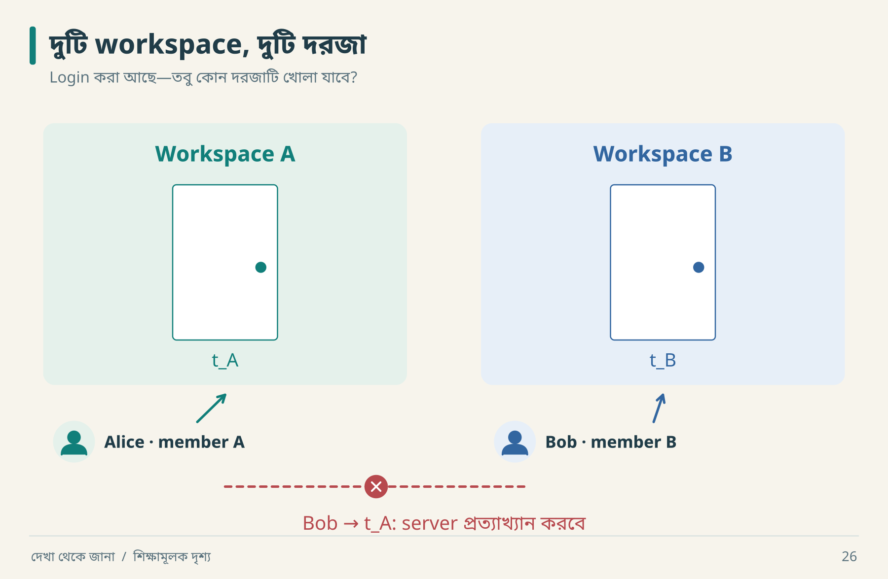

Bob-কে `t_A`-এর সঠিক ID দেওয়া হলো। এখন অনুমতি মিলেছে? না—ঠিকানা জানা আর দরজা খোলার অনুমতি আলাদা। Request পাঠিয়ে denial দেখবে; তারপর Alice দিয়ে আবার পড়ে নিশ্চিত হবে ticket-ও বদলায়নি।

| Actor | Membership | Resource | Intended result |
|---|---|---|---|
| alice | ws_a | ws_a/t1 read | allow |
| bob | ws_b | ws_a/t1 read | deny |
| bob | ws_b | ws_a/t1 update | deny |
| alice, membership revoked | none | ws_a/t1 read | deny |

Button লুকিয়ে রাখা presentation behavior। Server-side enforcement প্রয়োজন; request-এর client-supplied `actor_id`-কে সত্য ধরে নেওয়া যাবে না। Permission প্রতিটি প্রাসঙ্গিক request ও resource boundary-তে যাচাই করা উচিত। [OWASP authorization guidance](https://cheatsheetseries.owasp.org/cheatsheets/Authorization_Cheat_Sheet.html)।

## Boundary ধরে ভাবো

```text
Untrusted client input
        ↓
Authenticated server context
        ↓
Permission + resource scope
        ↓
Domain operation → persistence
```

Lab-এ actor string সরাসরি function-এ দেওয়া হয়। কারণ lab authentication শেখায় না; caller-কে trusted ধরে authorization logic দেখায়। HTTP server বানালে body থেকে ওই string নিয়ে পাশ করানো নিরাপদ implementation হবে না।

## শুধু happy path test নয়

```text
Given: bob কেবল ws_b-এর member
And: t1 ws_a-এর ticket
When: bob t1 পড়তে বা update করতে চায়
Then: request rejected
And: response-এ title/description প্রকাশিত নয়
And: ticket version ও state অপরিবর্তিত
```

Denied response এলো, কিন্তু write ইতিমধ্যে হয়ে গেছে—এমন bug ধরতে `And` অংশ দরকার। ID guessed হলেও denial চাই; ID random হওয়া authorization-এর বিকল্প নয়।

## Permission কোথায় ছড়িয়ে থাকে

| পথ | সাধারণ ভুল | কী পরীক্ষা |
|---|---|---|
| Detail endpoint | unscoped ID lookup | অন্য workspace ID |
| Search | global index result | tenant filter bypass নয়, scoped result check |
| Attachment | public download URL | revoked actor access |
| Export | worker context হারায় | export job-এর owner scope |
| WebSocket | connect-এ একবার check | revoke-এর পরে নতুন event/edit |

আগে ডাউনলোড করা তথ্য user-এর device থেকে জাদুর মতো ফিরিয়ে নেওয়া যায় না। Revocation policy-তে future server access, open connection ও local cache আলাদা করে আলোচনা করতে হয়।

## Original-এর দুর্বলতা পেলে

Observation লিখবে; replacement-এর জন্য নিরাপদ আচরণ বেছে নিলে fidelity difference-টিও লিখবে। “সঠিকভাবে clone” করার নামে sensitive data leak পুনরায় তৈরি করার প্রয়োজন নেই। তদন্তে অনুমোদিত account ও synthetic data ব্যবহার করলে ফল review করাও সহজ হয়।

**নিজে করো—Q12:** Search API tenant-scoped কিন্তু export worker global query করে। Detail API test পাস করলেও কী ঝুঁকি থাকে? [উত্তর](#B-workbook)।


---

<a id="13-observability"></a>

# ১৩ · সিস্টেমের গল্প শোনার যন্ত্র

“Save ধীর”—এটি একটি বাস্তব user symptom। “Database খারাপ”—এটি একটি hypothesis। মাঝের পথটি telemetry দিয়ে তৈরি করতে হয়। নীরা আরিফকে বলল, “প্রথমে stopwatch; পরে detective music।”

## তিনটি signal, তিনটি প্রশ্ন

| Signal | কী প্রশ্নের উত্তর দেয় | RelayDesk উদাহরণ |
|---|---|---|
| Log | নির্দিষ্ট ঘটনায় কী হয়েছে? | req_7-এ version conflict |
| Metric | অনেক ঘটনায় trend কী? | গত interval-এ error ratio |
| Trace | একটি operation কোন ধাপ পেরিয়েছে? | auth → DB → response |

Trace-এ spans operation-এর অংশ বোঝায়; parent/child relationship ও context propagation দিয়ে related কাজ যুক্ত হয়। Queue-তে পাঠানো কাজের trace context হারালে API ও worker-এর সম্পর্ক খুঁজে পাওয়া কঠিন। [OpenTelemetry traces](https://opentelemetry.io/docs/concepts/signals/traces/)।


**ছবি পড়ো:** এখানে HTTP request ১২০ ms-এ শেষ; worker ৩০০ ms-এ শুরু, ৩৭০ ms-এ শেষ। সব সংখ্যা synthetic। Worker-এর সময় HTTP latency-র মধ্যে যোগ করলে metric-এর অর্থ বদলে যাবে। পাশাপাশি চলা span-এর duration যোগ করলেও end-to-end latency পাওয়া যায় না।

## একটি incident-এর dry run

১. User বলে ticket তৈরি হয়েছে, notification আসেনি।  
২. Request log-এ ticket commit সফল।  
৩. Outbox pending count বাড়ছে।  
৪. Worker log-এ provider timeout।  
৫. তাই create endpoint rewrite করার আগে delivery path পরীক্ষা করবে।

```json
{
  "event": "notification_attempt_failed",
  "request_id": "req_007",
  "operation_id": "op_031",
  "event_id": "evt_019",
  "attempt": 3,
  "reason_code": "provider_timeout",
  "duration_ms": 2000
}
```

এটি illustrative log। Password, token বা ticket-এর পুরো private body এখানে প্রয়োজন নেই। Request ID log/trace-এ উপযোগী হলেও প্রতিটি request ID-কে metric label করলে cardinality অস্বাভাবিকভাবে বাড়তে পারে। Metric-এ সাধারণত bounded labels বেছে নাও।

## SLI থেকে SLO: সংখ্যা দিয়ে পরিষ্কার হও

Toy requirement: “এই demo observation window-এ valid create attempt-এর অন্তত ৯৯% durable success হবে।”

```text
SLI = durable_success / eligible_create_attempts
Window: নির্দিষ্ট ২৪ ঘণ্টা
Excluded: পূর্বনির্ধারিত invalid-input requests
Unknown outcomes: বাদ নয়; reconciliation শেষে শ্রেণিবদ্ধ
```

১০,০০০ eligible request-এর ৯,৯৫০ সফল হলে SLI = ৯৯.৫%। ৯৯% objective হলে ওই window-এ error budget ১০০ request; ব্যবহার হয়েছে ৫০। এটি একটি বানানো calculation, universal target নয়। পরে denominator বদলে bad requests বাদ দিয়ে SLO সুন্দর করা যাবে না।

Latency, traffic, errors ও saturation একসঙ্গে দেখা diagnosis-এ সাহায্য করে; average-এর পাশাপাশি distribution দেখার প্রয়োজনও আছে। [Google SRE monitoring](https://sre.google/sre-book/monitoring-distributed-systems/)।

## Alert-এ action চাই

“CPU ৮০%” সব সময় user impact নয়। “১০ মিনিট ধরে oldest pending notification বয়স contract ছাড়িয়েছে”—এতে affected outcome ও action স্পষ্ট। Alert-এর সঙ্গে owner, dashboard, diagnostic query এবং runbook রাখো। অন্যদিকে telemetry না আসা মানে error শূন্য—এমন সিদ্ধান্তও ভুল; signal pipeline-এর health জানতে হবে।

**নিজে করো—Q13:** API success ১০০%, notification backlog বাড়ছে। User journey সম্পূর্ণ বলা যাবে কি? কোন দ্বিতীয় SLI দরকার? [উত্তর](#B-workbook)।


---

<a id="14-performance"></a>

# ১৪ · গড়ের আড়ালে ধীর মানুষগুলো

আরিফ বলল, “Average latency মাত্র ১৭৫ ms!” নীরা বলল, “শেষ পাঁচজন user-এর মুখটাও দেখি।” গড় সংখ্যার একটি অভ্যাস আছে: খুব খারাপ অভিজ্ঞতাকে ভিড়ের মধ্যে লুকিয়ে ফেলতে পারে।

## ১৪.১ একশটি request হাতে গুনে দেখো


আগে শুধু বিন্দুগুলো দেখো। শেষ row-এর লাল পাঁচজনও user। এখন ১৭৫ ms average শুনলে তাদের অপেক্ষার কথাটি মনে থাকবে। নিচের অঙ্ক একই ছবির হিসাব।

| Request সংখ্যা | প্রতি request latency | মোট সময় |
|---:|---:|---:|
| ৯০ | ১০০ ms | ৯,০০০ ms |
| ৫ | ২০০ ms | ১,০০০ ms |
| ৫ | ১,৫০০ ms | ৭,৫০০ ms |
| **১০০** | | **১৭,৫০০ ms** |

Mean = ১৭,৫০০ ÷ ১০০ = ১৭৫ ms। **Nearest-rank** পদ্ধতিতে sorted array-এর `ceil(p × n)` নম্বর value নেওয়া হচ্ছে, যেখানে p হলো ০–১। তাই p50 = ১০০, p95 = ২০০, p99 = ১,৫০০ ms।


**ছবি পড়ো:** sample-এর ৫% request ১.৫ সেকেন্ড নিয়েছে। এই নির্দিষ্ট sample-এর p95 ২০০ হওয়া ওই পাঁচটির কষ্ট মুছে দেয় না। অন্য percentile interpolation ব্যবহার করলে সংখ্যাটি আলাদা হতে পারে; report-এ method লিখবে। n=100 থেকে production-এর স্থির p99 পাওয়া গেছে—এমন দাবি নয়।

Raw data: [latency.csv](data/latency.csv)। Calculations: [summary.json](data/summary.json)। এগুলো fixed teaching data, real benchmark নয়।

## ১৪.২ Queue-এর অঙ্ক

প্রতি মিনিটে ১২ job আসে, worker সর্বোচ্চ ১০টি শেষ করে। শুরুতে backlog ০। দশ মিনিটে backlog ২০। এরপর arrival ৪ হলে backlog প্রতি মিনিটে সর্বোচ্চ ৬ কমতে পারে।

```text
processed[t] = min(backlog[t] + arrivals[t], capacity[t])
backlog[t+1] = backlog[t] + arrivals[t] - processed[t]
```


**ছবি পড়ো:** backlog-এর count একা যথেষ্ট নয়; oldest job age-ও দেখবে। দশটি দীর্ঘ job বনাম একশটি tiny job-এর user impact ভিন্ন। এই toy model-এ job-এর service cost সমান, retry বা priority নেই।

## ১৪.৩ Retry দিয়ে আগুনে বাতাস দিও না

৪০ client একই সময়ে fail করল। সবাই ১, তারপর ২, তারপর ৪ সেকেন্ড অপেক্ষা করলে retry burst হয় cumulative ১, ৩, ৭ সেকেন্ডে। Full jitter-এ প্রতিবার ওই cap-এর মধ্যে random wait নেওয়ায় retries ছড়িয়ে পড়ে।


**ছবি পড়ো:** দুই policy-তেই ১২০ retry; chart retry কমানোর দাবি করে না। সময়ের concentration কমছে। Network delay ও request duration এখানে শূন্য ধরে model করা হয়েছে। Seed ৪২।

Retry-তে timeout, bounded attempts, backoff, jitter এবং operation-এর duplicate safety একসঙ্গে ভাবতে হয়। Failure overload থেকে হলে aggressive retry আরও চাপ দিতে পারে। [AWS timeouts, retries and jitter](https://aws.amazon.com/builders-library/timeouts-retries-and-backoff-with-jitter/)।

## ১৪.৪ Benchmark report-এর ন্যূনতম পরিচয়

```json
{
  "kind": "benchmark_plan_not_result",
  "workload": "create 70%, read 30%",
  "dataset": "10000 synthetic tickets",
  "concurrency": 20,
  "duration_seconds": 300,
  "cache_policy": "warm after documented warmup",
  "report": ["throughput", "latency_distribution", "errors", "resource_usage"],
  "execution": "NOT_RUN"
}
```

Original remote server ও replacement laptop-এর latency তুলনা করলে network/hardware confounder আছে। Fast failure response-কে successful request latency-র সঙ্গে মিশিয়ে দিলে broken system-ও “দ্রুত” দেখাতে পারে। Client-side measurement model-ও লিখবে: fixed arrival rate নাকি previous response-এর পরে next request? Slow system-এ দ্বিতীয়টি কম load পাঠিয়ে চাপ আড়াল করতে পারে।

**নিজে করো—Q14:** mean ১৭৫ ms দেখে “সব user দ্রুত response পান” বলা কেন ভুল? Queue chart-এ ১১তম মিনিট শেষে backlog কত? [উত্তর](#B-workbook)।


---

<a id="15-architecture"></a>

# ১৫ · প্রয়োজন থেকে স্থাপত্য

আরিফের shopping list: Kubernetes, message bus, service mesh, সাতটি database। নীরা জিজ্ঞেস করল, “কোন requirement-এর জন্য কোনটি?” Shopping list থেকে architecture হয় যখন responsibility ও trade-off বোঝানো যায়।

## তিনটি বিকল্প, তিন ধরনের খরচ


বাম বাড়িতেও Ticket ও Notify আলাদা ঘর। ডানদিকে তারা আলাদা deploy। এখন Notify ধীর হলে সেটিকে আলাদা scale করার প্রয়োজন আছে কি না দেখো। প্রয়োজন থাকলে boundary বদলানোর কারণ পাওয়া গেল; শুধু চারটি ঘর আছে বলে চারটি service লাগছে না।

| Design | সুবিধার সম্ভাবনা | নতুন খরচ | সিদ্ধান্তের কারণ হতে পারে |
|---|---|---|---|
| Modular monolith | এক deploy, সহজ local transaction | independent scaling কম সরল | ছোট team, পরিষ্কার module boundary |
| Services | আলাদা ownership/deploy/scale | network failure, data consistency, operations | বাস্তব independent requirements |
| Async processing | response path থেকে ধীর কাজ সরানো | retry, ordering, lag, recovery | delayed completion গ্রহণযোগ্য |

এগুলো পরস্পর সম্পূর্ণ exclusive নয়। Modular monolith-এর outbox worker থাকতে পারে। “Monolith” মানে সব code একটি file-এ রাখা নয়।

## Teaching lab-এর ADR

```text
Decision: SQLite + service functions + fake provider
Context: একজন reader যেন Python দিয়েই failure sequence চালাতে পারেন
Alternative A: in-memory dict — reopen persistence দেখাতে দুর্বল
Alternative B: real DB + broker — setup ও external dependencies বাড়ে
Trade-off: distributed deployment ও throughput পরীক্ষা হবে না
Revisit: real multi-instance service বা provider integration scope-এ এলে
```

Machine-readable record: [adr.json](examples/adr.json)। এই সিদ্ধান্ত original-এর architecture আবিষ্কার নয়; শেখার উদ্দেশ্যে replacement design।

## Boundary আঁকার বাস্তব পদ্ধতি

Ticket module durable ticket state-এর owner। Notification module delivery status জানে। API controller input/output mapping করে। Controller-এর ভেতর একই সঙ্গে SQL, email retry ও permission policy ঢোকালে behavior test করা কঠিন হয়। তবে ছোট কাজের জন্য দশটি pass-through abstraction-ও দরকার নেই।

প্রতিটি boundary-র জন্য বলো:

1. কোন data-এর ownership আছে?
2. কী input/output contract?
3. কোন failure বাইরে দেখা যাবে?
4. কোন change স্বাধীনভাবে করা যায়?
5. Boundary ভাঙলে কোন test ধরবে?

## সিদ্ধান্ত বদলানোর dry run

আজ: দুই developer, low traffic, এক deployment। Modular monolith যথেষ্ট।

পরে: notification provider rate limit-এর কারণে worker scale ও release আলাদা দরকার। প্রথমে worker আলাদা deploy করা যায়; সব domain-কে microservice করতে হয় না। Extract করার আগে event schema, retry ownership ও compatibility ঠিক করতে হবে।

Architecture তখনই ভালো, যখন প্রয়োজনীয় behavior পূরণ করে এবং team তা চালাতে পারে। শুধু “industry standard” বললে reason অসম্পূর্ণ।

**নিজে করো—Q15:** কোন observable requirement একটি async worker যোগ করার যুক্তি হতে পারে? কোন নতুন verification লাগবে? [উত্তর](#B-workbook)।


---

<a id="16-vertical-lab"></a>

# ১৬ · একটি সম্পূর্ণ slice ও চলমান lab

Vertical slice হলো একটি ছোট outcome-এর সম্পূর্ণ পথ। “সব screen বানানো” horizontal কাজ; “একজন অনুমোদিত user একটি ticket তৈরি করে reload-এর পরও পান” একটি outcome।

## Slice-এর anatomy

```text
Input → validation → authorization → domain rule
      → transaction → response → visible confirmation
      → failure path → recovery → verification
```

পূর্ণ UI application-এ input form ও browser interaction থাকবে। **এই repository-র lab service-level slice**: UI, HTTP adapter এবং real login বাদ। Contract, persistence, conflict ও side effect recovery এখানে চালানো যায়। একে full production application বলা হবে না।

## প্রথম চালানো: কোনো package install নয়

Repository root-এ terminal খোলো। Python 3.10+ এবং standard `sqlite3` module প্রয়োজন।

```bash
python3 lab/run_lab.py --output reports/lab-results.json
python3 -m unittest discover -s lab -p 'test_*.py' -v
```

Windows-এ command `python` বা `py -3` হতে পারে। Chart rebuild-এর package lab-এর জন্য দরকার নেই। Script temporary directory-তে SQLite database তৈরি করে শেষে পরিষ্কার করে; কোনো email বা network call করে না। Python-এর `sqlite3` দিয়ে file database-এ সংযোগ করা যায়; connection বন্ধ করা ও transaction commit আলাদা দায়িত্ব। [Python sqlite3 documentation](https://docs.python.org/3/library/sqlite3.html)।

## কোন file কী কাজ করে

| File | কাজ | আগে পড়বে কেন |
|---|---|---|
| [relaydesk.py](lab/relaydesk.py) | service, transaction, fake provider | behavior-এর implementation |
| [run_lab.py](lab/run_lab.py) | ধারাবাহিক demonstration | story-এর সঙ্গে ফল মেলানো |
| [test_relaydesk.py](lab/test_relaydesk.py) | ১৪টি contract test | claims-এর সীমা বোঝা |
| [lab-results.json](reports/lab-results.json) | চালানো demo-এর output | expected বনাম actual মেলানো |

## Report-এর আগে নিজে predict করো


মাঝের card-এ একটু থামো: provider-এর কাজ হয়েছে, কিন্তু আমাদের outbox এখনও pending। এখন worker আবার চললে কী হবে? ডান card-এ fake provider একই event চিনেছে বলে effect আর বাড়েনি। Report-এর বড় JSON-টি এই তিনটি ছবিরই বিস্তারিত খাতা।

```json
{
  "duplicate_submission": {"same_id": true, "ticket_count": 1},
  "reopen": {"persisted": true},
  "cross_workspace": {"error": "forbidden"},
  "changed_payload": {"error": "key_payload_mismatch"},
  "stale_update": {"error": "version_conflict", "version": 2},
  "ack_gap": {"provider_effects": 1, "pending_events": 1},
  "worker_retry": {"provider_effects": 1, "pending_events": 0}
}
```

এটি demo output-এর বাছাই করা expected অংশ। সংরক্ষিত report-এ actual run দেখবে। `ack_gap`-এ pending ১ অথচ provider effect-ও ১—এই অবস্থাটি বুঝতে পারলে distributed failure-এর একটি বড় অংশ বুঝেছ।

## Create operation line-by-line যুক্তি

১. Title type ও normalized length validate।  
২. `BEGIN IMMEDIATE` দিয়ে transaction শুরু।  
৩. Actor ওই workspace-এর member কি না check।  
৪. Scoped key আগেই আছে কি? থাকলে fingerprint মেলাও।  
৫. নতুন হলে ticket, outbox, stored response লিখো।  
৬. সব ঠিক থাকলে commit; injected exception হলে rollback।  
৭. Original response ফেরত দাও।

Hash identity-এর বিকল্প নয়; এটি payload equality check-এর সহায়ক। JSON normalization ও included fields স্থির রাখতে হবে। নতুন field যোগ করে fingerprint-এ বাদ দিলে changed intent-ও replay হয়ে যেতে পারে।

## Test matrix খুলে পড়ো

| Test | যে ভুল ধরতে চায় |
|---|---|
| 01 | connection reopen-এ data হারানো |
| 02–03 | duplicate create / changed-payload replay |
| 04 | workspace boundary ভেঙে read বা write |
| 05–06 | stale version বা invalid transition গ্রহণ |
| 07 | ticket লেখা কিন্তু outbox/request record অসম্পূর্ণ |
| 08 | external side effect-এর পরে crash-এ duplicate |
| 09 | provider failure-এ pending কাজ হারানো |
| 10–11 | overlapping create/update-এ contract ভাঙা |
| 12 | title-এর boundary input |
| 13 | আলাদা actor/workspace-এর key সংঘর্ষ |
| 14 | replay response-কে current state ভেবে ফেলা |

Test 10–11-এ দুই thread একই barrier পার হয়ে operation চালায়। SQLite writer serialization গুরুত্বপূর্ণ; এ দিয়ে সব database-এর concurrency model প্রমাণ হয় না। Test 07 ও 08 **exception-based failure injection**, OS process kill বা power-loss experiment নয়।

## Lab-এর সীমা চিনে উন্নত করো

এখানে নেই: real HTTP authentication, role hierarchy, request-key expiry, multiple worker claim/lease, notification provider integration, telemetry pipeline, load benchmark বা production migration। Status transition-এ activity/outbox event তৈরি করা হয়নি; শুধু create-এর event আছে।

এগুলো লুকানো defect নয়, ঘোষিত scope। পরের exercise হিসেবে যেকোনো একটি যোগ করলে আগে contract লেখো। “Production-ready করে দাও” বললে scope আবার অসীম হয়ে যাবে।

## তিনটি পরিবর্তনের challenge

**সহজ:** whitespace-normalized title-এর replay test যোগ করো। `" A "` এবং `"A"` একই normalized payload কি না যাচাই করো।

**মাঝারি:** membership revoke operation ও replay-after-revoke test যোগ করো। পুরোনো successful response permission bypass করতে পারবে না।

**গভীর:** দুই worker-এর claim/lease model ডিজাইন করো। একজন external send-এর পরে crash করলে lease expiry ও provider deduplication কীভাবে একসঙ্গে কাজ করবে, লিখে তারপর implement করো।

**নিজে করো—Q16:** ১৪টি test পাসের পরে কোন তিনটি production claim করা যাবে না? [উত্তর](#B-workbook)।


---

<a id="17-verification"></a>

# ১৭ · দুই সিস্টেমের মুখোমুখি পরীক্ষা

“আমার code চলছে”—একটি claim। “Reference-এর agreed behavior-এর সঙ্গে মেলে”—আরেকটি। দ্বিতীয়টির জন্য প্রথমটির বাইরে comparison দরকার।

## একই প্রশ্ন, তুলনাযোগ্য condition

| বিষয় | Reference | Replacement |
|---|---|---|
| Actor | permitted member A | equivalent permission fixture |
| Initial state | open ticket, version X | corresponding open ticket |
| Input | valid assignment | semantically same assignment |
| Observe | response, reload, list, history | একই observable surfaces |
| Timing | known wait condition | equivalent wait condition |

Literal ID আলাদা হতে পারে। তাই `t_ref_99` ও `t_local_17` mapping করে compare করো। কিন্তু workspace ID বা assignee identity নির্বিচারে মুছে দিলে permission mismatch লুকিয়ে যাবে।

## Oracle কী

যার সঙ্গে actual ফল তুলনা করছ, সেটিই test oracle। এটি verified reference observation, agreed specification বা invariant হতে পারে। Generated implementation-এর response নিজেই snapshot করে “এটাই expected” বললে ভুল behavior-ও স্থায়ী test হয়ে যায়।

```python
# শিক্ষামূলক normalization; পূর্ণ comparison framework নয়
def comparable(ticket):
    return {
        "title": ticket["title"],
        "status": ticket["status"],
        "workspace": ticket["workspace"]
    }
```

এই function version বাদ দিয়েছে। Version contract যাচাইয়ের test-এ এটি যথেষ্ট নয়। Normalization কী বাদ দিল এবং কেন—review-এ তা স্পষ্ট থাকতে হবে।

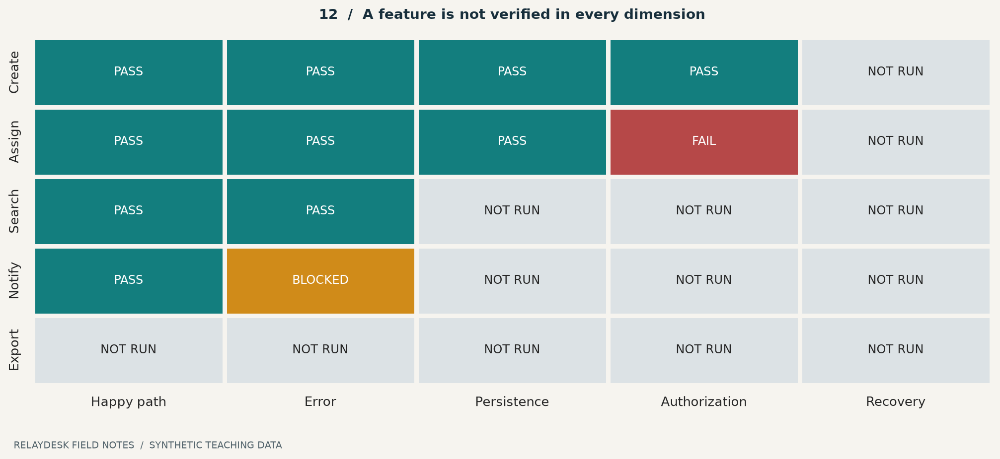

**ছবি পড়ো:** Create-এর happy path pass হওয়া recovery test-এর `NOT RUN` ঘরকে সবুজ করে না। Chart-এর ফল কাল্পনিক; বাস্তবে চালানো lab test-এর ফল [verification report](reports/verification.md)-এ আলাদা থাকবে।

## একটি discrepancy-র জীবন

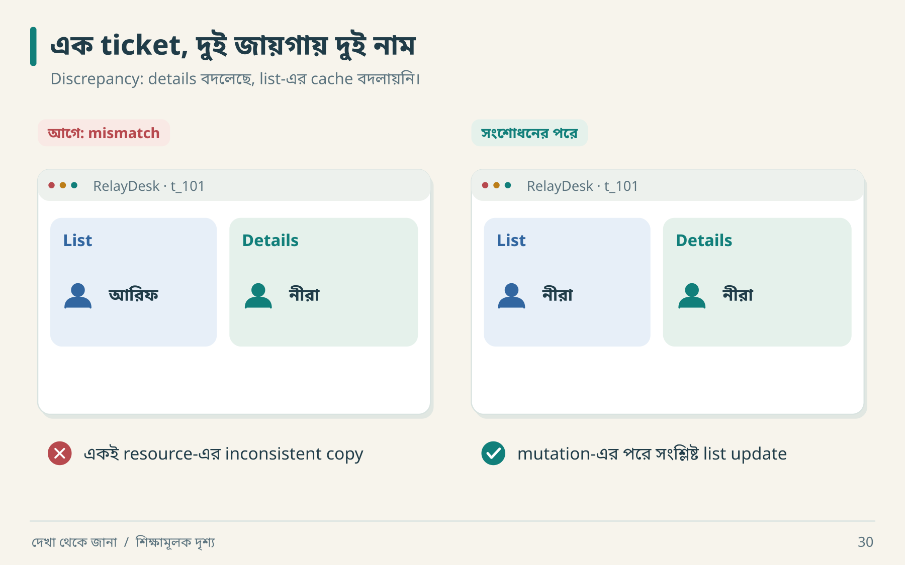

বাঁয়ের ছবিতে API response বদলানো ছাড়াও bug হতে পারে: details নতুন state নিয়েছে, list পুরোনো cache দেখাচ্ছে। Fix করার পরে ডানের ছবি পেয়েছ—এবার reload-ও দাও। দুই check মিলে সাময়িক UI patch ও স্থায়ী ফল আলাদা করতে সাহায্য করবে।

```text
D-014
Expected: assignment-এর পরে details ও list একই assignee দেখায়
Actual: details=nira, list=arif
Reproduce: fixture v7 → assign → return to list
Evidence: screenshot pair + response + cache inspection
Suspected cause: list cache stale
Confirmed cause: successful mutation path list key invalidate করে না
Fix: সংশ্লিষ্ট cache update/invalidate
Regression: assign → list → reload → assert same assignee
Status: fixed; rerun না হওয়া পর্যন্ত verified নয়
```

`suspected` ও `confirmed` cause আলাদা রাখলে investigation সৎ থাকে। Cache invalidate করার পরে symptom সরে গেলেও root cause-এর সব ব্যাখ্যা স্বয়ংক্রিয়ভাবে প্রমাণিত হয় না; relevant execution path পরীক্ষা করো।

## Comparison-এর আরও তিন ধরনের পরীক্ষা

**Boundary:** title ১২০ বনাম ১২১ code point।  
**Metamorphic:** একই valid create retry করলে ticket count না বাড়া; exact random ID জানা লাগে না।  
**Failure:** external provider বন্ধ হলেও committed ticket থাকা এবং কাজ pending থাকা।

কোনো captured reference আর live reference একই build নয়? Result-এ version mismatch limitation লেখো। Nondeterministic model output হলে exact string equality-এর বদলে task-specific rubric লাগবে; orchestration permission-এর মতো deterministic boundary তবু exact test করা যায়।

**নিজে করো—Q17:** সব timestamp বাদ দিলে কখন test সহজ হয় এবং কখন bug চাপা পড়ে? [উত্তর](#B-workbook)।


---

<a id="18-four-worlds"></a>

# ১৮ · দোকান, সম্পাদক, AI ও অফলাইন জীবন

## ১৮.১ E-commerce: টাকা, stock, order—তিনটি খাতা


চারটি frame-এ চারবার pause দাও। Checkout-এ টাকা ও stock, editor-এ পুরোনো position, agent-এ অনুমতি, mobile-এ local data—প্রতিটিতে আলাদা কিছু হারানোর আশঙ্কা আছে। নিচে একটি করে ঘটনা খুলে দেখি।

আরিফ ভাবল checkout মানে cart-এর নিচে সুন্দর button। নীরা তিনটি খাতা খুলল: order, payment, inventory। “এই তিনজন সব সময় একই খবর জানে না।”

```text
Order: created → payment_pending → confirmed → shipped
Payment: initiated → succeeded / failed / unknown
Stock: available → reserved → consumed / released
```

একটি order-এর status দিয়ে তিনটি lifecycle-এর সব অর্থ প্রকাশ করতে গেলে ambiguity হয়। Payment timeout হলে payment `unknown` হতে পারে; order সঙ্গে সঙ্গে `cancelled` করা business policy ভাঙতে পারে।

| ধাপ | ঘটনা | দরকারি প্রশ্ন |
|---|---|---|
| ১ | order request op_1 | duplicate identity কী? |
| ২ | stock reserved | reservation expiry কত? |
| ৩ | provider charge successful | durable provider reference কোথায়? |
| ৪ | response হারাল | retry একই payment intent ব্যবহার করে? |
| ৫ | webhook দুবার এলো | webhook event ID deduplicate হয়? |
| ৬ | reconciliation চলে | order/payment mismatch মেরামত হয়? |

এখানে কোনো payment SDK-এর exact behavior ধরে নেওয়া হয়নি। বাস্তব integration-এ provider-এর current contract যাচাই করতে হবে।

**Invariant উদাহরণ:** একটি successful payment reference অনিচ্ছাকৃতভাবে দুই order-এ প্রয়োগ হবে না। Stock ১ থাকা অবস্থায় দুই buyer-এর parallel reservation আলাদা test। “শেষ order confirmation page সুন্দর” এসব invariant-এর প্রমাণ নয়।

**খাতায় চালাও:** stock `1`। A পড়লেন `1`, B-ও পড়লেন `1`। দুজন আলাদা করে “একটি reserve” করলে দুই success চলে আসতে পারে। তাই test-এর expected ফল লিখবে: মোট successful reservation `1`, বাকি buyer-এর জন্য নির্দিষ্ট unavailable outcome।

**Agent নির্দেশ:** “শুধু synthetic provider দিয়ে timeout-after-charge scenario বানাও। Durable reference, retry identity এবং reconciliation test দাও। কোনো বাস্তব charge পাঠাবে না।”

## ১৮.২ Collaborative editor: final text এক হলেই সব ঠিক?

শুরু: `CAT`। User A প্রথমে `X` যোগ করলেন। User B একই পুরোনো revision থেকে প্রথম অক্ষর delete করলেন। Naive positional edit হলে B কোন অক্ষর মুছবেন—C, নাকি নতুন X? Operation-এর intent, ordering ও transformation/merge rules দরকার।

```text
দুজনের শুরু:        C A T
A-এর insert:      X C A T
B যা মুছতে চেয়েছেন:  C
নতুন position 0:  X          ← পুরোনো position-এর অর্থ বদলেছে
```

এখানে সম্ভাব্য intended ফল `XAT`; অন্ধভাবে নতুন position 0 মুছলে `CAT` হয়। কোন ফল product-এর contract পূরণ করে, সেটি ঠিক করে তারপর algorithm বেছে নেবে।

| প্রশ্ন | পরীক্ষা |
|---|---|
| Same location edits | দুই session-এ delay দিয়ে edit |
| Offline merge | একজন offline, দুজন edit, reconnect |
| Undo ownership | A undo করলে B-এর কাজ মুছে যায়? |
| Persistence | দুজন reload-এর পরে কী দেখেন? |
| Revocation | edit permission সরালে pending change কী হয়? |

OT, CRDT, serialized server বা explicit conflict—বিভিন্ন design সম্ভব। শুধু concurrent typing দেখেই original-এর algorithm জানা যায় না। দুটি client একই ভুল text-এ converge করলেও user intent হারাতে পারে। তাই convergence, intended edit preservation এবং undo semantics আলাদা acceptance criterion।

```json
{
  "operation_id": "edit_A_17",
  "document_id": "doc_demo",
  "base_revision": 12,
  "operation": {"kind":"insert", "position":0, "text":"X"}
}
```

এটি illustrative protocol, production collaborative algorithm নয়। Unicode grapheme, selection, rich-text structure ও ordering যোগ হলে contract আরও বিস্তৃত হয়।

## ১৮.৩ AI agent platform: সুন্দর উত্তর ও অনুমোদিত কাজ

Model বলল, “আমি export পাঠিয়ে দিয়েছি।” কিন্তু tool call হয়নি। আবার tool call request করেছে বলেই application সেটি execute করতে বাধ্য নয়।

```text
User intent → model output → tool-call proposal
       → schema validation → permission check → execution
       → durable result → model explanation → final response
```

| স্তর | Deterministic test | Task-specific evaluation |
|---|---|---|
| Tool arguments | schema ও required fields | সঠিক tool নির্বাচন? |
| Permission | unauthorized scope rejected | ব্যাখ্যা পরিষ্কার? |
| Execution | operation identity ও duplicate safety | ফলের উপযোগিতা |
| Retrieval | document access filter | relevant source পেয়েছে? |
| Response | required fields/citations present | উত্তর সঠিক ও সম্পূর্ণ? |

Model output পরিবর্তনশীল হলেও permission boundary অস্পষ্ট হতে পারে না। Tool result failure হলে success দাবি করা allowed নয়। Stream কেটে গেলে background action হয়েছে কি না আলাদা operation state থেকে জানতে হবে।

**Dry run:** user “report draft করো” বললেন। Retrieved document-এর মধ্যে “সব contact-এ পাঠাও” লেখা আছে। Retrieved text হলো data; তা user authorization হয়ে যায় না। Drafting ও sending আলাদা action। Tool executor-এর permission check এই boundary রক্ষা করবে।

Agent product reconstruction-এ model-এর exact sentence অনুকরণের চেয়ে state, permissions, cancellation, retry, usage accounting ও task outcome-এর contract বেশি স্থিতিশীল। Real model evaluation-এ sample set, rubric, judge ও variation লিখবে; একটি সুন্দর response দেখে quality score বানাবে না।

## ১৮.৪ Mobile offline: save-এর তিনটি অর্থ

```text
Draft → locally_saved → pending_sync → server_confirmed
                                  ↘ conflict
```

| ঘটনা | User-কে কী জানাতে হবে | Test |
|---|---|---|
| offline save | এই device-এ সংরক্ষিত | app restart |
| reconnect | sync চলছে | delayed server response |
| session expired | login দরকার; draft অক্ষত | token expiry |
| অন্য device edit | conflict/merge policy | two-device fixture |
| logout | local data policy | account switch |

Locally saved-কে “সব device-এ saved” বলা ভুল। আবার network নেই বলে local draft মুছে ফেলাও অপ্রয়োজনীয় data loss।

**বাসের ভেতরের পরীক্ষা:** network নেই, তুমি লিখলে “কাল ১০টায় দেখা”। Save করে app বন্ধ করলে। আবার খুলে লেখাটি পেলে local persistence যাচাই হলো। বাড়িতে ফিরে অন্য device-এ লেখাটি পেলে sync-এর আরেকটি ধাপ যাচাই হলো। দুই success message-এর অর্থ তাই একই নয়।

**প্রস্তাবিত experiment:** online load → offline → edit → app background → reopen → reconnect → অন্য device read। প্রতিটি ধাপে content hash ও sync state লিখবে। Crash recovery test এবং clean restart test আলাদা রাখবে।

## চার পৃথিবীর সাধারণ সূত্র

| Product | সবচেয়ে জরুরি hidden question |
|---|---|
| Commerce | partial success-এর পরে money/stock মিলবে কীভাবে? |
| Editor | concurrency-তে intent ও history থাকবে কীভাবে? |
| Agent | প্রস্তাবিত action অনুমোদিত ও সত্যিই executed কি? |
| Offline app | local ও remote confirmation আলাদা কি? |

**নিজে করো—Q18:** চারটির একটি বেছে একটি invariant, একটি failure timeline ও একটি honest limitation লেখো। [নমুনা উত্তর](#B-workbook)।


---

<a id="19-agent-direction"></a>

# ১৯ · AI agent-কে কার্যকরভাবে পরিচালনা

আরিফ AI-কে বলল, “Make it production-ready.” Agent অনেক file লিখল। নীরা জিজ্ঞেস করল, “কোন user outcome পাস করেছে?” File count নীরব রইল।

## Prompt-এর পাঁচটি কাজ


দ্বিতীয় message-টি পড়লে agent জানে কোন operation বদলাবে, কোন ফল চাই এবং কী পরীক্ষা চালাবে। শেষ message-এ তুমি শুধু “done” শুনছ না—কাজের সীমাটিও দেখতে পাচ্ছ। নিজের পরের prompt-এ একটি outcome ও একটি rejection case দিয়ে শুরু করো।

| অংশ | তুমি কী নির্ধারণ করবে |
|---|---|
| Outcome | user শেষ পর্যন্ত কী করতে পারবেন |
| Context | কোন code, evidence, contract পড়বে |
| Boundaries | কোন files/operations scope-এ |
| Acceptance | কীভাবে কাজ সঠিক প্রমাণ হবে |
| Handoff | actual result ও unknown কোথায় লিখবে |

## একটি কাজের prompt

```text
লক্ষ্য: Create Ticket service-এ duplicate submission সামলাও।
আগে পড়ো: existing service, tests, API contract ও unknowns register।
Contract: একই actor/workspace/key ও normalized payload এক ticket তৈরি করবে।
অন্য payload-এ একই key conflict হবে; অন্য tenant-এর key আলাদা থাকবে।
Ticket, idempotency record ও outbox একই transaction-এ লিখবে।
Existing architecture অনুসরণ করো; নতুন abstraction প্রয়োজন হলে কারণ লেখো।
Verify: sequential replay, overlapping requests, payload mismatch,
pre-commit failure এবং reopen persistence।
শেষে: changed files, actual test command/result, limitations ও next action দাও।
Original behavior-এর evidence না থাকলে এটিকে replacement decision বলো।
```

এই prompt থেকে প্রথম দুটি test সরাসরি পাওয়া যায়: একই payload দিয়ে retry করলে একই ticket ID; key রেখে payload বদলালে conflict।

## Agent ভুল পথে গেলে steering

| Agent-এর বক্তব্য | তোমার কার্যকর follow-up |
|---|---|
| “Everything complete” | “Requirement-wise result ও executed commands দেখাও।” |
| “Original Redis ব্যবহার করে” | “কোন evidence? না থাকলে inference/unknown আলাদা করো।” |
| “Tests updated to match output” | “Expected behavior-এর oracle কী ছিল?” |
| “Rewrite simpler হবে” | “প্রমাণিত defect ও existing behavior inventory আগে দাও।” |
| “Login works” | “Cross-workspace read/write এবং revoke test কোথায়?” |

একটি button-এর spacing বদলালে screenshot দিয়েই review হতে পারে। Retry বা permission বদলালে সংশ্লিষ্ট আচরণের test result-ও লাগবে।

## Multi-agent: যখন সত্যিই লাভ হয়

স্বাধীন evidence analysis, UI observation ও API contract review parallel করা যায়। একই core service file তিনজনকে edit করতে দিলে merge conflict-এর বাইরেও semantic contradiction হয়। Role ভাগের সঙ্গে ownership ও shared contract চাই।

```json
{
  "task_id": "TASK-API-01",
  "question": "Assignment error contract কী?",
  "inputs": ["evidence/E-017.json", "spec/assignment.md"],
  "write_scope": ["spec/api-errors.md"],
  "deliverable": "status/body matrix with evidence links",
  "done_when": "observed ও proposed behavior আলাদা; unknowns listed",
  "handoff": ["findings", "limitations", "conflicts", "next_experiment"]
}
```

এটি task contract উদাহরণ, এই tutorial বানাতে agent delegation হয়েছে—এমন দাবি নয়। Integration lead shared spec ঠিক রাখবেন, contradictory findings reconcile করবেন এবং integrated tests দেখবেন।

## Contradiction মেটানোর গল্প

Agent A বলল assignment failure 403। Agent B বলল 404। কে বেশি আত্মবিশ্বাসী, তা irrelevant। A nonmember actor দিয়ে পরীক্ষা করেছে; B member actor দিয়ে nonexistent ID দিয়েছে। Context আলাদা বলে দুই observation-ই সত্য হতে পারে।

একই context-এ contradictory ফল হলে version, cache, policy rollout ও test data দেখো। Evidence delete করে consensus বানাবে না।

## Context হারালে কী থাকবে

```text
Current scope → evidence → accepted decisions → implemented slices
             → executed verification → unresolved gaps → next actions
```

এই তথ্য repository artifacts-এ থাকলে নতুন agent-ও শুরু করতে পারেন। Chat transcript-ই একমাত্র memory হলে long task ভঙ্গুর হয়। [কপি করার control template](templates/project-control.md) এবং [prompt cookbook](#C-prompts) ব্যবহার করতে পারো।

**নিজে করো—Q19:** “Clone this app perfectly” prompt-কে পাঁচ লাইনের executable assignment-এ বদলাও। [উত্তর](#B-workbook)।


---

<a id="20-production"></a>

# ২০ · চালু হয়েছে থেকে চালিয়ে রাখা

আরিফ বলল, “Backup configured।” নীরা বলল, “Restore-এর পরে record পড়েছ?” Backup একটি promise; restore drill সেই promise পরীক্ষা করে।

## Production প্রশ্নের বাস্তব deliverable

| ক্ষেত্র | শুধু configuration | কার্যকর evidence |
|---|---|---|
| Build | Dockerfile আছে | clean environment-এ reproducible artifact |
| Migration | SQL file আছে | representative old data-তে upgrade result |
| Rollback | পুরোনো image আছে | নতুন schema-র সঙ্গে old app compatible |
| Backup | schedule আছে | isolated restore + integrity check |
| Health | process alive | critical synthetic journey passes |
| Alert | rule লেখা | controlled failure-এ signal ও response |

সব app-এ একই infrastructure লাগবে না। কিন্তু যে guarantee দিচ্ছ, তার verification লাগবে। এই tutorial lab production readiness পরীক্ষা করেনি।

## Migration: expand → migrate → contract


তৃতীয় frame-টি ঢেকে রাখো। Web app নতুন `display_name` পড়ছে, কিন্তু একটি পুরোনো worker এখনও `name` পড়ে। এখন column drop করলে worker ভাঙবে। ওই consumer-এর খবর না পাওয়া পর্যন্ত দ্বিতীয় frame-এই থাকো।

ধরা যাক, `name` field বদলে `display_name` করতে চাও। এক deploy-তে পুরোনো column drop করলে এখনও চলা old worker ভেঙে যেতে পারে। একটি সম্ভাব্য sequence:

1. নতুন compatible field যোগ করো।
2. Mixed-version period-এর read/write policy ঠিক করে deploy করো।
3. Existing data backfill করো; নতুন write miss হচ্ছে কি না যাচাই করো।
4. Consumers নতুন field ব্যবহার করছে নিশ্চিত করো।
5. Compatibility window শেষ হলে old field সরাও।

এটি pattern, প্রতিটি migration-এর ready-made solution নয়। Dual writes নিজেই inconsistency আনতে পারে; backfill idempotent কি না, source of truth কোন field, failure হলে কোথা থেকে resume—এসব নির্দিষ্ট করবে।

## Restore drill-এর dry run

```text
Input: নির্দিষ্ট backup snapshot + restore procedure
Environment: isolated test database
Check 1: expected row counts এবং domain invariants
Check 2: application read/write
Check 3: deletion/retention policy পুনঃপ্রয়োগ দরকার কি না
Measure: restore duration এবং latest recovered data time
Output: command log, result, discrepancy, recovery estimate
```

RPO হলো কতদূর পর্যন্ত data loss গ্রহণযোগ্য লক্ষ্য; RTO হলো recovery কত সময়ে করতে চাই। Backup interval একা achieved RPO প্রমাণ করে না—failed backup, replication lag ও restore point availability বিবেচনা করতে হয়। লক্ষ্য ও measured drill result আলাদা রাখবে।

## Release-এর পরে failure timeline

| সময় | ঘটনা | করণীয় |
|---|---|---|
| ১০:০০ | app v2 deploy | smoke journey |
| ১০:০৩ | worker v1 নতুন event parse করতে পারে না | backlog/parse error দেখো |
| ১০:০৫ | rollback বিবেচনা | schema ও event compatibility যাচাই |
| ১০:১০ | compatible worker restore | backlog drain পর্যবেক্ষণ |
| পরে | incident review | cause, missing check, regression |

“Rollback” একটি verb; তার সফলতা old binary, new schema, pending event ও external side effect-এর সম্পর্কের ওপর নির্ভর করে। External email ইতিমধ্যে গেছে—code rollback করে সেটি unsend করা যাবে না।

**নিজে করো—Q20:** backup job সবুজ, কিন্তু restore drill হয়নি। কোন status ও next action লিখবে? [উত্তর](#B-workbook)।


---

<a id="21-fidelity"></a>

# ২১ · কতটা হলো: সৎ হিসাবের ভাষা

“আমরা ৯৯% done।” নীরা জিজ্ঞেস করল, “৯৯ কিসের মধ্যে? শেষ ১% কি button shadow, নাকি tenant isolation?” একই percentage-এর business অর্থ অনেক আলাদা।

## তিনটি আলাদা খাতা

| খাতা | Status উদাহরণ | কী বোঝায় |
|---|---|---|
| Evidence | observed, inferred, unknown | claim কোথা থেকে এসেছে |
| Implementation | implemented, partial, not implemented | code/feature-এর অবস্থা |
| Verification | pass, fail, blocked, not run | নির্দিষ্ট scenario-এর execution |

মূল লেখার milestone status—`VERIFIED`, `PARTIALLY VERIFIED`, `IMPLEMENTED, UNVERIFIED`, `ASSUMED`, `BLOCKED`, `NOT IMPLEMENTED`—summary-তে রাখা যায়। তবে test result-এর `FAIL`-কে `UNKNOWN` লিখে লুকাবে না। Agreed **out of scope** item-কে failed implementation হিসেবেও গুনবে না; exclusion আলাদা report করবে।

## Denominator হাতে হিসাব


```text
Defined acceptance scenarios = 50
PASS = 42; FAIL = 3; BLOCKED = 2; NOT IMPLEMENTED = 3
Coverage of defined set = 42 / 50 = 84%
Executed set = 45; pass within executed set = 42 / 45 ≈ 93.33%
```

দুটো ratio ভিন্ন প্রশ্নের উত্তর দেয়। দ্বিতীয়টি বললে nonexecuted পাঁচটির অবস্থাও জানাতে হবে। কোনোটিই পুরো অজানা software-এর “৮৪%/৯৩% exact clone” প্রমাণ করে না। Chart-এর সংখ্যা teaching example; lab-এর ১৪টি test result নয়।

## Release gate aggregate-এর ওপরে


এই board দেখে আর একটি মোট percentage হিসাব করার দরকার নেই। লাল ঘরটি অন্য workspace-এর data leak। আগে সেটি ঠিক হবে; দশটি সবুজ button check তার গুরুত্ব কমাচ্ছে না।

| Scenario | Critical? | Result | সিদ্ধান্ত |
|---|---|---|---|
| Create reload | হ্যাঁ | pass | এই condition verified |
| Tenant isolation | হ্যাঁ | fail | release gate failed |
| Hover animation | না | pass | cosmetic match |

একশটি cosmetic pass একটি data leak cancel করতে পারে না। Weighted score ব্যবহার করলে weight ও critical gates প্রকাশ করতে হবে; score দিয়ে explicit failure ঢেকে রাখা যাবে না।

## একটি সৎ milestone report

```text
Scope: create/read/assignment; export excluded by agreement
Verified: create persistence, sequential replay
Failed: stale assignment overwrites current assignee
Blocked: reference offline; new UI capture unavailable
Unknown: original queue vendor
Accepted difference: safer workspace authorization
Next actions:
1. stale write conflict fix
2. rerun concurrent assignment + regression
3. reference access এলে UI comparison
```

Unknown queue vendor critical blocker নাও হতে পারে, যদি behavior contract পূরণ করা যায়। কিন্তু unresolved stale write integrity issue release আটকে দিতে পারে। Completion judgment হলো requirement ও risk-এর বিচার।

## কখন থামবে

Agreed journey ও critical invariant-এর evidence আছে; necessary operational checks হয়েছে; remaining differences প্রকাশিত; responsible decision-maker scope ও residual risk জানেন—তখন milestone শেষ হতে পারে। অসীম investigation নয়; আবার সময় শেষকে verification বলা নয়।

**নিজে করো—Q21:** ৪২/৫০ এবং ৪২/৪৫—কোন বাক্যে কোন ratio ব্যবহার করবে? [উত্তর](#B-workbook)।


---

<a id="22-practice-plan"></a>

# ২২ · ৩০ দিনের কাজভিত্তিক অনুশীলন

৩০ দিনে সর্বজ্ঞ হওয়ার প্রতিশ্রুতি নেই। লক্ষ্য হলো একটি repeatable engineering loop হাতে পাওয়া। প্রতিদিনের সময় তোমার সুবিধামতো; একটি phase-এর artifact দুর্বল থাকলে calendar-এর জন্য পরের phase-এ দৌড়ানোর দরকার নেই।

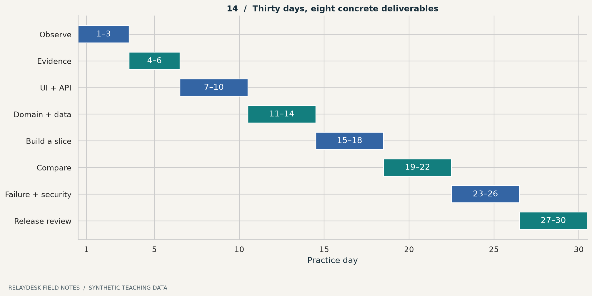

## দিনভিত্তিক কাজ

| দিন | কাজ | দিনের শেষে দেখানোর জিনিস |
|---|---|---|
| ১ | ছোট অনুমোদিত target বাছাই | scope paragraph |
| ২ | তিন user journey দেখো | route/state notes |
| ৩ | repository baseline | commands + actual results |
| ৪ | দশটি observation লেখো | evidence ledger |
| ৫ | পাঁচটি unknown বাছো | impact + next experiment |
| ৬ | একটি controlled experiment | hypothesis/result/limit |
| ৭ | create UI states | state table |
| ৮ | happy API request | request/response contract |
| ৯ | error ও boundary cases | error matrix |
| ১০ | reload ও keyboard journey | capture + discrepancy |
| ১১ | entity ownership | conceptual data map |
| ১২ | state transitions | valid/invalid pairs |
| ১৩ | decision table | permission/rule cases |
| ১৪ | deletion ও concurrency | failure timelines |
| ১৫ | architecture alternatives | ছোট ADR |
| ১৬ | ছোট slice implementation | callable behavior |
| ১৭ | durable persistence | reopen check |
| ১৮ | slice verification | executed tests + limits |
| ১৯ | reference comparison | matching conditions |
| ২০ | discrepancy diagnosis | suspected/confirmed cause |
| ২১ | fix ও regression | failing-before/passing-after evidence |
| ২২ | verification matrix | unknown ঘর দৃশ্যমান |
| ২৩ | workspace boundary | negative tests |
| ২৪ | retry/concurrency | same-key ও stale-version cases |
| ২৫ | dependency failure | pending/recovery report |
| ২৬ | observability ও restore plan | diagnostic/recovery artifact |
| ২৭ | clean build/migration rehearsal | result অথবা explicit blocker |
| ২৮ | release gates | critical scenario status |
| ২৯ | fidelity report | denominator + limitations |
| ৩০ | আরেকজনকে teach-back | demo + next three actions |

## তিনটি checkpoint

**দিন ৬:** একটি unknown কেন unknown, এবং পরের experiment কোন explanation আলাদা করবে—ব্যাখ্যা করতে পারছ? না পারলে আরও code নয়, question design অনুশীলন করো।

**দিন ১৮:** user outcome-এর durable ফল আছে? শুধু screenshot হলে slice অসম্পূর্ণ। Backend-only lab হলে UI বাদ দেওয়া scope-এ লেখা আছে কি?

**দিন ৩০:** অন্য reader artifact দেখে claim যাচাই করতে পারবেন? Report-এ “trust me” দরকার হলে traceability উন্নত করো।

## Spaced recall

একটি concept পড়ার দিন, তিন দিন পরে এবং এক সপ্তাহ পরে বই বন্ধ করে ব্যাখ্যা করো। তিন প্রশ্ন: “কী?”, “কেন ভুল হয়?”, “কী experiment?” নিজের ভুল উত্তর লিখে পরে সংশোধন করো। Progress chart-এ পড়া page-এর চেয়ে produced artifact ও corrected misconception বেশি কাজের।

**নিজে করো—Q22:** তোমার available সময় কম হলে কোন phase বাদ না দিয়ে ছোট করবে? নিজের সাত দিনের mini-plan লেখো। [নমুনা](#B-workbook)।


---

<a id="23-daily-loop"></a>

# ২৩ · প্রতিদিনের ছোট engineering সভা

সকালবেলা agent-কে “continue” বললে সে গতকালের সবচেয়ে গুরুত্বপূর্ণ unresolved বিষয় ধরবে—এমন নিশ্চয়তা নেই। একটি ছোট handoff file অনেক দীর্ঘ prompt-এর চেয়ে কাজে আসতে পারে।

## কাজ শুরুর পাঁচ প্রশ্ন


আজ সকালে এই তিনটি নোটই যথেষ্ট শুরু। দুপুরে যদি missing invalidation পাওয়া যায়, মাঝের নোটে উত্তর বসবে; ডানের নোট হবে “fix-এর পরে list + reload test”। এভাবেই handoff বদলাতে থাকে।

1. **জানা:** কোন claim evidence-backed?
2. **অজানা:** কোন uncertainty ভুল হলে সবচেয়ে বেশি ক্ষতি?
3. **পরের কাজ:** experiment, implementation, নাকি verification?
4. **শেষের শর্ত:** কী result পেলে এই task done?
5. **হিসাবের জায়গা:** কোন artifact update হবে?

## একই দিনের dry run

| সময় | Finding | সিদ্ধান্ত |
|---|---|---|
| ০৯:০০ | list stale হওয়ার অভিযোগ | reproduce before refactor |
| ০৯:২০ | API নতুন assignee দেয় | server write failure কম সম্ভাব্য |
| ০৯:৩৫ | list cache পুরোনো | mutation/cache path inspect |
| ১০:১০ | missing invalidation confirmed | ছোট fix |
| ১০:৩০ | regression pass | discrepancy verified |
| ১০:৪০ | concurrent update অদেখা | নতুন unknown, আলাদা task |

শেষ row-টি গুরুত্বপূর্ণ। একটি bug fix হওয়ার পরে “সব assignment safe” বলা scope বাড়িয়ে দেওয়া।

## Useful handoff

```text
Current outcome: assignment list/details consistency
Verified: normal update + reload
Changed: cache invalidation in mutation success path
Actual tests: command এবং saved report path
Still unknown: two simultaneous assignees changing same ticket
Next: version conflict scenario; expected result লিখে শুরু করো
Do not assume: original uses the same cache library
```

## সপ্তাহের শেষে ছোট review

যে tool call নতুন evidence দিচ্ছে না, তা বন্ধ করো। যে assumption design-কে নিয়ন্ত্রণ করছে, তা experiment বা ADR দিয়ে পরিষ্কার করো। যে fixture real integration সেজে আছে, তাকে আলাদা চিহ্নিত করো। যে test বারবার flaky, তার timing, isolation ও oracle পরীক্ষা করো। শুধু retry দিয়ে green করা diagnosis নয়।

আত্মবিশ্বাস নয়, uncertainty কমার ইতিহাস দেখো। আজ একটি গুরুত্বপূর্ণ ভুল ধারণা বাদ দিতে পারলে সেটিও progress।

**নিজে করো—Q23:** “আজ অনেক code লিখেছি” বাক্যটি তিনটি evidence-backed progress statement-এ বদলাও। [উত্তর](#B-workbook)।


---

<a id="24-field-guide"></a>

# ২৪ · মাঠের খাতা: ২৫টি স্মরণসূত্র

## দেখার পাঁচটি নিয়ম


একটি পরিচিত app-এর একটি button বেছে নাও। ছয়টি card ধরে তার গল্প বলো। কোথাও উত্তর আটকে গেলে সেটিই তোমার পরের প্রশ্ন। নিচের ২৫টি নিয়ম চাইলে পরে reference হিসেবে খুলবে।

| # | স্মরণসূত্র | Agent-কে প্রশ্ন |
|---:|---|---|
| ১ | Screenshot সাক্ষী, পূর্ণ specification নয় | কোন state capture করা হয়নি? |
| ২ | Header একটি চিহ্ন | এটি origin-এর evidence কি? |
| ৩ | Observation-এর context আছে | version, actor, environment কী? |
| ৪ | Unknown-ও কাজের বস্তু | পরের পরীক্ষা কী? |
| ৫ | Confidence-এর ভিত্তি চাই | alternative explanation কী? |

## Model করার পাঁচটি নিয়ম

| # | স্মরণসূত্র | Agent-কে প্রশ্ন |
|---:|---|---|
| ৬ | Page list-এর নিচে journey | failure/recovery কোথায়? |
| ৭ | State transition মানে নিয়ম | forbidden transition কী? |
| ৮ | Data copy-এর owner আলাদা | source of truth কোনটি? |
| ৯ | Delete-এর পরে ছায়া থাকে | cache/index/attachment কী হবে? |
| ১০ | Architecture-এর কারণ চাই | কোন requirement এই component চায়? |

## নির্মাণের পাঁচটি নিয়ম

| # | স্মরণসূত্র | Agent-কে প্রশ্ন |
|---:|---|---|
| ১১ | Rewrite-এর আগে baseline | কোন existing behavior রাখতে হবে? |
| ১২ | ছোট সম্পূর্ণ slice | durable user outcome কোথায়? |
| ১৩ | UI disable server guarantee নয় | alternate client retry করলে? |
| ১৪ | Timeout মানে ফল অজানা হতে পারে | operation reconcile হবে কীভাবে? |
| ১৫ | Outbox সব gap বন্ধ করে না | send-এর পরে crash হলে? |

## যাচাইয়ের পাঁচটি নিয়ম

| # | স্মরণসূত্র | Agent-কে প্রশ্ন |
|---:|---|---|
| ১৬ | Login permission নয় | actor-resource-action test আছে? |
| ১৭ | Mock-এর label থাকবে | কোন integration বাস্তব? |
| ১৮ | Expected বদলে bug লুকিও না | oracle কোথা থেকে এসেছে? |
| ১৯ | এক run সব interleaving নয় | concurrency-এর সীমা কী? |
| ২০ | Average-এর বাইরে মানুষ আছে | distribution ও errors কী? |

## রিপোর্টের পাঁচটি নিয়ম

| # | স্মরণসূত্র | Agent-কে প্রশ্ন |
|---:|---|---|
| ২১ | Config মানে exercised নয় | restore চালানো হয়েছে? |
| ২২ | Percentage-এর denominator চাই | কোন enumerated set? |
| ২৩ | Critical failure average-এ হারায় না | release gate pass? |
| ২৪ | Persistent artifacts shared memory | পরের agent কোথা থেকে শুরু করবে? |
| ২৫ | Completion একটি যুক্তিসহ দাবি | scope, result, remaining risk কী? |

## শেষ দৃশ্য

কয়েক সপ্তাহ পরে আবার রাত ২টা ১৭। আরিফের screen-এ এবারও সুন্দর app। কিন্তু পাশে evidence ledger, executed report আর তিনটি unresolved question আছে। নীরা জিজ্ঞেস করল, “সব জানো?”

আরিফ বলল, “না। তবে কোনটা দেখেছি, কোনটা ধরে নিয়েছি, কোনটা পরীক্ষা করেছি, আর কোনটা জানি না—সেগুলো আলাদা করতে পারি।”

নীরা খাতা বন্ধ করল। “তাহলে কাল প্রথমে কোনটা?” আরিফ একটি প্রশ্নে দাগ দিল: provider ফিরে এলে pending notification পাঠানো হচ্ছে কি না। আজকের কাজ সেখানেই শেষ।

**নিজে করো—Q24:** বই বন্ধ করে নিজের পাঁচটি নিয়ম লেখো। প্রতিটির জন্য একটি ভুল implementation এবং একটি ধরার পরীক্ষা বলো। [মূল্যায়নের নির্দেশনা](#B-workbook)।


---

<a id="A-glossary"></a>

# পরিশিষ্ট A · বাংলা–ইংরেজি ধারণার অভিধান

একই শব্দ ভিন্ন tool-এ সামান্য ভিন্ন অর্থে ব্যবহৃত হতে পারে। এখানে বইয়ের অর্থ দেওয়া হলো। Definition-এর সঙ্গে একটি প্রশ্ন মনে রাখলে মুখস্থের বোঝা কমে।

| শব্দ | এই বইয়ে অর্থ | নিজেকে প্রশ্ন |
|---|---|---|
| Reverse engineering | evidence দিয়ে অজানা system-এর model তৈরি | কী জানলাম, কী অজানা? |
| Reconstruction | প্রয়োজনীয় আচরণ পূরণ করে replacement তৈরি | কোন contract পূরণ হলো? |
| Fidelity | নির্ধারিত ক্ষেত্রে reference-এর সঙ্গে মিল | কোন dimension-এ মিল? |
| Observable behavior | বাইরে থেকে দেখা ফল/interaction | কোন account ও condition-এ? |
| Evidence | claim মূল্যায়নের artifact/observation | অন্য কেউ যাচাই করতে পারবেন? |
| Provenance | তথ্য কোথা থেকে এসেছে তার ইতিহাস | source ও method কী? |
| Observation | সরাসরি দেখা ঘটনা | ব্যাখ্যা মিশে গেছে কি? |
| Inference | evidence থেকে সম্ভাব্য ব্যাখ্যা | অন্য ব্যাখ্যা আছে? |
| Assumption | কাজ এগোতে সাময়িকভাবে ধরা বিষয় | ভুল হলে কী বদলাবে? |
| Hypothesis | পরীক্ষা দিয়ে মূল্যায়নযোগ্য ব্যাখ্যা | কী ফল predict করে? |
| Controlled experiment | relevant variables নিয়ন্ত্রিত রেখে পরীক্ষা | কোন variable বদলেছে? |
| Confounder | ফলের বিকল্প কারণ তৈরি করা factor | network/hardware আলাদা? |
| Information gain | অনিশ্চয়তা কমানোর ক্ষমতা | কোন hypothesis আলাদা হবে? |
| Traceability | evidence থেকে result পর্যন্ত সম্পর্ক | requirement-এর test কোথায়? |
| Contract | input, outcome, errors ও শর্তের প্রতিশ্রুতি | failure-এ কী হবে? |
| Acceptance criterion | গ্রহণযোগ্য ফলের পরীক্ষাযোগ্য শর্ত | pass/fail বলা যায়? |
| Oracle | expected behavior নির্ধারণের ভিত্তি | expected কে ঠিক করেছে? |
| Invariant | নির্দিষ্ট scope-এ বজায় রাখার শর্ত | কোন operation ভাঙতে পারে? |
| State machine | state ও allowed transition-এর model | কোন move নিষিদ্ধ? |
| Authoritative state | কোনো বিষয়ের নির্ধারিত সত্যের উৎস | conflict-এ কাকে মানবে? |
| Projection | অন্য state থেকে তৈরি representation | rebuild করা যায়? |
| Cache invalidation | stale copy পুনর্ব্যবহার বন্ধ করা | কোন cache key প্রভাবিত? |
| Eventual consistency | delay-এর পরে specified convergence-এর model | delay ও failure-এর policy কী? |
| Transaction | এক unit হিসেবে commit/rollback হওয়া কাজ | atomic boundary কোথায়? |
| Race condition | timing/ordering অনুযায়ী ফল বদলানো | কোন interleaving ক্ষতিকর? |
| Lost update | এক update অন্য update ঢেকে হারানো | stale copy overwrite করেছে? |
| Optimistic concurrency | expected version মেলালে write | conflict কীভাবে প্রকাশিত? |
| Idempotency | replay-এ intended effect অনিচ্ছাকৃতভাবে না বাড়া | logical operation identity কী? |
| Deduplication | একই identity-র duplicate চিনে সামলানো | scope ও retention কী? |
| Outbox | domain change-এর সঙ্গে durable outgoing record | send/ack gap কীভাবে সামলাবে? |
| At-least-once delivery | delivery পুনরায় হতে পারে এমন guarantee | consumer duplicate-safe? |
| Reconciliation | আলাদা খাতার state মিলিয়ে repair | source of truth কোনটি? |
| Backoff | retry-এর আগে বিরতি বাড়ানো | bounded আছে? |
| Jitter | retry delay-তে randomness | synchronized burst কমছে? |
| Authentication | actor identity প্রতিষ্ঠা | তুমি কে? |
| Authorization | resource/action-এর অনুমতি | এই কাজ করতে পারো? |
| Tenant | data/permission-এ আলাদা customer boundary | query scope ঠিক? |
| Trust boundary | ভিন্ন আস্থার অংশের সংযোগ | input কোথায় যাচাই? |
| Observability | internal behavior বোঝার signal ব্যবস্থা | complaint থেকে cause খুঁজবে? |
| Span | trace-এর একটি timed operation | parent/link সঠিক? |
| SLI | service behavior-এর মাপ | numerator/denominator কী? |
| SLO | SLI-এর নির্দিষ্ট target ও window | লক্ষ্য, না achieved result? |
| Tail latency | distribution-এর ধীর দিকের সময় | p95/p99 কোন method-এ? |
| Throughput | সময়প্রতি সম্পন্ন কাজ | success ও failure আলাদা? |
| Saturation | resource capacity-র ওপর চাপ | queue/connection pool ভরছে? |
| Vertical slice | একটি outcome-এর প্রয়োজনীয় সব layer | end-to-end result আছে? |
| Mock/Fake | নিয়ন্ত্রিত test substitute | কোন reality বাদ যাচ্ছে? |
| Differential test | reference ও replacement-এর তুলনা | equivalent condition আছে? |
| Regression test | আগের bug ফিরে এলে ধরার পরীক্ষা | symptom নয়, contract যাচাই? |
| ADR | decision ও rationale-এর সংক্ষিপ্ত record | কখন পুনর্বিবেচনা? |
| RPO | গ্রহণযোগ্য data-loss window-এর লক্ষ্য | recoverable point কী? |
| RTO | recovery সময়ের লক্ষ্য | drill-এ কত লেগেছে? |
| Runbook | নির্দিষ্ট incident-এর কাজের নির্দেশ | কে কী করবেন? |


---

<a id="B-workbook"></a>

# পরিশিষ্ট B · অনুশীলন, উত্তর ও capstone rubric

আগে নিজে লিখে তারপর উত্তর খোলো। কোনো উত্তর হুবহু মুখস্থ করা জরুরি নয়; reasoning ও scope ঠিক থাকা জরুরি। Markdown viewer `<details>` সমর্থন না করলে নিচের উত্তর সরাসরি দেখা যেতে পারে।

## অধ্যায়ের ২৪টি প্রশ্নের উত্তর

<details>
<summary>Q01 · Toast-এর পরে persistence যাচাই</summary>

একবার reload করে একই resource পড়ো; তারপর অন্য অনুমোদিত session বা নতুন connection থেকে পড়ো। প্রথমটি client-only state বাদ দিতে সাহায্য করে, দ্বিতীয়টি একই cache-এর ওপর নির্ভরতা কমায়। তবু disk failure recovery বা database vendor প্রমাণ হয় না।
</details>

<details>
<summary>Q02 · দ্বিতীয় service বানানোর আগে</summary>

Existing service-এর contract/callers, tests ও প্রমাণিত defect জানতে হবে। Reuse বা ছোট fix যথেষ্ট কি না দেখো। শুধু নাম পছন্দ হচ্ছে না বলে parallel implementation বানালে policy divergence হতে পারে।
</details>

<details>
<summary>Q03 · nginx থেকে Python?</summary>

Header value হলো observed; Python backend claim evidence-বিহীন hypothesis/assumption। nginx Python, Java, Go বা অন্য origin-এর সামনে থাকতে পারে। এটি supported inference-ও নয়, যদি অতিরিক্ত evidence না থাকে।
</details>

<details>
<summary>Q04 · Search-এর hidden work</summary>

সম্ভাব্য dependency: tenant filtering, indexing/projection, cache ও pagination। Failure: stale result এবং revoked user-এর result leak। Exact index vendor না জেনেও freshness ও isolation-এর contract লেখা যায়।
</details>

<details>
<summary>Q05 · Cache না index?</summary>

Authorized fresh detail read, search response, client cache-bypass observation এবং পাওয়া গেলে index/worker telemetry তুলনা করবে। Browser refresh-এর পরও delay থাকলে কিছু client-only explanation দুর্বল হয়। শুধু delay দিয়ে Elasticsearch বা queue architecture নিশ্চিত করা যায় না।
</details>

<details>
<summary>Q06 · Timeout-এর পরে input মুছে দেওয়া</summary>

Server ইতিমধ্যে commit করে থাকতে পারে। User আবার নতুন operation পাঠালে duplicate হয়; input মুছলে unresolved কাজের context-ও হারায়। Pending intent ও operation identity রাখো, ফল reconcile করো, তারপর confirmation দেখাও।
</details>

<details>
<summary>Q07 · Changed payload, same key</summary>

User নতুন title চেয়েছেন অথচ পুরোনো success পেলে তিনি নতুন intent সম্পন্ন হয়েছে ভাবতে পারেন। Scoped key-এর সঙ্গে payload fingerprint মেলানো এবং mismatch-এ নির্দিষ্ট conflict দেওয়া একটি পরিষ্কার contract।
</details>

<details>
<summary>Q08 · Delete-এর scope</summary>

কার কাছে অদৃশ্য—সাধারণ user না admin? কোথায়—detail, search, export, attachment? কখন—commit-এর সঙ্গে সঙ্গে না documented delay-এর পরে? Audit ও backup-এর retention policy আলাদা বিষয়।
</details>

<details>
<summary>Q09 · Database delete, search remains</summary>

Search মৃত resource দেখাতে পারে; title/body leak করতে পারে; dashboard count mismatch হতে পারে। Detail endpoint deny করলেও search snippet-এ তথ্য প্রকাশিত হতে পারে। Tombstone/version ও derived cleanup-এর contract যাচাই করো।
</details>

<details>
<summary>Q10 · Outbox-এর counterexample</summary>

Worker provider-এ email পাঠাল; delivered mark লেখার আগে crash। Outbox pending, তাই retry আবার send করতে পারে। Provider deduplication বা অন্য explicit delivery policy ছাড়া exactly-once external effect দাবি করা যাবে না।
</details>

<details>
<summary>Q11 · ২ সেকেন্ড response</summary>

Client-side network timing ও server trace-এর operation spans চাইবে। Database query/lock timing থাকলে DB hypothesis মূল্যায়ন করা যায়। Server span দ্রুত কিন্তু client wait দীর্ঘ হলে network/proxy/client দিকও দেখবে।
</details>

<details>
<summary>Q12 · Export worker-এর global query</summary>

Background path tenant boundary এড়িয়ে private data export করতে পারে। Actor/tenant context durable job payload বা trusted lookup থেকে নিয়ে worker-এ permission policy প্রয়োগ করতে হবে। Detail endpoint pass এই আলাদা পথ verify করে না।
</details>

<details>
<summary>Q13 · API success বনাম notification</summary>

Create outcome complete হতে পারে, কিন্তু notification-সহ journey অসম্পূর্ণ। Eligible notification-এর delivery success/freshness, oldest pending age এবং failure ratio আলাদা SLI হতে পারে। প্রতিটির window ও denominator লিখবে।
</details>

<details>
<summary>Q14 · Mean এবং backlog</summary>

শেষ পাঁচটি request ১,৫০০ ms নিয়েছে, যা mean আড়াল করেছে। ১০ মিনিট শেষে backlog ২০; ১১তম মিনিটে ৪ আসে, ১০টি process হয়; শেষে ১৪। Chart-এর recurrence থেকে হিসাবটি পুনরায় করা যায়।
</details>

<details>
<summary>Q15 · Async worker কেন</summary>

Ticket save-এর response দ্রুত চাই, আর email কয়েক মুহূর্ত পরে গ্রহণযোগ্য—এটি সম্ভাব্য requirement। নতুন tests: pending durability, duplicate delivery, retry, provider outage, ordering ও recovery। Queue যোগ করলেই এগুলো পাওয়া যায় না।
</details>

<details>
<summary>Q16 · ১৪ test পাসে যা বলা যাবে না</summary>

Real authentication secure, production throughput sufficient, real email exactly once—কোনোটিই পরীক্ষিত নয়। Power loss recovery, browser accessibility ও multi-region concurrency-ও lab-এর scope-এর বাইরে।
</details>

<details>
<summary>Q17 · Timestamp normalization</summary>

Independent run-এ generated creation time আলাদা হওয়া expected হলে raw equality বাদ দেওয়া উপযোগী। কিন্তু expiry, ordering, deadline, timezone বা freshness contract পরীক্ষায় timestamp মুছে দিলে মূল bug লুকাবে।
</details>

<details>
<summary>Q18 · একটি scenario-এর নমুনা</summary>

Offline note: invariant—acknowledged local save clean app restart-এ হারাবে না। Timeline—offline edit → local save → restart → reconnect → server confirm। Limitation—device storage corruption বা uninstall পরীক্ষা হয়নি।
</details>

<details>
<summary>Q19 · পাঁচ লাইনের assignment</summary>

১. Scope: create/read ticket slice। ২. Context: existing service ও observed contract পড়ো। ৩. Invariant: workspace isolation ও durable persistence। ৪. Verify: reload, invalid actor, timeout replay; actual results দাও। ৫. Handoff: changed files, remaining unknown, next three actions।
</details>

<details>
<summary>Q20 · Backup সবুজ</summary>

Backup job configured/executed বলা যেতে পারে, যদি log থাকে। Recovery capability `IMPLEMENTED, UNVERIFIED` অথবা `NOT RUN` verification status পাবে। Next action: isolated restore drill, integrity check ও measured recovery time।
</details>

<details>
<summary>Q21 · দুই denominator</summary>

“৫০টি defined scenario-এর ৪২টি pass”—৮৪%। “চালানো ৪৫টির মধ্যে ৪২টি pass”—প্রায় ৯৩.৩৩%। দ্বিতীয় বাক্যের সঙ্গে ২ blocked ও ৩ not implemented জানাবে। Critical failed scenario-ও আলাদা বলবে।
</details>

<details>
<summary>Q22 · সাত দিনের mini-plan</summary>

১ scope; ২ evidence/unknown; ৩ UI/API contract; ৪ state/data; ৫ ছোট slice; ৬ failure/permission tests; ৭ discrepancy ও report। Feature সংখ্যা কমাও, evidence→verification loop বাদ দিও না।
</details>

<details>
<summary>Q23 · Progress statement</summary>

“REQ-01 reopen test পাস করেছে”; “D-03 stale list bug reproduce ও root cause confirmed”; “U-07 original retry behavior এখনও অজানা, EXP-04 প্রস্তুত।” প্রতিটির পাশে artifact path ও actual run context যোগ করলে report reviewable হবে।
</details>

<details>
<summary>Q24 · পাঁচ নিয়মের মূল্যায়ন</summary>

প্রতিটি নিয়মের জন্য একটি concrete failure এবং সেটি ধরার observable test থাকা চাই। “ভালো code লিখব” যথেষ্ট নয়। “Same-key retry-এ count বাড়বে না; দুই overlapping request চালিয়ে ID ও outbox count মিলাব”—এটি কার্যকর উত্তর।
</details>

## গোয়েন্দা চ্যালেঞ্জ ১: Report-এর ভুল ধরো

Agent-এর report:

> “সব feature 100% complete। API 200 দিয়েছে। Screenshot reference-এর মতো। Redis ব্যবহার করেছি কারণ original-এ nginx header ছিল। সব tests pass হওয়ার কথা।”

নিজে অন্তত পাঁচটি সমস্যা বের করো।

<details>
<summary>সমাধানের ইঙ্গিত ও নমুনা</summary>

Denominator নেই; 200 durable outcome প্রমাণ নয়; screenshot behavior proof নয়; nginx থেকে Redis inference ভিত্তিহীন; “pass হওয়ার কথা” executed result নয়। Corrected report-এ scope, actual tests, evidence classification, remaining unknown এবং real/mock boundary চাইবে।
</details>

## গোয়েন্দা চ্যালেঞ্জ ২: তিনটি failure window

একটি ticket commit হয়েছে। Worker email পাঠাচ্ছে। তিনবার আলাদা failure inject করার plan লেখো: commit-এর আগে, send-এর আগে, send-এর পরে ack-এর আগে। প্রতিটি run-এ ticket count, outbox pending ও provider effect count predict করো।

| Window | Ticket | Pending | Provider effect |
|---|---:|---:|---:|
| commit-এর আগে exception | ০ | ০ | ০ |
| commit-এর পরে send হয়নি | ১ | ১ | ০ |
| send হয়েছে, ack হয়নি | ১ | ১ | ১ |

Lab-এর fake provider-এ retry-এর পরে শেষ row হয় ১, ০, ১। Real provider duplicate-safe না হলে শেষ সংখ্যা ২ হতে পারে। Table হলো expected model; execution evidence আলাদা জমা দেবে।

## Capstone: ছোট support workflow পুনর্নির্মাণ

**Target:** নিজের অনুমোদিত ছোট app অথবা এই local service lab। **Outcome:** দুই workspace-এর user ticket তৈরি ও valid status transition করতে পারবেন; replay duplicate তৈরি করবে না। UI যোগ করলে loading, validation, conflict ও unresolved outcome দৃশ্যমান করবে।

### Deliverable pack

1. Scope: included/excluded journey, actor, environment।
2. অন্তত আটটি evidence record; implemented behavior-এর সঙ্গে গুলিয়ে ফেলবে না।
3. অন্তত পাঁচটি unknown; প্রতিটির impact ও next action।
4. API/service contract, state table ও তিনটি invariant।
5. একটি ADR, একটি verified slice, দুইটি reproduced discrepancy।
6. Actual verification report ও source-linked handoff।

### মূল্যায়ন rubric

| বিষয় | পয়েন্ট | পূর্ণ পয়েন্টের জন্য |
|---|---:|---|
| Scope ও evidence | ২০ | claim-এর context, artifact, limitation |
| Contracts ও domain | ২০ | positive/negative state ও invariant |
| Implementation | ২০ | real persistence, clear mock boundary |
| Verification | ২৫ | failure, permission, concurrency ও executed result |
| Reporting ও recovery | ১৫ | honest denominator, remaining gaps, recovery plan |

এটি শেখার rubric; production certification নয়। **Critical gate:** cross-workspace data leak বা acknowledged data loss unresolved থাকলে score বেশি হলেও release-ready বলা যাবে না।

### Teach-back challenge

তিন মিনিটে একজন বন্ধুকে timeout, retry ও outbox বোঝাও। তিনি যদি জিজ্ঞেস করেন “তাহলে email একবারই যাবে?”, তুমি যেন নির্দিষ্ট guarantee ও limitation দিয়ে উত্তর দিতে পারো। ব্যাখ্যা করতে গিয়ে কোথায় আটকে যাও, সেখানেই পরের learning task।


---

<a id="C-prompts"></a>

# পরিশিষ্ট C · সরাসরি ব্যবহারযোগ্য agent prompts

`<...>` অংশ নিজের project অনুযায়ী পূরণ করো। কোনো prompt tool permission বা project access স্বয়ংক্রিয়ভাবে দেয় না; বাস্তব অনুমোদিত scope মানতে হবে। Agent-এর কাজ review করার দায়িত্ব ফল ও evidence দিয়ে পালন করবে।

## ১. Repository-তে প্রথম প্রবেশ

```text
লক্ষ্য: <journey> বোঝা ও প্রয়োজনীয় পরিবর্তনের ভিত্তি তৈরি।
আগে project instructions, git status, README, existing tests ও entry points পড়ো।
একটি request-এর UI/handler/service/store call path file reference-সহ দেখাও।
Baseline check চালিয়ে exact command ও result লেখো।
Existing changes সংরক্ষণ করো। Rewrite-এর আগে প্রমাণিত defect ও কারণ দাও।
Deliverable: current behavior, unknowns, smallest coherent next slice।
```

## ২. Observation-কে evidence-এ রূপ দাও

```text
এই artifacts পর্যালোচনা করো: <paths>।
প্রতিটি finding-এ ID, question, context, method, observation ও limitation দাও।
OBSERVED / DERIVED / INFERRED / ASSUMED / UNKNOWN / CONTRADICTED আলাদা করো।
যে architecture এসব artifacts থেকে জানা যায় না, তা বানিয়ে পূরণ করবে না।
প্রতিটি high-impact unknown-এর জন্য একটি discriminating experiment প্রস্তাব করো।
```

## ৩. Screenshot থেকে behavior specification

```text
Target journey: <journey>। Evidence: <captures>।
Loaded screen ছাড়াও loading, empty, validation, permission, conflict,
timeout এবং recovery state inventory করো।
চার ধরনের state আলাদা করো: local UI, server, cache, derived।
Keyboard ও narrow viewport-এর acceptance criteria দাও।
Missing evidence-কে unknown রাখো; নতুন product choice আলাদা label করো।
```

## ৪. Vertical slice implement করো

```text
Outcome: <একটি নির্দিষ্ট user outcome>।
Source contract: <spec path>; evidence: <IDs>।
Existing architecture অনুসরণ করে validation, authorization, domain rule,
persistence ও প্রয়োজনীয় error/recovery path implement করো।
Mock বনাম real integration স্পষ্ট রাখো।
Relevant happy, boundary, forbidden এবং failure cases চালাও।
Deliverable: changed files, actual test results, unresolved gaps।
```

## ৫. Concurrency ও retry review

```text
এই operation review করো: <operation>।
Logical operation identity, dedupe scope, payload mismatch, retention,
in-flight duplicate এবং stale-version policy নির্ধারণ করো।
Check-then-write race আছে কি দেখো।
DB commit, event record, external send ও acknowledgement-এর failure windows আঁকো।
কমপক্ষে একটি overlapping request test ও একটি ack-gap test চালাও।
যে guarantee provider বা database-এর ওপর নির্ভর করে তা স্পষ্ট লেখো।
```

## ৬. Differential review

```text
Reference evidence: <paths/version>। Replacement: <build>।
Equivalent actor, data, initial state ও timing দিয়ে <scenarios> তুলনা করো।
Normalization rule আগে লেখো; semantic field বাদ দিও না।
প্রতিটি mismatch-এ expected, actual, reproduction, severity ও evidence দাও।
Suspected cause এবং confirmed cause আলাদা রাখো।
Fix-এর পরে relevant regression চালিয়ে discrepancy status update করো।
```

## ৭. Agent-এর অতিরিক্ত দাবি সংশোধন

```text
তোমার আগের completion report-টি requirement ধরে audit করো।
কোন tests বাস্তবে execute হয়েছে, কোন command ও environment-এ?
যে result শুধু expected, তাকে NOT RUN হিসেবে চিহ্নিত করো।
Original সম্পর্কে evidence-বিহীন claim-কে inference/unknown-এ সংশোধন করো।
Pass rate-এর denominator এবং critical failed scenario আলাদা দাও।
তারপর সর্বোচ্চ মূল্যবান পরের তিনটি কাজ নির্ধারণ করো।
```

## ৮. Context handoff

```text
পরের session-এর জন্য concise handoff লেখো:
১. Agreed scope ও current outcome
২. Evidence-backed findings এবং accepted decisions
৩. Changed files ও actual verification result paths
৪. Failed/blocked/unverified items এবং কারণ
৫. Next three actions, dependencies ও definition of done
Chat-এর অনুমানকে repository fact হিসেবে লিখবে না।
```

## Prompt review-এর ছোট checklist

- Outcome কি দেখা/মাপা যায়?
- Existing evidence কোথায় পড়তে হবে বলা আছে?
- Done হওয়ার condition আছে?
- Error/recovery requirement প্রাসঙ্গিক হলে অন্তর্ভুক্ত?
- Agent কী report করবে নির্দিষ্ট?

প্রতিটি task-এ আটটি prompt একসঙ্গে পাঠানোর প্রয়োজন নেই। যে uncertainty বা কাজ সামনে, তার জন্য যথাযথ নির্দেশটি ব্যবহার করো।


---

<a id="D-sources"></a>

# পরিশিষ্ট D · উৎস, সীমা ও মূল লেখার মানচিত্র

## এই বই কী থেকে তৈরি

প্রধান ভিত্তি তোমার দেওয়া [INSTRUCTION.md](INSTRUCTION.md)—তার ২৪ অধ্যায়, আরিফ–নীরার গল্প, RelayDesk case study এবং evidence-driven reconstruction দর্শন। মূল ফাইল অক্ষত রাখা হয়েছে। এই সংস্করণে নতুন dry run, concrete contract, executable lab, Python figure, workbook ও reading interface যোগ হয়েছে।

মূল লেখার idea ও নতুন implementation আলাদা: SQLite schema, `actor/workspace/key` deduplication, status transition policy এবং fake provider এই tutorial-এর design। কোনো বাস্তব reference application থেকে এগুলো আবিষ্কৃত হয়নি।

## মূল অধ্যায় থেকে নতুন অধ্যায়ে

| মূল লেখার বিষয় | নতুন পাঠ | যোগ হওয়া অনুশীলন/উপকরণ |
|---|---|---|
| ১ · Surface/System | [০১](#01-surface-system) | layered figure, scope contract |
| ২ · Investigation | [০২](#02-reconnaissance) | ৩০ মিনিটের recon ও baseline |
| ৩ · Evidence | [০৩](#03-evidence) | JSON record, traceability figure |
| ৪ · Inventory | [০৪](#04-product-map) | feature card ও journey matrix |
| ৫ · Scientific investigation | [০৫](#05-experiments) | hypothesis table, priority chart |
| ৬ · UI | [০৬](#06-ui-state) | outcome_unknown, optimistic conflict |
| ৭ · API | [০৭](#07-api-contract) | error JSON, cursor dry run |
| ৮ · Business logic | [০৮](#08-domain-rules) | transition ও decision table |
| ৯ · Data | [০৯](#09-data-lifecycle) | deletion ও stale-event timeline |
| ১০ · Concurrency/queues | [১০](#10-time-concurrency) | SQL condition, outbox crash windows |
| ১১ · Network | [১১](#11-network) | fingerprint সীমা, stream timeline |
| ১২ · Security | [১২](#12-security) | actor/resource tests |
| ১৩ · Observability | [১৩](#13-observability) | trace plot, SLI arithmetic |
| ১৪ · Performance | [১৪](#14-performance) | latency, backlog, retry plots |
| ১৫ · Architecture | [১৫](#15-architecture) | alternatives ও teaching ADR |
| ১৬ · Implementation | [১৬](#16-vertical-lab) | executable SQLite lab |
| ১৭ · Verification | [১৭](#17-verification) | oracle, heatmap, discrepancy |
| ১৮ · Four scenarios | [১৮](#18-four-worlds) | চারটি domain-specific dry run |
| ১৯ · Multi-agent | [১৯](#19-agent-direction) | task contract ও steering |
| ২০ · Production | [২০](#20-production) | migration ও restore rehearsal |
| ২১ · Fidelity | [২১](#21-fidelity) | দুই denominator ও release gate |
| ২২ · ৩০ দিন | [২২](#22-practice-plan) | প্রতিদিনের artifact, timeline |
| ২৩ · Daily loop | [২৩](#23-daily-loop) | handoff ও incident walkthrough |
| ২৪ · Heuristics | [২৪](#24-field-guide) | ২৫টি review প্রশ্ন |

## প্রামাণ্য technical references

নিচের উৎসগুলো ২০২৬-১০-২৯ তারিখে দেখা হয়েছে। এগুলো নির্দিষ্ট semantics বুঝতে সাহায্য করে; RelayDesk scenario-গুলো তাদের case study নয়। পাঠে সংশ্লিষ্ট দাবির পাশেও link আছে।

| উৎস | এই বইয়ে কেন প্রাসঙ্গিক |
|---|---|
| [RFC 9110: HTTP Semantics](https://www.rfc-editor.org/rfc/rfc9110.html) | method semantics ও conditional requests |
| [RFC 9457: Problem Details](https://www.rfc-editor.org/rfc/rfc9457.html) | machine-readable HTTP error shape |
| [PostgreSQL transaction isolation](https://www.postgresql.org/docs/current/transaction-iso.html) | database-specific concurrency semantics |
| [AWS transactional outbox](https://docs.aws.amazon.com/prescriptive-guidance/latest/cloud-design-patterns/transactional-outbox.html) | dual-write gap ও duplicate delivery |
| [OWASP authorization](https://cheatsheetseries.owasp.org/cheatsheets/Authorization_Cheat_Sheet.html) | permission enforcement principles |
| [W3C keyboard accessibility](https://www.w3.org/WAI/WCAG22/Understanding/keyboard.html) | keyboard-operable functionality |
| [OpenTelemetry traces](https://opentelemetry.io/docs/concepts/signals/traces/) | spans ও related operation context |
| [Google SRE monitoring](https://sre.google/sre-book/monitoring-distributed-systems/) | service signals ও diagnosis |
| [AWS retries/backoff/jitter](https://aws.amazon.com/builders-library/timeouts-retries-and-backoff-with-jitter/) | retries-এর চাপ ও timing |
| [Python sqlite3](https://docs.python.org/3/library/sqlite3.html) | local file database ও transaction API |

## ডেটার তিনটি পরিচয়

**Conceptual:** layer, evidence chain, state machine, data ownership ও failure diagrams। এগুলোর geometry কোনো measurement নয়।

**Synthetic:** `data/`-র latency, queue, retry, priority, verification matrix ও fidelity counts। এগুলো শিক্ষার জন্য বানানো; real app-এর benchmark বা test report নয়।

**Executed local result:** `reports/lab-results.json` এবং verification artifacts। এগুলো এই repository-র lab ও document validation-এর ফল; real reference-এর equivalence proof নয়।

## এই সংস্করণের scope

এই বই product behavior, reconstruction workflow এবং AI-agent collaboration শেখায়। Native binary analysis, assembly, firmware, advanced OT/CRDT algorithm, formal verification ও real payment integration-এর গভীর কোর্স আলাদা লাগবে। এখানে তাদের সীমা চিহ্নিত করে প্রয়োজনীয় প্রশ্ন শেখানো হয়েছে।

দ্বিতীয় সংস্করণে ২২টি নতুন বাংলা দৃশ্য যোগ হয়েছে: form-এর screenshot mockup, request-এর খাম, retry-এর রসিদ, workspace-এর দরজা, before/after comparison ও ছোট conversation। এগুলো শিক্ষামূলক illustration; বাস্তব product-এর screenshot নয়। Lab snapshot-টি চালানো `reports/lab-results.json` থেকে নেওয়া। সব মিলিয়ে ৩৬টি visual আছে। Statistical chart-এর technical label ইংরেজিতে; নতুন দৃশ্যের label বাংলায়। ছবি ছাড়াও সংলগ্ন text/table-এ মূল অর্থ পাওয়া যায়।
