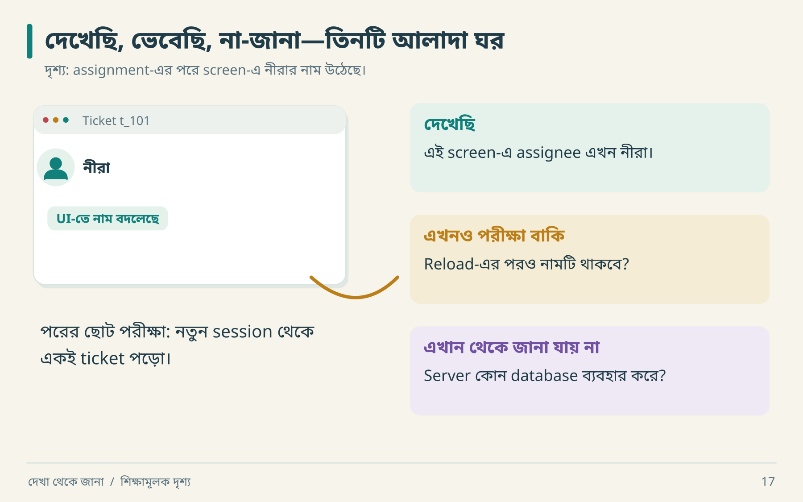
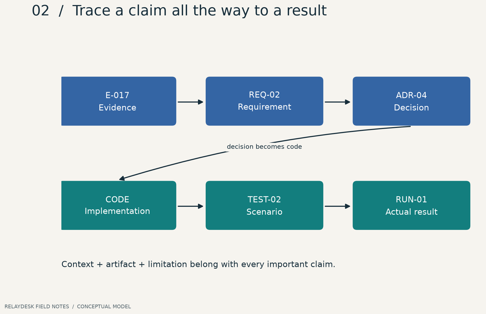

# ০৩ · প্রমাণের খাতা ও অনুমানের সীমানা

আরিফ বলল, “Assign করার পর নাম বদলেছে, কাজেই database update হয়েছে।” নীরা বলল, “তোমার বাক্যের প্রথম অংশ observation; দ্বিতীয় অংশ আরও প্রমাণ চায়।” এক বাক্যে দুই ধরনের জ্ঞান লুকিয়ে ছিল।

## ছয়টি ঘর, ছয়টি অর্থ



একই দৃশ্য থেকে তিনটি বাক্য বের হলো। প্রথমটি এখনই খাতায় লেখা যায়। দ্বিতীয়টির জন্য নতুন read দরকার। তৃতীয়টির উত্তর screen-এ নেই। নিচের ছয়টি label এই বাক্যগুলোকে গুছিয়ে রাখার নামমাত্র।

| শ্রেণি | সাধারণ ভাষায় | RelayDesk উদাহরণ |
|---|---|---|
| `OBSERVED` | সরাসরি দেখেছি | request body-তে `assignee_id` ছিল |
| `DERIVED` | দেখা data থেকে হিসাব | ১০টির মধ্যে ৮টির error shape এক |
| `INFERRED` | evidence-সমর্থিত ব্যাখ্যা | request path-এ কোনো permission enforcement আছে |
| `ASSUMED` | কাজের জন্য ধরে নিচ্ছি | replacement-এ single region যথেষ্ট |
| `UNKNOWN` | এখনো জানি না | original queue provider |
| `CONTRADICTED` | নতুন evidence-এ আগের দাবি টেকেনি | “search সঙ্গে সঙ্গে update হয়” |

এই শ্রেণিগুলো quality rank নয়। সুন্দরভাবে লেখা `UNKNOWN` অনেক সময় ভিত্তিহীন `OBSERVED`-এর চেয়ে মূল্যবান। আর `DERIVED` দাবি নির্ভর করে input data ও calculation ঠিক থাকার ওপর।



**ছবি পড়ো:** প্রতিটি node-এর নিজস্ব ID আছে। শেষ test পাস হলেও প্রথম evidence-এর scope বেড়ে যায় না। Local lab-এর result দিয়ে real target-এর contract প্রমাণিত হয় না।

## একটি ভালো record খুলে দেখা

```json
{
  "id": "E-017",
  "question": "Assignment reload-এর পর থাকে?",
  "classification": "OBSERVED",
  "context": {"build": "demo-v3", "actor": "member_A", "workspace": "ws_a"},
  "method": "assign → hard reload → read details",
  "finding": "নতুন assignee দেখা গেছে",
  "limitations": ["দ্বিতীয় device পরীক্ষা হয়নি", "concurrent update হয়নি"],
  "artifact": "captures/E-017.json",
  "requirement": "REQ-ASSIGN-02"
}
```

এটি শিক্ষামূলক record; ওই capture এই repository-তে নেই। বাস্তবে artifact path সত্যিই থাকা চাই। এই বইয়ের থাকা উদাহরণটি [examples/evidence.json](../examples/evidence.json), যা local lab report-এর দিকে নির্দেশ করে।

## Confidence নিয়ে একটি সতর্ক হিসাব

“Confidence ৯৭%”—কীসের probability? কোন model? কোন sampling process? উত্তর না থাকলে সংখ্যাটি সাজসজ্জা। বরং লেখো: “একই build-এ তিন account-এ পুনরাবৃত্ত হয়েছে; permission revoke case অদেখা।” এতে reader জানবে কোথায় বিশ্বাস করবেন, কোথায় পরীক্ষা করবেন।

দুটি observer একই ফল পেয়েছেন বলেই independent evidence হয় না। দুজন যদি একই cached response দেখেন, তাদের ভুলও একই উৎস থেকে আসতে পারে। Evidence-এর **স্বাধীনতা** এবং **প্রাসঙ্গিকতা** গুরুত্বপূর্ণ।

## দাবি বদলানোর dry run

| ধাপ | কী পাওয়া গেল | খাতায় কী বদলাবে |
|---|---|---|
| ১ | Update-এর পর search-এ পুরোনো title | `OBSERVED` timing record |
| ২ | ২ সেকেন্ড পরে নতুন title | immediate consistency claim `CONTRADICTED` |
| ৩ | দুই session-এ একই delay | async projection একটি `INFERRED` explanation |
| ৪ | worker code পাওয়া যায়নি | queue technology `UNKNOWN` থাকবে |

Search delay দেখেই “Elasticsearch আছে” লেখা যায় না। একই ফল database replica, cache, debounce, periodic refresh বা index pipeline থেকেও আসতে পারে।

## Traceability: AI-কে accountable করার সহজ পথ

```text
E-017 → REQ-ASSIGN-02 → ADR-004 → assignment_service.py
      → TEST-RELOAD-02 → RUN-2026-10-29
```

Source evidence নেই, কিন্তু product requirement আছে? সেটিও বৈধ requirement। উৎস লিখবে `product decision`। Source fidelity এবং replacement improvement যেন এক ঘরে মিশে না যায়।

**নিজে করো—Q03:** `Server: nginx` header দেখে “backend Python” লিখলে কোন শ্রেণি হওয়া উচিত? ওই claim-এর সমস্যাটি কী? [উত্তর](../appendices/B-workbook.md)।

<!-- book-navigation -->

---

[← অজানা রিপোজিটরিতে প্রথম অভিযান](../chapters/02-reconnaissance.md) · [সূচি](../README.md) · [পাতার তালিকা থেকে আচরণের মানচিত্র →](../chapters/04-product-map.md)
