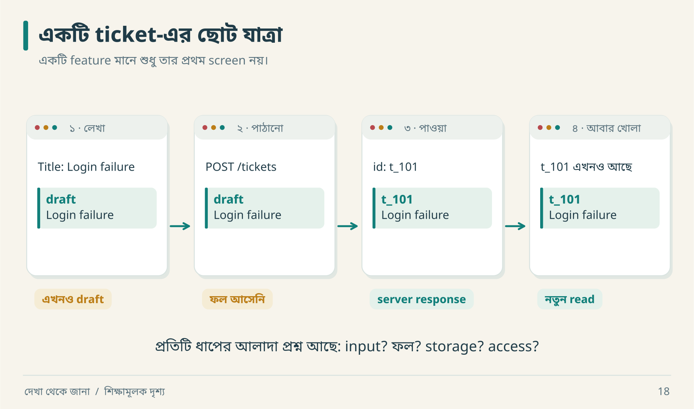

# ০৪ · পাতার তালিকা থেকে আচরণের মানচিত্র

“Dashboard, Tickets, Settings—তিন page। তিন দিনে শেষ?” আরিফের হিসাব মন্দ নয়, যদি page-গুলো ক্যালেন্ডারের পাতা হয়। Software page-এর মধ্যে অনেক state, permission ও failure লুকিয়ে থাকে।

## একটি feature card



দ্বিতীয় frame-এ network কেটে দাও। User শুধু জানেন তিনি পাঠিয়েছেন; ticket তৈরি হয়েছে কি না এখনও জানেন না। তাই feature card-এ “create” লিখলেই শেষ হয় না—এই মাঝের অবস্থাটি থেকে ফেরার পথও লাগে।

| ক্ষেত্র | Assign Ticket-এর প্রস্তাবিত contract |
|---|---|
| Actor | workspace-এর assignment permission থাকা member |
| Entry point | ticket details-এর assignee menu |
| Preconditions | ticket আছে; assignee একই workspace-এর eligible member |
| Input | ticket ID, assignee ID, expected version |
| Durable result | assignee বদলাবে; version বাড়বে |
| Side effect | activity; notification pending হতে পারে |
| Failure | forbidden, invalid assignee, stale version |
| Recovery | conflict-এ নতুন state পড়ে সিদ্ধান্ত |
| Verification | অন্য member দিয়ে read, refresh, invalid actor, stale write |

Card-এর প্রত্যেক requirement-এর source যোগ করতে হবে। এই card আমাদের teaching design; মূল target-এর প্রত্যক্ষ evidence নয়।

## Dependency-র তিন রং

```text
Identity → Authorization → Domain validation → Ticket write
                                                   │
                                      একই transaction-এ outbox
                                                   │
                                              পরে worker
                                                ↙     ↘
                                       notification   search projection
```

**আগে দরকার:** identity ও authorization। **একসঙ্গে commit দরকার:** ticket ও সংশ্লিষ্ট outbox record, যদি সেই pattern বাছাই করো। **পরে হতে পারে:** notification বা search update, যদি contract eventual consistency অনুমোদন করে।

সব arrow এক ধরনের relationship নয়। “A ছাড়া B শুরু হয় না”, “A ও B atomically commit হয়”, “A থেকে B পরে derive হয়”—আলাদা লিখলে architecture discussion অনেক নির্দিষ্ট হয়।

## Journey matrix বানাও

| Journey | New member | Existing member | Revoked member | Network failure |
|---|---|---|---|---|
| Create | onboarding policy | allowed | reject | outcome uncertain হলে reconcile |
| Assign | role-dependent | permission-dependent | reject | current assignee যাচাই |
| Search | tenant scoped | tenant scoped | access removed | stale/error state |

এখানে `role-dependent` মানে কাজ অসম্পূর্ণ নয়; rule এখনো নির্দিষ্ট করতে হবে। Matrix-এর ফাঁকা ঘর investigation-এর কাজ প্রকাশ করে।

## Scope ছোট করার ভালো পদ্ধতি

প্রথম slice-এ attachment বাদ দিতে পারো। কিন্তু attachment button রেখে fake upload success দেখানো হলে reader ভুল contract শিখবে। Scope-এ বাদ দেওয়া outcome UI-তেও সত্যভাবে প্রকাশ করতে হবে।

একটি dependency graph থেকে plan বের করো: create ticket পরীক্ষা করতে authentication-এর production provider দরকার নাও হতে পারে; lab-এ trusted actor fixture যথেষ্ট। কিন্তু fixture-কে বাস্তব login security বলা যাবে না।

**নিজে করো—Q04:** “Search” feature-এর জন্য তিনটি hidden dependency ও দুটি failure case লেখো। [উত্তর](../appendices/B-workbook.md)।

<!-- book-navigation -->

---

[← প্রমাণের খাতা ও অনুমানের সীমানা](../chapters/03-evidence.md) · [সূচি](../README.md) · [গোয়েন্দার মতো পরীক্ষা সাজাও →](../chapters/05-experiments.md)
