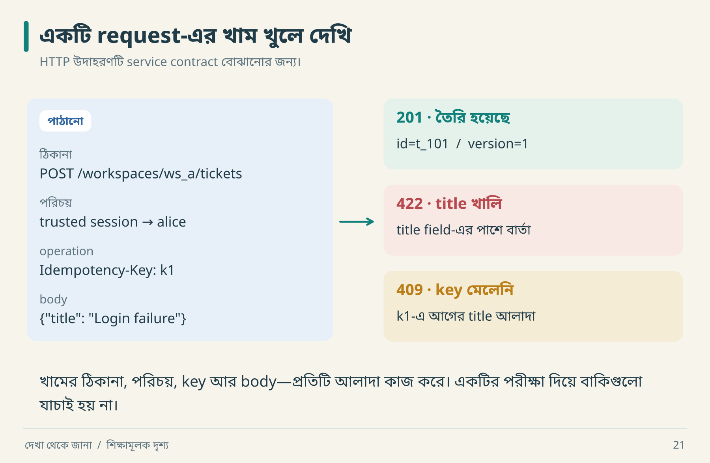

# ০৭ · API-এর প্রতিশ্রুতি পড়তে শেখা

API হলো দুই পক্ষের যোগাযোগের নিয়ম। একটি successful request সেই নিয়মের একটি উদাহরণ; সব বৈধ input, failure ও ordering-এর পূর্ণ তালিকা নয়।

## একটি প্রস্তাবিত create contract



খামটি খুলে চারটি অংশ আলাদা করো। `ws_a` বলে কাজটি কোথায়; trusted session বলে কে করছেন; `k1` বলে কোন operation; body বলে কী তৈরি হবে। একই title হলেও `k2` হলে সেটি আরেকটি submission হতে পারে।

```http
POST /api/workspaces/ws_a/tickets
Content-Type: application/json
Idempotency-Key: op-001

{"title":"Login failure"}
```

```json
{
  "id": "ticket_001",
  "workspace_id": "ws_a",
  "title": "Login failure",
  "status": "open",
  "version": 1
}
```

এটি আমাদের API design example। বইয়ের Python lab সরাসরি service function চালায়; এই HTTP route চালু করে না। `Idempotency-Key` এখানে বেছে নেওয়া application contract; প্রতিটি server স্বয়ংক্রিয়ভাবে এটি সমর্থন করে না।

## Request-এর বাইরে যে প্রশ্নগুলো থাকে

| বিষয় | নির্দিষ্ট প্রশ্ন | উদাহরণ সিদ্ধান্ত |
|---|---|---|
| Identity | actor কোথা থেকে আসে? | trusted session context |
| Validation | whitespace title বৈধ? | trim-এর পরে ১–১২০ character |
| Replay | একই key-তে payload বদলালে? | conflict |
| Ordering | একই timestamp হলে sort? | `(created_at, id)` tie-breaker |
| Pagination | cursor পুরোনো হলে? | contract অনুযায়ী error/continuation |
| Errors | machine-readable code আছে? | `version_conflict` |
| Compatibility | unknown field কী হবে? | গ্রহণ/ignore/reject লিখে দাও |

Character limit মানে bytes, Unicode code points, নাকি user-perceived grapheme clusters—এটিও contract। Lab-এর Python `len()` Unicode code points গুনছে; বাংলা যুক্তাক্ষরের দৃশ্যমান দৈর্ঘ্যের সমান নাও হতে পারে।

## Status code যথেষ্ট নয়

HTTP-এর idempotent method semantics intended server effect নিয়ে কথা বলে; একই response body ফেরত আসবেই—এমন দাবি নয়। `POST`-এর duplicate safety তোমার operation contract দিয়ে যোগ করতে হতে পারে। Conditional request-এ `If-Match` precondition ব্যর্থ হলে 412-এর মতো নির্দিষ্ট semantics আছে। [RFC 9110](https://www.rfc-editor.org/rfc/rfc9110.html)।

আমাদের service lab `version_conflict` দেয়। HTTP adapter লিখলে body-level expected version-এর জন্য 409 বেছে নিতে পারো; `If-Match` ব্যবহার করলে তার protocol semantics মানতে হবে। Code mapping যেন কেবল পছন্দের সংখ্যা না হয়।

```json
{
  "type": "https://example.invalid/problems/version-conflict",
  "title": "Ticket version conflict",
  "status": 409,
  "detail": "Read the current ticket before applying this change.",
  "instance": "/requests/req_007",
  "code": "version_conflict"
}
```

এটি Problem Details ধরনে error উদাহরণ; `code` extension field। বাস্তবে HTTP status ও body status সামঞ্জস্যপূর্ণ রাখতে হবে, sensitive internals প্রকাশ করা যাবে না। [RFC 9457](https://www.rfc-editor.org/rfc/rfc9457.html)।

## Pagination-এর ফাঁদ: হাতে গুনে দেখো

শুরুতে newest-first list: `[D,C,B,A]`। Page size ২। প্রথম page `[D,C]`। মাঝখানে `E` তৈরি হলো। Offset ২ দিয়ে পরের page নিলে `[C,B]`—C আবার এলো।

```text
আগে:      [ D  C ]  B  A       ← প্রথম page শেষ
নতুন E:   E  D  [ C  B ]  A    ← offset 2 এখন এখানে
                    ↑
                  C আবার!
```

Array-তে আঙুল দিয়ে দুই ঘর সরিয়ে দেখো। Offset একই থাকলেও তালিকার অবস্থান বদলে গেছে।

Cursor `(created_at,id)`-এর পরে continuation দিতে পারে। কিন্তু cursor ব্যবহার করলেই snapshot consistency নিশ্চিত নয়। Update/delete বা backdated record-এর policy আলাদা করে নির্ধারণ করতে হয়। “Pagination আছে” বলার চেয়ে “একই record দুবার আসবে কি?” ভালো প্রশ্ন।

## Boundary test menu

```text
Title lengths: 0, 1, 120, 121
Whitespace-only / wrong type / missing field
Member / nonmember / revoked member
Same key same payload / same key different payload
No records / one page / exact full page / last partial page
```

**নিজে করো—Q07:** একই idempotency key দিয়ে title বদলে দিলে পুরোনো success ফেরত দেওয়া কেন বিভ্রান্তিকর? [উত্তর](../appendices/B-workbook.md)।

<!-- book-navigation -->

---

[← একটি বাটনের আট রকম জীবন](../chapters/06-ui-state.md) · [সূচি](../README.md) · [ব্যবসার নিয়মকে পরীক্ষাযোগ্য করা →](../chapters/08-domain-rules.md)
