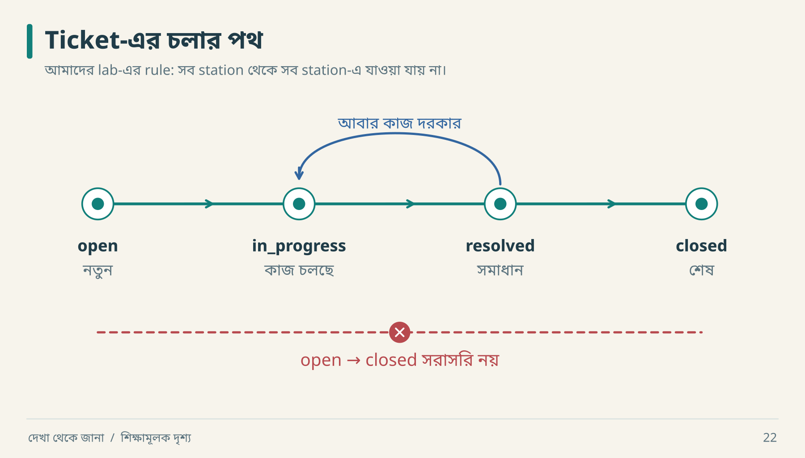

# ০৮ · ব্যবসার নিয়মকে পরীক্ষাযোগ্য করা

Database-এ status string রাখা সহজ। কোন actor কখন কোন status দিতে পারেন, সেটিই business logic। `UPDATE tickets SET status = ...` নিজে কোনো product policy জানে না।

## তিনটি আলাদা যন্ত্র



আরিফ `open` ticket-কে এক লাফে `closed` করতে চায়। ছবির লাল shortcut-টি আমাদের lab-এ বন্ধ। কিন্তু `resolved` থেকে আবার `in_progress`-এ ফেরা যায়। একই “status change” কথার মধ্যে তাই বৈধ ও অবৈধ—দুই ধরনের move আছে।

| যন্ত্র | প্রশ্ন | উদাহরণ |
|---|---|---|
| State machine | কোথা থেকে কোথায় যাব? | open → in_progress |
| Invariant | কোন শর্ত ভাঙা যাবে না? | ticket-এর workspace অবশ্যই নির্দিষ্ট |
| Decision table | একাধিক শর্তে সিদ্ধান্ত কী? | valid actor + current version + allowed transition |

Lab-এর transition contract:

```text
open → in_progress → resolved → closed
                       │
                       └────────→ in_progress
```

Closed terminal। Reopen করতে হলে নতুন product decision ও test প্রয়োজন। Original product-এ closed reopen হতে পারে; এই teaching rule-কে তার ওপর চাপানো যাবে না।

## Transition table থেকে test

| From | To | Lab-এর ফল | কেন |
|---|---|---|---|
| open | in_progress | allow | কাজ শুরু |
| open | closed | reject | মধ্যবর্তী নিয়ম এড়িয়ে যায় |
| resolved | in_progress | allow | পুনরায় কাজ প্রয়োজন |
| closed | open | reject | terminal contract |
| in_progress | in_progress | reject | self-transition সংজ্ঞায়িত নয় |

একই state আবার set করলে no-op হবে, event হবে, নাকি reject হবে—তিনটিই সম্ভাব্য design। না লিখলে agent নিজের মতো বেছে নেবে। এই lab reject করেছে।

## Decision table: ভুলের অগ্রাধিকার

| Actor member? | Resource in requested workspace? | Version current? | Transition valid? | Result |
|---|---|---|---|---|
| না | — | — | — | forbidden |
| হ্যাঁ | না | — | — | not_found |
| হ্যাঁ | হ্যাঁ | না | — | version_conflict |
| হ্যাঁ | হ্যাঁ | হ্যাঁ | না | invalid_transition |
| হ্যাঁ | হ্যাঁ | হ্যাঁ | হ্যাঁ | update + version increment |

`—` মানে ওই সিদ্ধান্তের জন্য আর পরীক্ষা দরকার নেই। এই precedence আমাদের design। একটি request-এ একাধিক ভুল থাকলে কোন error দেখানো হবে, সেটিও observable behavior।

## Invariant: scope না বললে বাক্য অসম্পূর্ণ

“একই request-এ একটিই ticket”—কোন request identity? Lab-এ scope হলো `(actor, workspace, key)`। একই title দিয়ে নতুন key দিলে নতুন ticket বৈধ। Title-কে duplicate identity করলে দুইজনের একই সমস্যা report করা আটকে যাবে।

“Version বাড়বে”—সব read-এ নয়; accepted transition-এ এক বাড়বে। Failed transition-এ state অপরিবর্তিত থাকবে। এই negative condition test-এ লেখা জরুরি।

```text
Given: ticket open, version=1, actor authorized
When: expected_version=1 দিয়ে in_progress করা হয়
Then: status=in_progress, version=2
And: expected_version=1 দিয়ে পরের update প্রত্যাখ্যাত
And: failed update version বা status বদলায় না
```

## নতুন তথ্য এলে নিয়ম বদলাও

ধরা যাক, real observation-এ closed ticket-এ comment করলে reopen হয়। তাহলে `comment` শুধু CRUD নয়; status transition trigger। Inventory, state machine, audit behavior ও regression test—সবগুলো update করতে হবে। একটি জায়গায় code patch করলেই knowledge model সঠিক হয় না।

**নিজে করো—Q08:** “Ticket delete হলে আর দেখা যাবে না”—বাক্যটির কোন তিনটি scope নির্দিষ্ট করা প্রয়োজন? [উত্তর](../appendices/B-workbook.md)।

<!-- book-navigation -->

---

[← API-এর প্রতিশ্রুতি পড়তে শেখা](../chapters/07-api-contract.md) · [সূচি](../README.md) · [ডেটার মালিক, কপি ও বিদায় →](../chapters/09-data-lifecycle.md)
