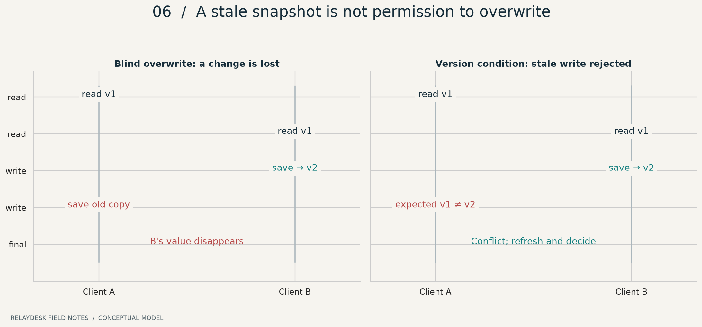
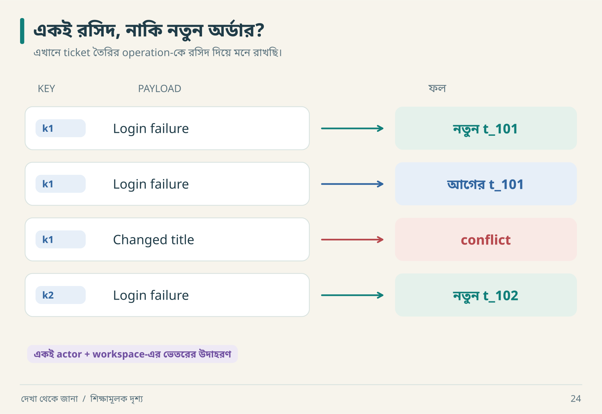
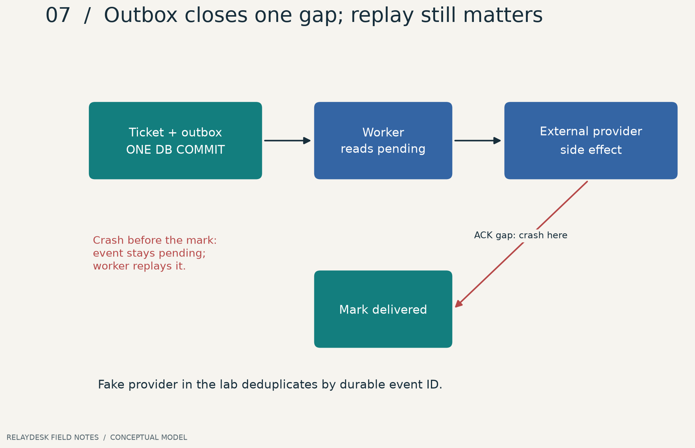

# ১০ · একই সময়ে দুজন: সময়ের ফাঁদ

আরিফ আর নীরা একই ticket খুলল। দুজনের কাছে version ১। নীরা status বদলাল; আরিফ পুরোনো form থেকে title বদলে পুরো object পাঠাল। Title ঠিক হলো, status আবার পুরোনো। Software-এ time travel ঘটেছে, কিন্তু product requirement-এ ছিল না।

## ১০.১ Lost update হাতে চালাও



| ধাপ | আরিফ | নীরা | Durable state |
|---|---|---|---|
| ১ | পড়ে: open, v1 | | open, v1 |
| ২ | | পড়ে: open, v1 | open, v1 |
| ৩ | | in_progress save | in_progress, v2 |
| ৪ | v1 copy পাঠায় | | conflict অথবা lost update |

Version-based design-এ update condition হবে current version == expected version।

```sql
UPDATE tickets
SET status = :new_status, version = version + 1
WHERE id = :ticket_id
  AND workspace = :workspace
  AND version = :expected_version;
```

Affected row ০ হলে কারণ জানতে হবে: stale version, missing resource, নাকি scope mismatch? Lab membership ও lookup আগে করে, transaction-এর মধ্যে compare করে; update-এর row count-ও পরীক্ষা করে। SQL fragment একা পূর্ণ authorization implementation নয়।

একটি গুরুত্বপূর্ণ ফাঁদ: `SELECT version` করে transaction/atomic condition ছাড়া পরে unconditional `UPDATE` করলে মাঝের সময়ে আরেক write ঢুকতে পারে। Check এবং effect-এর সম্পর্কই correctness নির্ধারণ করে।

**গভীর সীমা:** প্রতি-record version check সব multi-record invariant রক্ষা করে না। “দুই doctor-এর অন্তত একজন on-call থাকবেন” নিয়মে দুজন আলাদা row update করলে প্রত্যেকে নিজের version ঠিক পেয়েও যৌথ নিয়ম ভাঙতে পারেন। Isolation, locks বা constraint কী লাগবে তা invariant অনুযায়ী ঠিক করতে হয়। PostgreSQL-এর isolation level ও serialization retry সম্পর্কে তার নিজস্ব semantics পড়তে হবে; SQLite lab-এর ফল সেখানে সরাসরি প্রতিস্থাপন করা যায় না। [PostgreSQL transaction isolation](https://www.postgresql.org/docs/current/transaction-iso.html)।

## ১০.২ Idempotency: click count নয়, logical operation



একটি রসিদ হারিয়ে আবার তার copy চাইলে নতুন কেনাকাটা হয় না। ছবির দ্বিতীয় row-তে সেটাই হচ্ছে। তৃতীয় row-তে একই রসিদে অন্য জিনিস চাওয়া হয়েছে; চতুর্থ row-তে রসিদই নতুন। এবার key ও payload-এর আলাদা ভূমিকা দেখা যাচ্ছে।

**ছবির ফল ঢেকে বলো:** `k1 / Changed title`-কে চুপচাপ `t_101` ফেরত দিলে user কী ভুল বুঝবেন? তিনি ভাবতে পারেন নতুন title-টি সংরক্ষিত হয়েছে।

Lab identity = `(actor, workspace, key)`। Fingerprint = normalized title payload-এর hash।

```text
alice / ws_a / k1 / title=A → create t1, store original response
alice / ws_a / k1 / title=A → replay t1
alice / ws_a / k1 / title=B → conflict
alice / ws_a / k2 / title=A → create t2
bob   / ws_b / k1 / title=A → separate operation
```

Key browser refresh-এ বদলে ফেললে timeout retry নতুন operation হয়ে যাবে। আবার প্রতিটি আলাদা submission-এ একই key পুনর্ব্যবহার করলেও ভুল। User intent থেকে key lifecycle তৈরি করতে হবে।

**আরও চারটি contract প্রশ্ন:** key কতদিন রাখা হবে? In-flight duplicate এলে wait নাকি conflict? প্রথম failure replay হবে কি? Actor permission revoke হলে পুরোনো response replay করা যাবে কি? Lab-এ replay-এর আগেও membership check আছে; key expiry নেই। এটি ছোট lab-এর সীমা।

Lab original response সংরক্ষণ করে। Create-এর পরে status version ২ হয়ে গেলেও create replay version ১-এর response দিতে পারে; current resource জানতে read করবে। “Replay result” ও “current state” আলাদা endpoint semantics হতে পারে।

## ১০.৩ Outbox: দুই write-এর মাঝের গর্ত

খারাপ sequence: ticket commit → process crash → notification event কখনো তৈরি হলো না। Transactional outbox-এ ticket ও outbox row একই local transaction-এ লেখা হয়। Commit হলে দুটো থাকে; rollback হলে কোনোটিই থাকে না। তারপর worker external delivery চেষ্টা করে। [AWS transactional outbox guidance](https://docs.aws.amazon.com/prescriptive-guidance/latest/cloud-design-patterns/transactional-outbox.html)।



| Crash point | Ticket | Outbox | External effect | Recovery |
|---|---|---|---|---|
| commit-এর আগে | নেই | নেই | নেই | নতুন করে চেষ্টা |
| commit-এর পরে, send-এর আগে | আছে | pending | নেই | worker retry |
| send-এর পরে, mark-এর আগে | আছে | pending | হয়েছে | duplicate-safe retry দরকার |
| delivered mark-এর পরে | আছে | delivered | হয়েছে | সাধারণত শেষ |

শেষের আগের row-টাই “exactly once” দাবিকে কঠিন করে। শুধু local `processed=true` যথেষ্ট নয়। আগে mark করলে send হারাতে পারে; পরে mark করলে send duplicate হতে পারে।

Lab-এর fake provider **নিজের durable receipt table-এ event ID deduplicate করে**। তাই retry-এ effect count এক থাকে। বাস্তব email provider ওই guarantee না দিলে একই নিশ্চয়তা পাওয়া যায় না; reconciliation বা duplicate গ্রহণের policy প্রয়োজন হতে পারে।

## ১০.৪ অনুশীলন চালাও

```bash
python3 lab/run_lab.py
python3 -m unittest discover -s lab -p 'test_*.py' -v
```

এই lab-এ দুই thread, দুই database connection এবং barrier দিয়ে overlapping request পরীক্ষা আছে। SQLite `BEGIN IMMEDIATE` writers serialize করে। এটি বাস্তব network, multi-region deployment বা অসংখ্য interleaving-এর proof নয়। [পূর্ণ lab guide](16-vertical-lab.md)।

**নিজে করো—Q10:** Outbox থাকলে external side effect ঠিক একবার হবে—এই দাবির counterexample বলো। [উত্তর](../appendices/B-workbook.md)।

<!-- book-navigation -->

---

[← ডেটার মালিক, কপি ও বিদায়](../chapters/09-data-lifecycle.md) · [সূচি](../README.md) · [নেটওয়ার্কের চিহ্ন কী বলে →](../chapters/11-network.md)
