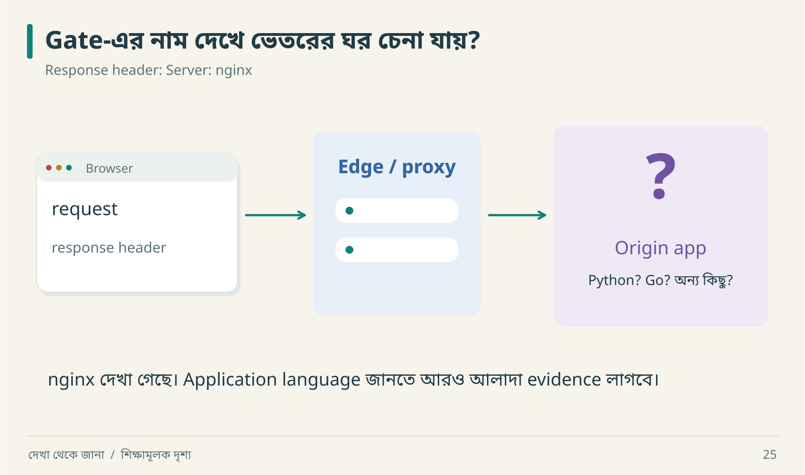

# ১১ · নেটওয়ার্কের চিহ্ন কী বলে

“Response-এ nginx আছে, তাহলে পুরো architecture জানি।” নীরা বলল, “বাড়ির gate-এর কোম্পানি দেখে রান্নাঘরের recipe বোঝা যায়?”

## Fingerprint থেকে fact নয়



গেটের নামটি পড়া যাচ্ছে; ভেতরের application language-টি নয়। একটি header-এর record তাই লিখতে পারো: `observed: Server=nginx; origin_language: unknown`। Unknown ঘর খালি রাখলে পরের তদন্তের জায়গাটি পরিষ্কার থাকে।

| চিহ্ন | সরাসরি observation | সম্ভাব্য ব্যাখ্যা | যা অজানা |
|---|---|---|---|
| `Server` header | একটি value এসেছে | edge/proxy/origin যোগ করেছে | application language |
| এক IP | ওই request একটি address-এ গেছে | load balancer বা single server | backend instance count |
| chunked/streamed output | data ধাপে এসেছে | streaming application/proxy buffering | exact model বা worker topology |
| long delay | end-to-end অপেক্ষা | network, queue, computation | কোন অংশ দায়ী |

Fingerprint spoofed, omitted বা intermediary থেকে আসতে পারে। অতএব architecture drawing-এ uncertain node-কে “candidate” লিখবে।

## Request-এর যাত্রা

```text
Client → DNS result → TLS endpoint → Edge / Gateway → Application
                                                  → Data / Dependencies
```

এটি observation-এর checklist; সব request-এ এই exact topology পাওয়া যাবে না। DNS, TLS, headers, redirects ও timing আলাদা evidence source। Browser network panel-এর একটি request থেকে origin database schema পাওয়া যায় না।

## Streaming-এর ছোট dry run

| সময় | Observable event | প্রশ্ন |
|---|---|---|
| t0 | request শুরু | request identity কী? |
| t1 | headers | HTTP success body complete বোঝায়? না |
| t2 | প্রথম chunk | partial result UI-তে safe? |
| t3 | connection কেটে গেল | server task এখনও চলছে? |
| t4 | reconnect | resume cursor আছে, নাকি নতুন task? |

Client disconnect মানে server operation cancel হয়েছে—এটি পরীক্ষা ছাড়া বলা যায় না। Side effect চললে duplicate task সৃষ্টি হতে পারে। Streaming output-এর completion marker ও operation state আলাদা model করা ভালো।

## ছোট investigation protocol

১. নিজের/অনুমোদিত test target ও account ঠিক করো।  
২. একটি প্রশ্ন নাও: redirect-এ authentication context থাকে কি?  
৩. Redacted request/response sequence রাখো।  
৪. Version, environment ও সময় লিখো।  
৫. Inaccessible internals unknown রেখেই observable contract লেখো।

লক্ষ্য protocol বোঝা; evidence ছাড়াই বড় infrastructure diagram বানালে decision ভুল দিকে যেতে পারে।

**নিজে করো—Q11:** response আসতে ২ সেকেন্ড লাগল। “Database slow” বলার আগে কোন দুটি measurement চাইবে? [উত্তর](../appendices/B-workbook.md)।

<!-- book-navigation -->

---

[← একই সময়ে দুজন: সময়ের ফাঁদ](../chapters/10-time-concurrency.md) · [সূচি](../README.md) · [পরিচয় আছে, অনুমতি আছে কি →](../chapters/12-security.md)
