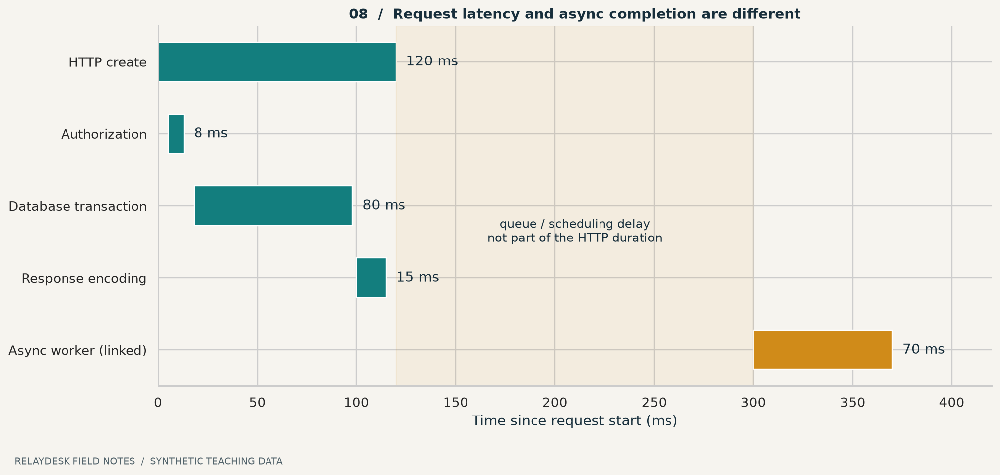

# ১৩ · সিস্টেমের গল্প শোনার যন্ত্র

“Save ধীর”—এটি একটি বাস্তব user symptom। “Database খারাপ”—এটি একটি hypothesis। মাঝের পথটি telemetry দিয়ে তৈরি করতে হয়। নীরা আরিফকে বলল, “প্রথমে stopwatch; পরে detective music।”

## তিনটি signal, তিনটি প্রশ্ন

| Signal | কী প্রশ্নের উত্তর দেয় | RelayDesk উদাহরণ |
|---|---|---|
| Log | নির্দিষ্ট ঘটনায় কী হয়েছে? | req_7-এ version conflict |
| Metric | অনেক ঘটনায় trend কী? | গত interval-এ error ratio |
| Trace | একটি operation কোন ধাপ পেরিয়েছে? | auth → DB → response |

Trace-এ spans operation-এর অংশ বোঝায়; parent/child relationship ও context propagation দিয়ে related কাজ যুক্ত হয়। Queue-তে পাঠানো কাজের trace context হারালে API ও worker-এর সম্পর্ক খুঁজে পাওয়া কঠিন। [OpenTelemetry traces](https://opentelemetry.io/docs/concepts/signals/traces/)।



**ছবি পড়ো:** এখানে HTTP request ১২০ ms-এ শেষ; worker ৩০০ ms-এ শুরু, ৩৭০ ms-এ শেষ। সব সংখ্যা synthetic। Worker-এর সময় HTTP latency-র মধ্যে যোগ করলে metric-এর অর্থ বদলে যাবে। পাশাপাশি চলা span-এর duration যোগ করলেও end-to-end latency পাওয়া যায় না।

## একটি incident-এর dry run

১. User বলে ticket তৈরি হয়েছে, notification আসেনি।  
২. Request log-এ ticket commit সফল।  
৩. Outbox pending count বাড়ছে।  
৪. Worker log-এ provider timeout।  
৫. তাই create endpoint rewrite করার আগে delivery path পরীক্ষা করবে।

```json
{
  "event": "notification_attempt_failed",
  "request_id": "req_007",
  "operation_id": "op_031",
  "event_id": "evt_019",
  "attempt": 3,
  "reason_code": "provider_timeout",
  "duration_ms": 2000
}
```

এটি illustrative log। Password, token বা ticket-এর পুরো private body এখানে প্রয়োজন নেই। Request ID log/trace-এ উপযোগী হলেও প্রতিটি request ID-কে metric label করলে cardinality অস্বাভাবিকভাবে বাড়তে পারে। Metric-এ সাধারণত bounded labels বেছে নাও।

## SLI থেকে SLO: সংখ্যা দিয়ে পরিষ্কার হও

Toy requirement: “এই demo observation window-এ valid create attempt-এর অন্তত ৯৯% durable success হবে।”

```text
SLI = durable_success / eligible_create_attempts
Window: নির্দিষ্ট ২৪ ঘণ্টা
Excluded: পূর্বনির্ধারিত invalid-input requests
Unknown outcomes: বাদ নয়; reconciliation শেষে শ্রেণিবদ্ধ
```

১০,০০০ eligible request-এর ৯,৯৫০ সফল হলে SLI = ৯৯.৫%। ৯৯% objective হলে ওই window-এ error budget ১০০ request; ব্যবহার হয়েছে ৫০। এটি একটি বানানো calculation, universal target নয়। পরে denominator বদলে bad requests বাদ দিয়ে SLO সুন্দর করা যাবে না।

Latency, traffic, errors ও saturation একসঙ্গে দেখা diagnosis-এ সাহায্য করে; average-এর পাশাপাশি distribution দেখার প্রয়োজনও আছে। [Google SRE monitoring](https://sre.google/sre-book/monitoring-distributed-systems/)।

## Alert-এ action চাই

“CPU ৮০%” সব সময় user impact নয়। “১০ মিনিট ধরে oldest pending notification বয়স contract ছাড়িয়েছে”—এতে affected outcome ও action স্পষ্ট। Alert-এর সঙ্গে owner, dashboard, diagnostic query এবং runbook রাখো। অন্যদিকে telemetry না আসা মানে error শূন্য—এমন সিদ্ধান্তও ভুল; signal pipeline-এর health জানতে হবে।

**নিজে করো—Q13:** API success ১০০%, notification backlog বাড়ছে। User journey সম্পূর্ণ বলা যাবে কি? কোন দ্বিতীয় SLI দরকার? [উত্তর](../appendices/B-workbook.md)।

<!-- book-navigation -->

---

[← পরিচয় আছে, অনুমতি আছে কি](../chapters/12-security.md) · [সূচি](../README.md) · [গড়ের আড়ালে ধীর মানুষগুলো →](../chapters/14-performance.md)
