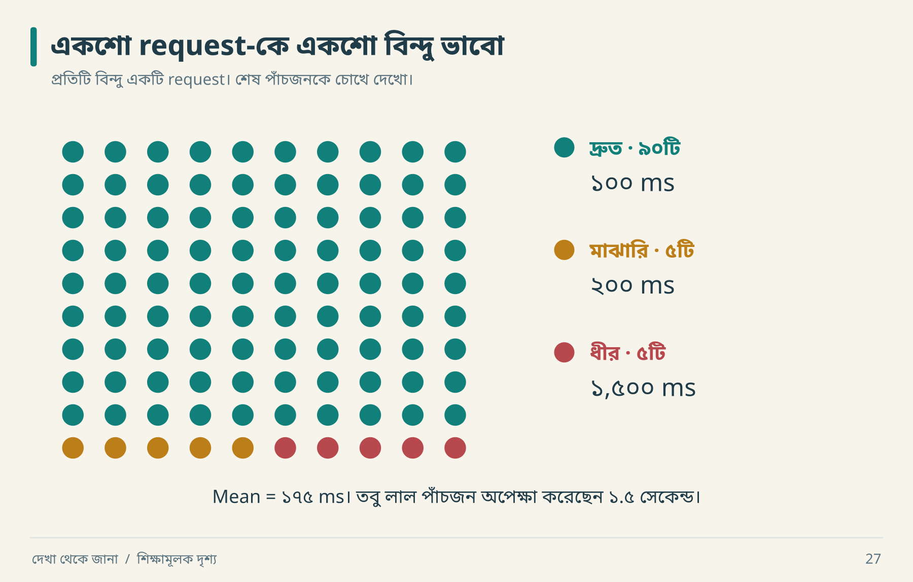
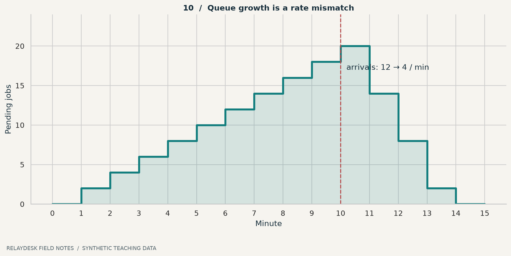
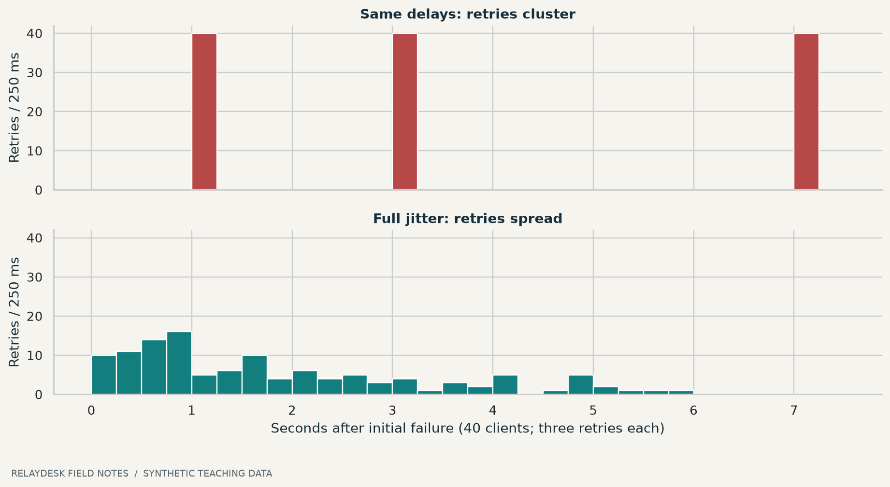

# ১৪ · গড়ের আড়ালে ধীর মানুষগুলো

আরিফ বলল, “Average latency মাত্র ১৭৫ ms!” নীরা বলল, “শেষ পাঁচজন user-এর মুখটাও দেখি।” গড় সংখ্যার একটি অভ্যাস আছে: খুব খারাপ অভিজ্ঞতাকে ভিড়ের মধ্যে লুকিয়ে ফেলতে পারে।

## ১৪.১ একশটি request হাতে গুনে দেখো



আগে শুধু বিন্দুগুলো দেখো। শেষ row-এর লাল পাঁচজনও user। এখন ১৭৫ ms average শুনলে তাদের অপেক্ষার কথাটি মনে থাকবে। নিচের অঙ্ক একই ছবির হিসাব।

| Request সংখ্যা | প্রতি request latency | মোট সময় |
|---:|---:|---:|
| ৯০ | ১০০ ms | ৯,০০০ ms |
| ৫ | ২০০ ms | ১,০০০ ms |
| ৫ | ১,৫০০ ms | ৭,৫০০ ms |
| **১০০** | | **১৭,৫০০ ms** |

Mean = ১৭,৫০০ ÷ ১০০ = ১৭৫ ms। **Nearest-rank** পদ্ধতিতে sorted array-এর `ceil(p × n)` নম্বর value নেওয়া হচ্ছে, যেখানে p হলো ০–১। তাই p50 = ১০০, p95 = ২০০, p99 = ১,৫০০ ms।


**ছবি পড়ো:** sample-এর ৫% request ১.৫ সেকেন্ড নিয়েছে। এই নির্দিষ্ট sample-এর p95 ২০০ হওয়া ওই পাঁচটির কষ্ট মুছে দেয় না। অন্য percentile interpolation ব্যবহার করলে সংখ্যাটি আলাদা হতে পারে; report-এ method লিখবে। n=100 থেকে production-এর স্থির p99 পাওয়া গেছে—এমন দাবি নয়।

Raw data: [latency.csv](../data/latency.csv)। Calculations: [summary.json](../data/summary.json)। এগুলো fixed teaching data, real benchmark নয়।

## ১৪.২ Queue-এর অঙ্ক

প্রতি মিনিটে ১২ job আসে, worker সর্বোচ্চ ১০টি শেষ করে। শুরুতে backlog ০। দশ মিনিটে backlog ২০। এরপর arrival ৪ হলে backlog প্রতি মিনিটে সর্বোচ্চ ৬ কমতে পারে।

```text
processed[t] = min(backlog[t] + arrivals[t], capacity[t])
backlog[t+1] = backlog[t] + arrivals[t] - processed[t]
```



**ছবি পড়ো:** backlog-এর count একা যথেষ্ট নয়; oldest job age-ও দেখবে। দশটি দীর্ঘ job বনাম একশটি tiny job-এর user impact ভিন্ন। এই toy model-এ job-এর service cost সমান, retry বা priority নেই।

## ১৪.৩ Retry দিয়ে আগুনে বাতাস দিও না

৪০ client একই সময়ে fail করল। সবাই ১, তারপর ২, তারপর ৪ সেকেন্ড অপেক্ষা করলে retry burst হয় cumulative ১, ৩, ৭ সেকেন্ডে। Full jitter-এ প্রতিবার ওই cap-এর মধ্যে random wait নেওয়ায় retries ছড়িয়ে পড়ে।



**ছবি পড়ো:** দুই policy-তেই ১২০ retry; chart retry কমানোর দাবি করে না। সময়ের concentration কমছে। Network delay ও request duration এখানে শূন্য ধরে model করা হয়েছে। Seed ৪২।

Retry-তে timeout, bounded attempts, backoff, jitter এবং operation-এর duplicate safety একসঙ্গে ভাবতে হয়। Failure overload থেকে হলে aggressive retry আরও চাপ দিতে পারে। [AWS timeouts, retries and jitter](https://aws.amazon.com/builders-library/timeouts-retries-and-backoff-with-jitter/)।

## ১৪.৪ Benchmark report-এর ন্যূনতম পরিচয়

```json
{
  "kind": "benchmark_plan_not_result",
  "workload": "create 70%, read 30%",
  "dataset": "10000 synthetic tickets",
  "concurrency": 20,
  "duration_seconds": 300,
  "cache_policy": "warm after documented warmup",
  "report": ["throughput", "latency_distribution", "errors", "resource_usage"],
  "execution": "NOT_RUN"
}
```

Original remote server ও replacement laptop-এর latency তুলনা করলে network/hardware confounder আছে। Fast failure response-কে successful request latency-র সঙ্গে মিশিয়ে দিলে broken system-ও “দ্রুত” দেখাতে পারে। Client-side measurement model-ও লিখবে: fixed arrival rate নাকি previous response-এর পরে next request? Slow system-এ দ্বিতীয়টি কম load পাঠিয়ে চাপ আড়াল করতে পারে।

**নিজে করো—Q14:** mean ১৭৫ ms দেখে “সব user দ্রুত response পান” বলা কেন ভুল? Queue chart-এ ১১তম মিনিট শেষে backlog কত? [উত্তর](../appendices/B-workbook.md)।

<!-- book-navigation -->

---

[← সিস্টেমের গল্প শোনার যন্ত্র](../chapters/13-observability.md) · [সূচি](../README.md) · [প্রয়োজন থেকে স্থাপত্য →](../chapters/15-architecture.md)
