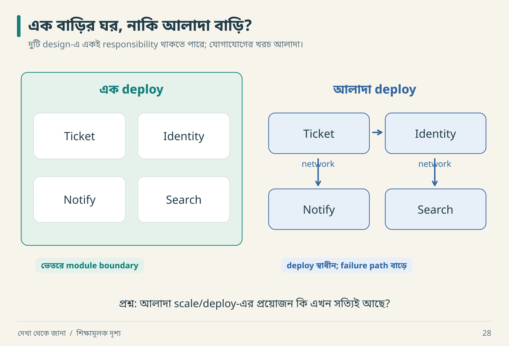

# ১৫ · প্রয়োজন থেকে স্থাপত্য

আরিফের shopping list: Kubernetes, message bus, service mesh, সাতটি database। নীরা জিজ্ঞেস করল, “কোন requirement-এর জন্য কোনটি?” Shopping list থেকে architecture হয় যখন responsibility ও trade-off বোঝানো যায়।

## তিনটি বিকল্প, তিন ধরনের খরচ



বাম বাড়িতেও Ticket ও Notify আলাদা ঘর। ডানদিকে তারা আলাদা deploy। এখন Notify ধীর হলে সেটিকে আলাদা scale করার প্রয়োজন আছে কি না দেখো। প্রয়োজন থাকলে boundary বদলানোর কারণ পাওয়া গেল; শুধু চারটি ঘর আছে বলে চারটি service লাগছে না।

| Design | সুবিধার সম্ভাবনা | নতুন খরচ | সিদ্ধান্তের কারণ হতে পারে |
|---|---|---|---|
| Modular monolith | এক deploy, সহজ local transaction | independent scaling কম সরল | ছোট team, পরিষ্কার module boundary |
| Services | আলাদা ownership/deploy/scale | network failure, data consistency, operations | বাস্তব independent requirements |
| Async processing | response path থেকে ধীর কাজ সরানো | retry, ordering, lag, recovery | delayed completion গ্রহণযোগ্য |

এগুলো পরস্পর সম্পূর্ণ exclusive নয়। Modular monolith-এর outbox worker থাকতে পারে। “Monolith” মানে সব code একটি file-এ রাখা নয়।

## Teaching lab-এর ADR

```text
Decision: SQLite + service functions + fake provider
Context: একজন reader যেন Python দিয়েই failure sequence চালাতে পারেন
Alternative A: in-memory dict — reopen persistence দেখাতে দুর্বল
Alternative B: real DB + broker — setup ও external dependencies বাড়ে
Trade-off: distributed deployment ও throughput পরীক্ষা হবে না
Revisit: real multi-instance service বা provider integration scope-এ এলে
```

Machine-readable record: [adr.json](../examples/adr.json)। এই সিদ্ধান্ত original-এর architecture আবিষ্কার নয়; শেখার উদ্দেশ্যে replacement design।

## Boundary আঁকার বাস্তব পদ্ধতি

Ticket module durable ticket state-এর owner। Notification module delivery status জানে। API controller input/output mapping করে। Controller-এর ভেতর একই সঙ্গে SQL, email retry ও permission policy ঢোকালে behavior test করা কঠিন হয়। তবে ছোট কাজের জন্য দশটি pass-through abstraction-ও দরকার নেই।

প্রতিটি boundary-র জন্য বলো:

1. কোন data-এর ownership আছে?
2. কী input/output contract?
3. কোন failure বাইরে দেখা যাবে?
4. কোন change স্বাধীনভাবে করা যায়?
5. Boundary ভাঙলে কোন test ধরবে?

## সিদ্ধান্ত বদলানোর dry run

আজ: দুই developer, low traffic, এক deployment। Modular monolith যথেষ্ট।

পরে: notification provider rate limit-এর কারণে worker scale ও release আলাদা দরকার। প্রথমে worker আলাদা deploy করা যায়; সব domain-কে microservice করতে হয় না। Extract করার আগে event schema, retry ownership ও compatibility ঠিক করতে হবে।

Architecture তখনই ভালো, যখন প্রয়োজনীয় behavior পূরণ করে এবং team তা চালাতে পারে। শুধু “industry standard” বললে reason অসম্পূর্ণ।

**নিজে করো—Q15:** কোন observable requirement একটি async worker যোগ করার যুক্তি হতে পারে? কোন নতুন verification লাগবে? [উত্তর](../appendices/B-workbook.md)।

<!-- book-navigation -->

---

[← গড়ের আড়ালে ধীর মানুষগুলো](../chapters/14-performance.md) · [সূচি](../README.md) · [একটি সম্পূর্ণ slice ও চলমান lab →](../chapters/16-vertical-lab.md)
