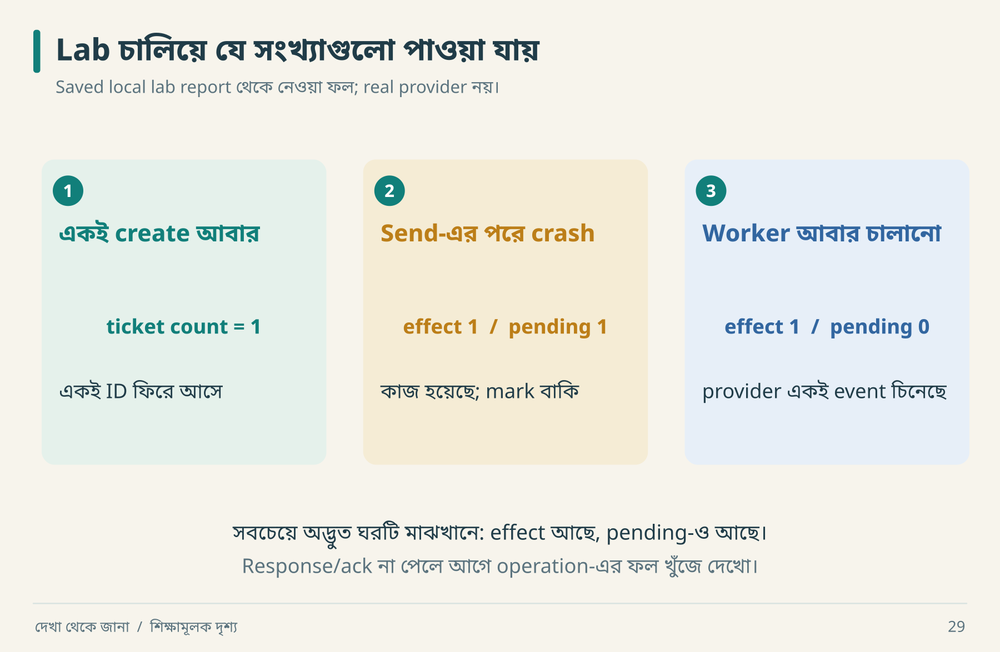

# ১৬ · একটি সম্পূর্ণ slice ও চলমান lab

Vertical slice হলো একটি ছোট outcome-এর সম্পূর্ণ পথ। “সব screen বানানো” horizontal কাজ; “একজন অনুমোদিত user একটি ticket তৈরি করে reload-এর পরও পান” একটি outcome।

## Slice-এর anatomy

```text
Input → validation → authorization → domain rule
      → transaction → response → visible confirmation
      → failure path → recovery → verification
```

পূর্ণ UI application-এ input form ও browser interaction থাকবে। **এই repository-র lab service-level slice**: UI, HTTP adapter এবং real login বাদ। Contract, persistence, conflict ও side effect recovery এখানে চালানো যায়। একে full production application বলা হবে না।

## প্রথম চালানো: কোনো package install নয়

Repository root-এ terminal খোলো। Python 3.10+ এবং standard `sqlite3` module প্রয়োজন।

```bash
python3 lab/run_lab.py --output reports/lab-results.json
python3 -m unittest discover -s lab -p 'test_*.py' -v
```

Windows-এ command `python` বা `py -3` হতে পারে। Chart rebuild-এর package lab-এর জন্য দরকার নেই। Script temporary directory-তে SQLite database তৈরি করে শেষে পরিষ্কার করে; কোনো email বা network call করে না। Python-এর `sqlite3` দিয়ে file database-এ সংযোগ করা যায়; connection বন্ধ করা ও transaction commit আলাদা দায়িত্ব। [Python sqlite3 documentation](https://docs.python.org/3/library/sqlite3.html)।

## কোন file কী কাজ করে

| File | কাজ | আগে পড়বে কেন |
|---|---|---|
| [relaydesk.py](../lab/relaydesk.py) | service, transaction, fake provider | behavior-এর implementation |
| [run_lab.py](../lab/run_lab.py) | ধারাবাহিক demonstration | story-এর সঙ্গে ফল মেলানো |
| [test_relaydesk.py](../lab/test_relaydesk.py) | ১৪টি contract test | claims-এর সীমা বোঝা |
| [lab-results.json](../reports/lab-results.json) | চালানো demo-এর output | expected বনাম actual মেলানো |

## Report-এর আগে নিজে predict করো



মাঝের card-এ একটু থামো: provider-এর কাজ হয়েছে, কিন্তু আমাদের outbox এখনও pending। এখন worker আবার চললে কী হবে? ডান card-এ fake provider একই event চিনেছে বলে effect আর বাড়েনি। Report-এর বড় JSON-টি এই তিনটি ছবিরই বিস্তারিত খাতা।

```json
{
  "duplicate_submission": {"same_id": true, "ticket_count": 1},
  "reopen": {"persisted": true},
  "cross_workspace": {"error": "forbidden"},
  "changed_payload": {"error": "key_payload_mismatch"},
  "stale_update": {"error": "version_conflict", "version": 2},
  "ack_gap": {"provider_effects": 1, "pending_events": 1},
  "worker_retry": {"provider_effects": 1, "pending_events": 0}
}
```

এটি demo output-এর বাছাই করা expected অংশ। সংরক্ষিত report-এ actual run দেখবে। `ack_gap`-এ pending ১ অথচ provider effect-ও ১—এই অবস্থাটি বুঝতে পারলে distributed failure-এর একটি বড় অংশ বুঝেছ।

## Create operation line-by-line যুক্তি

১. Title type ও normalized length validate।  
২. `BEGIN IMMEDIATE` দিয়ে transaction শুরু।  
৩. Actor ওই workspace-এর member কি না check।  
৪. Scoped key আগেই আছে কি? থাকলে fingerprint মেলাও।  
৫. নতুন হলে ticket, outbox, stored response লিখো।  
৬. সব ঠিক থাকলে commit; injected exception হলে rollback।  
৭. Original response ফেরত দাও।

Hash identity-এর বিকল্প নয়; এটি payload equality check-এর সহায়ক। JSON normalization ও included fields স্থির রাখতে হবে। নতুন field যোগ করে fingerprint-এ বাদ দিলে changed intent-ও replay হয়ে যেতে পারে।

## Test matrix খুলে পড়ো

| Test | যে ভুল ধরতে চায় |
|---|---|
| 01 | connection reopen-এ data হারানো |
| 02–03 | duplicate create / changed-payload replay |
| 04 | workspace boundary ভেঙে read বা write |
| 05–06 | stale version বা invalid transition গ্রহণ |
| 07 | ticket লেখা কিন্তু outbox/request record অসম্পূর্ণ |
| 08 | external side effect-এর পরে crash-এ duplicate |
| 09 | provider failure-এ pending কাজ হারানো |
| 10–11 | overlapping create/update-এ contract ভাঙা |
| 12 | title-এর boundary input |
| 13 | আলাদা actor/workspace-এর key সংঘর্ষ |
| 14 | replay response-কে current state ভেবে ফেলা |

Test 10–11-এ দুই thread একই barrier পার হয়ে operation চালায়। SQLite writer serialization গুরুত্বপূর্ণ; এ দিয়ে সব database-এর concurrency model প্রমাণ হয় না। Test 07 ও 08 **exception-based failure injection**, OS process kill বা power-loss experiment নয়।

## Lab-এর সীমা চিনে উন্নত করো

এখানে নেই: real HTTP authentication, role hierarchy, request-key expiry, multiple worker claim/lease, notification provider integration, telemetry pipeline, load benchmark বা production migration। Status transition-এ activity/outbox event তৈরি করা হয়নি; শুধু create-এর event আছে।

এগুলো লুকানো defect নয়, ঘোষিত scope। পরের exercise হিসেবে যেকোনো একটি যোগ করলে আগে contract লেখো। “Production-ready করে দাও” বললে scope আবার অসীম হয়ে যাবে।

## তিনটি পরিবর্তনের challenge

**সহজ:** whitespace-normalized title-এর replay test যোগ করো। `" A "` এবং `"A"` একই normalized payload কি না যাচাই করো।

**মাঝারি:** membership revoke operation ও replay-after-revoke test যোগ করো। পুরোনো successful response permission bypass করতে পারবে না।

**গভীর:** দুই worker-এর claim/lease model ডিজাইন করো। একজন external send-এর পরে crash করলে lease expiry ও provider deduplication কীভাবে একসঙ্গে কাজ করবে, লিখে তারপর implement করো।

**নিজে করো—Q16:** ১৪টি test পাসের পরে কোন তিনটি production claim করা যাবে না? [উত্তর](../appendices/B-workbook.md)।

<!-- book-navigation -->

---

[← প্রয়োজন থেকে স্থাপত্য](../chapters/15-architecture.md) · [সূচি](../README.md) · [দুই সিস্টেমের মুখোমুখি পরীক্ষা →](../chapters/17-verification.md)
