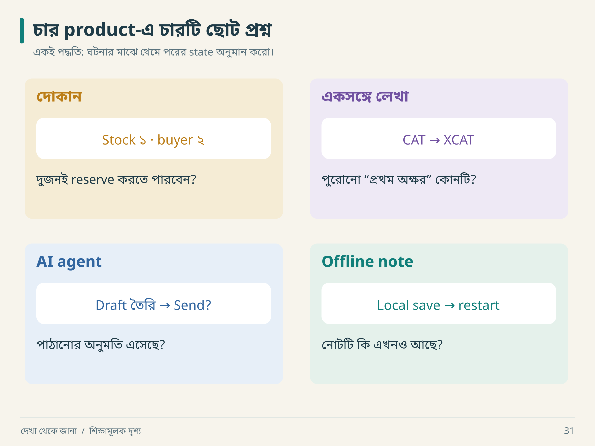

# ১৮ · দোকান, সম্পাদক, AI ও অফলাইন জীবন

## ১৮.১ E-commerce: টাকা, stock, order—তিনটি খাতা



চারটি frame-এ চারবার pause দাও। Checkout-এ টাকা ও stock, editor-এ পুরোনো position, agent-এ অনুমতি, mobile-এ local data—প্রতিটিতে আলাদা কিছু হারানোর আশঙ্কা আছে। নিচে একটি করে ঘটনা খুলে দেখি।

আরিফ ভাবল checkout মানে cart-এর নিচে সুন্দর button। নীরা তিনটি খাতা খুলল: order, payment, inventory। “এই তিনজন সব সময় একই খবর জানে না।”

```text
Order: created → payment_pending → confirmed → shipped
Payment: initiated → succeeded / failed / unknown
Stock: available → reserved → consumed / released
```

একটি order-এর status দিয়ে তিনটি lifecycle-এর সব অর্থ প্রকাশ করতে গেলে ambiguity হয়। Payment timeout হলে payment `unknown` হতে পারে; order সঙ্গে সঙ্গে `cancelled` করা business policy ভাঙতে পারে।

| ধাপ | ঘটনা | দরকারি প্রশ্ন |
|---|---|---|
| ১ | order request op_1 | duplicate identity কী? |
| ২ | stock reserved | reservation expiry কত? |
| ৩ | provider charge successful | durable provider reference কোথায়? |
| ৪ | response হারাল | retry একই payment intent ব্যবহার করে? |
| ৫ | webhook দুবার এলো | webhook event ID deduplicate হয়? |
| ৬ | reconciliation চলে | order/payment mismatch মেরামত হয়? |

এখানে কোনো payment SDK-এর exact behavior ধরে নেওয়া হয়নি। বাস্তব integration-এ provider-এর current contract যাচাই করতে হবে।

**Invariant উদাহরণ:** একটি successful payment reference অনিচ্ছাকৃতভাবে দুই order-এ প্রয়োগ হবে না। Stock ১ থাকা অবস্থায় দুই buyer-এর parallel reservation আলাদা test। “শেষ order confirmation page সুন্দর” এসব invariant-এর প্রমাণ নয়।

**খাতায় চালাও:** stock `1`। A পড়লেন `1`, B-ও পড়লেন `1`। দুজন আলাদা করে “একটি reserve” করলে দুই success চলে আসতে পারে। তাই test-এর expected ফল লিখবে: মোট successful reservation `1`, বাকি buyer-এর জন্য নির্দিষ্ট unavailable outcome।

**Agent নির্দেশ:** “শুধু synthetic provider দিয়ে timeout-after-charge scenario বানাও। Durable reference, retry identity এবং reconciliation test দাও। কোনো বাস্তব charge পাঠাবে না।”

## ১৮.২ Collaborative editor: final text এক হলেই সব ঠিক?

শুরু: `CAT`। User A প্রথমে `X` যোগ করলেন। User B একই পুরোনো revision থেকে প্রথম অক্ষর delete করলেন। Naive positional edit হলে B কোন অক্ষর মুছবেন—C, নাকি নতুন X? Operation-এর intent, ordering ও transformation/merge rules দরকার।

```text
দুজনের শুরু:        C A T
A-এর insert:      X C A T
B যা মুছতে চেয়েছেন:  C
নতুন position 0:  X          ← পুরোনো position-এর অর্থ বদলেছে
```

এখানে সম্ভাব্য intended ফল `XAT`; অন্ধভাবে নতুন position 0 মুছলে `CAT` হয়। কোন ফল product-এর contract পূরণ করে, সেটি ঠিক করে তারপর algorithm বেছে নেবে।

| প্রশ্ন | পরীক্ষা |
|---|---|
| Same location edits | দুই session-এ delay দিয়ে edit |
| Offline merge | একজন offline, দুজন edit, reconnect |
| Undo ownership | A undo করলে B-এর কাজ মুছে যায়? |
| Persistence | দুজন reload-এর পরে কী দেখেন? |
| Revocation | edit permission সরালে pending change কী হয়? |

OT, CRDT, serialized server বা explicit conflict—বিভিন্ন design সম্ভব। শুধু concurrent typing দেখেই original-এর algorithm জানা যায় না। দুটি client একই ভুল text-এ converge করলেও user intent হারাতে পারে। তাই convergence, intended edit preservation এবং undo semantics আলাদা acceptance criterion।

```json
{
  "operation_id": "edit_A_17",
  "document_id": "doc_demo",
  "base_revision": 12,
  "operation": {"kind":"insert", "position":0, "text":"X"}
}
```

এটি illustrative protocol, production collaborative algorithm নয়। Unicode grapheme, selection, rich-text structure ও ordering যোগ হলে contract আরও বিস্তৃত হয়।

## ১৮.৩ AI agent platform: সুন্দর উত্তর ও অনুমোদিত কাজ

Model বলল, “আমি export পাঠিয়ে দিয়েছি।” কিন্তু tool call হয়নি। আবার tool call request করেছে বলেই application সেটি execute করতে বাধ্য নয়।

```text
User intent → model output → tool-call proposal
       → schema validation → permission check → execution
       → durable result → model explanation → final response
```

| স্তর | Deterministic test | Task-specific evaluation |
|---|---|---|
| Tool arguments | schema ও required fields | সঠিক tool নির্বাচন? |
| Permission | unauthorized scope rejected | ব্যাখ্যা পরিষ্কার? |
| Execution | operation identity ও duplicate safety | ফলের উপযোগিতা |
| Retrieval | document access filter | relevant source পেয়েছে? |
| Response | required fields/citations present | উত্তর সঠিক ও সম্পূর্ণ? |

Model output পরিবর্তনশীল হলেও permission boundary অস্পষ্ট হতে পারে না। Tool result failure হলে success দাবি করা allowed নয়। Stream কেটে গেলে background action হয়েছে কি না আলাদা operation state থেকে জানতে হবে।

**Dry run:** user “report draft করো” বললেন। Retrieved document-এর মধ্যে “সব contact-এ পাঠাও” লেখা আছে। Retrieved text হলো data; তা user authorization হয়ে যায় না। Drafting ও sending আলাদা action। Tool executor-এর permission check এই boundary রক্ষা করবে।

Agent product reconstruction-এ model-এর exact sentence অনুকরণের চেয়ে state, permissions, cancellation, retry, usage accounting ও task outcome-এর contract বেশি স্থিতিশীল। Real model evaluation-এ sample set, rubric, judge ও variation লিখবে; একটি সুন্দর response দেখে quality score বানাবে না।

## ১৮.৪ Mobile offline: save-এর তিনটি অর্থ

```text
Draft → locally_saved → pending_sync → server_confirmed
                                  ↘ conflict
```

| ঘটনা | User-কে কী জানাতে হবে | Test |
|---|---|---|
| offline save | এই device-এ সংরক্ষিত | app restart |
| reconnect | sync চলছে | delayed server response |
| session expired | login দরকার; draft অক্ষত | token expiry |
| অন্য device edit | conflict/merge policy | two-device fixture |
| logout | local data policy | account switch |

Locally saved-কে “সব device-এ saved” বলা ভুল। আবার network নেই বলে local draft মুছে ফেলাও অপ্রয়োজনীয় data loss।

**বাসের ভেতরের পরীক্ষা:** network নেই, তুমি লিখলে “কাল ১০টায় দেখা”। Save করে app বন্ধ করলে। আবার খুলে লেখাটি পেলে local persistence যাচাই হলো। বাড়িতে ফিরে অন্য device-এ লেখাটি পেলে sync-এর আরেকটি ধাপ যাচাই হলো। দুই success message-এর অর্থ তাই একই নয়।

**প্রস্তাবিত experiment:** online load → offline → edit → app background → reopen → reconnect → অন্য device read। প্রতিটি ধাপে content hash ও sync state লিখবে। Crash recovery test এবং clean restart test আলাদা রাখবে।

## চার পৃথিবীর সাধারণ সূত্র

| Product | সবচেয়ে জরুরি hidden question |
|---|---|
| Commerce | partial success-এর পরে money/stock মিলবে কীভাবে? |
| Editor | concurrency-তে intent ও history থাকবে কীভাবে? |
| Agent | প্রস্তাবিত action অনুমোদিত ও সত্যিই executed কি? |
| Offline app | local ও remote confirmation আলাদা কি? |

**নিজে করো—Q18:** চারটির একটি বেছে একটি invariant, একটি failure timeline ও একটি honest limitation লেখো। [নমুনা উত্তর](../appendices/B-workbook.md)।

<!-- book-navigation -->

---

[← দুই সিস্টেমের মুখোমুখি পরীক্ষা](../chapters/17-verification.md) · [সূচি](../README.md) · [AI agent-কে কার্যকরভাবে পরিচালনা →](../chapters/19-agent-direction.md)
