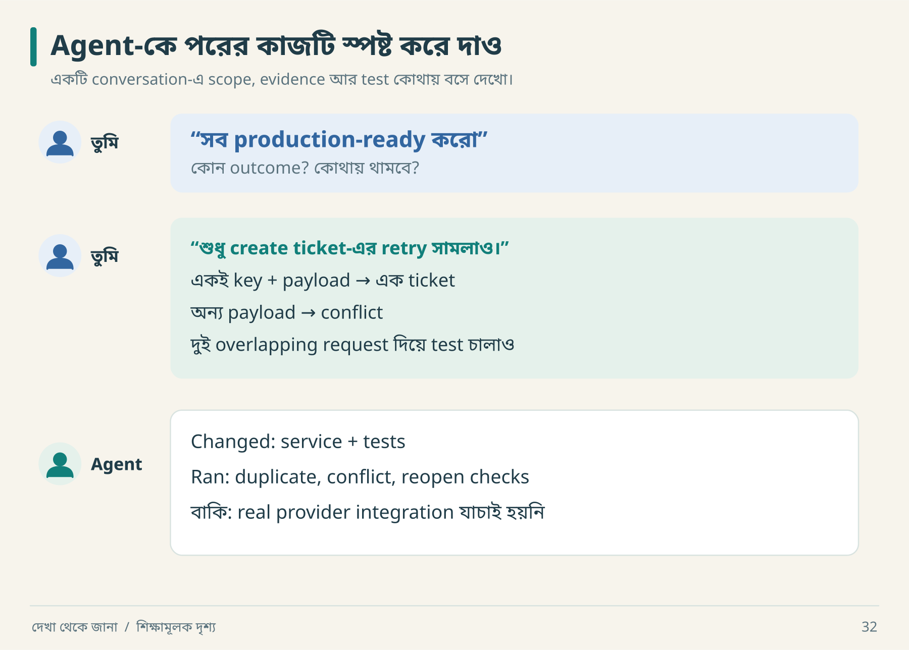

# ১৯ · AI agent-কে কার্যকরভাবে পরিচালনা

আরিফ AI-কে বলল, “Make it production-ready.” Agent অনেক file লিখল। নীরা জিজ্ঞেস করল, “কোন user outcome পাস করেছে?” File count নীরব রইল।

## Prompt-এর পাঁচটি কাজ



দ্বিতীয় message-টি পড়লে agent জানে কোন operation বদলাবে, কোন ফল চাই এবং কী পরীক্ষা চালাবে। শেষ message-এ তুমি শুধু “done” শুনছ না—কাজের সীমাটিও দেখতে পাচ্ছ। নিজের পরের prompt-এ একটি outcome ও একটি rejection case দিয়ে শুরু করো।

| অংশ | তুমি কী নির্ধারণ করবে |
|---|---|
| Outcome | user শেষ পর্যন্ত কী করতে পারবেন |
| Context | কোন code, evidence, contract পড়বে |
| Boundaries | কোন files/operations scope-এ |
| Acceptance | কীভাবে কাজ সঠিক প্রমাণ হবে |
| Handoff | actual result ও unknown কোথায় লিখবে |

## একটি কাজের prompt

```text
লক্ষ্য: Create Ticket service-এ duplicate submission সামলাও।
আগে পড়ো: existing service, tests, API contract ও unknowns register।
Contract: একই actor/workspace/key ও normalized payload এক ticket তৈরি করবে।
অন্য payload-এ একই key conflict হবে; অন্য tenant-এর key আলাদা থাকবে।
Ticket, idempotency record ও outbox একই transaction-এ লিখবে।
Existing architecture অনুসরণ করো; নতুন abstraction প্রয়োজন হলে কারণ লেখো।
Verify: sequential replay, overlapping requests, payload mismatch,
pre-commit failure এবং reopen persistence।
শেষে: changed files, actual test command/result, limitations ও next action দাও।
Original behavior-এর evidence না থাকলে এটিকে replacement decision বলো।
```

এই prompt থেকে প্রথম দুটি test সরাসরি পাওয়া যায়: একই payload দিয়ে retry করলে একই ticket ID; key রেখে payload বদলালে conflict।

## Agent ভুল পথে গেলে steering

| Agent-এর বক্তব্য | তোমার কার্যকর follow-up |
|---|---|
| “Everything complete” | “Requirement-wise result ও executed commands দেখাও।” |
| “Original Redis ব্যবহার করে” | “কোন evidence? না থাকলে inference/unknown আলাদা করো।” |
| “Tests updated to match output” | “Expected behavior-এর oracle কী ছিল?” |
| “Rewrite simpler হবে” | “প্রমাণিত defect ও existing behavior inventory আগে দাও।” |
| “Login works” | “Cross-workspace read/write এবং revoke test কোথায়?” |

একটি button-এর spacing বদলালে screenshot দিয়েই review হতে পারে। Retry বা permission বদলালে সংশ্লিষ্ট আচরণের test result-ও লাগবে।

## Multi-agent: যখন সত্যিই লাভ হয়

স্বাধীন evidence analysis, UI observation ও API contract review parallel করা যায়। একই core service file তিনজনকে edit করতে দিলে merge conflict-এর বাইরেও semantic contradiction হয়। Role ভাগের সঙ্গে ownership ও shared contract চাই।

```json
{
  "task_id": "TASK-API-01",
  "question": "Assignment error contract কী?",
  "inputs": ["evidence/E-017.json", "spec/assignment.md"],
  "write_scope": ["spec/api-errors.md"],
  "deliverable": "status/body matrix with evidence links",
  "done_when": "observed ও proposed behavior আলাদা; unknowns listed",
  "handoff": ["findings", "limitations", "conflicts", "next_experiment"]
}
```

এটি task contract উদাহরণ, এই tutorial বানাতে agent delegation হয়েছে—এমন দাবি নয়। Integration lead shared spec ঠিক রাখবেন, contradictory findings reconcile করবেন এবং integrated tests দেখবেন।

## Contradiction মেটানোর গল্প

Agent A বলল assignment failure 403। Agent B বলল 404। কে বেশি আত্মবিশ্বাসী, তা irrelevant। A nonmember actor দিয়ে পরীক্ষা করেছে; B member actor দিয়ে nonexistent ID দিয়েছে। Context আলাদা বলে দুই observation-ই সত্য হতে পারে।

একই context-এ contradictory ফল হলে version, cache, policy rollout ও test data দেখো। Evidence delete করে consensus বানাবে না।

## Context হারালে কী থাকবে

```text
Current scope → evidence → accepted decisions → implemented slices
             → executed verification → unresolved gaps → next actions
```

এই তথ্য repository artifacts-এ থাকলে নতুন agent-ও শুরু করতে পারেন। Chat transcript-ই একমাত্র memory হলে long task ভঙ্গুর হয়। [কপি করার control template](../templates/project-control.md) এবং [prompt cookbook](../appendices/C-prompts.md) ব্যবহার করতে পারো।

**নিজে করো—Q19:** “Clone this app perfectly” prompt-কে পাঁচ লাইনের executable assignment-এ বদলাও। [উত্তর](../appendices/B-workbook.md)।

<!-- book-navigation -->

---

[← দোকান, সম্পাদক, AI ও অফলাইন জীবন](../chapters/18-four-worlds.md) · [সূচি](../README.md) · [চালু হয়েছে থেকে চালিয়ে রাখা →](../chapters/20-production.md)
