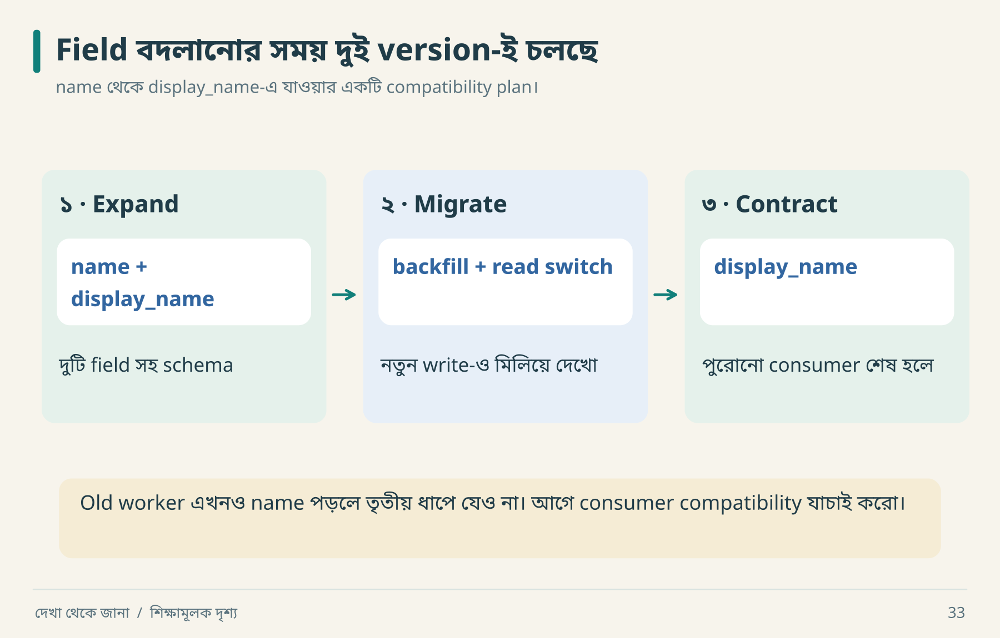

# ২০ · চালু হয়েছে থেকে চালিয়ে রাখা

আরিফ বলল, “Backup configured।” নীরা বলল, “Restore-এর পরে record পড়েছ?” Backup একটি promise; restore drill সেই promise পরীক্ষা করে।

## Production প্রশ্নের বাস্তব deliverable

| ক্ষেত্র | শুধু configuration | কার্যকর evidence |
|---|---|---|
| Build | Dockerfile আছে | clean environment-এ reproducible artifact |
| Migration | SQL file আছে | representative old data-তে upgrade result |
| Rollback | পুরোনো image আছে | নতুন schema-র সঙ্গে old app compatible |
| Backup | schedule আছে | isolated restore + integrity check |
| Health | process alive | critical synthetic journey passes |
| Alert | rule লেখা | controlled failure-এ signal ও response |

সব app-এ একই infrastructure লাগবে না। কিন্তু যে guarantee দিচ্ছ, তার verification লাগবে। এই tutorial lab production readiness পরীক্ষা করেনি।

## Migration: expand → migrate → contract



তৃতীয় frame-টি ঢেকে রাখো। Web app নতুন `display_name` পড়ছে, কিন্তু একটি পুরোনো worker এখনও `name` পড়ে। এখন column drop করলে worker ভাঙবে। ওই consumer-এর খবর না পাওয়া পর্যন্ত দ্বিতীয় frame-এই থাকো।

ধরা যাক, `name` field বদলে `display_name` করতে চাও। এক deploy-তে পুরোনো column drop করলে এখনও চলা old worker ভেঙে যেতে পারে। একটি সম্ভাব্য sequence:

1. নতুন compatible field যোগ করো।
2. Mixed-version period-এর read/write policy ঠিক করে deploy করো।
3. Existing data backfill করো; নতুন write miss হচ্ছে কি না যাচাই করো।
4. Consumers নতুন field ব্যবহার করছে নিশ্চিত করো।
5. Compatibility window শেষ হলে old field সরাও।

এটি pattern, প্রতিটি migration-এর ready-made solution নয়। Dual writes নিজেই inconsistency আনতে পারে; backfill idempotent কি না, source of truth কোন field, failure হলে কোথা থেকে resume—এসব নির্দিষ্ট করবে।

## Restore drill-এর dry run

```text
Input: নির্দিষ্ট backup snapshot + restore procedure
Environment: isolated test database
Check 1: expected row counts এবং domain invariants
Check 2: application read/write
Check 3: deletion/retention policy পুনঃপ্রয়োগ দরকার কি না
Measure: restore duration এবং latest recovered data time
Output: command log, result, discrepancy, recovery estimate
```

RPO হলো কতদূর পর্যন্ত data loss গ্রহণযোগ্য লক্ষ্য; RTO হলো recovery কত সময়ে করতে চাই। Backup interval একা achieved RPO প্রমাণ করে না—failed backup, replication lag ও restore point availability বিবেচনা করতে হয়। লক্ষ্য ও measured drill result আলাদা রাখবে।

## Release-এর পরে failure timeline

| সময় | ঘটনা | করণীয় |
|---|---|---|
| ১০:০০ | app v2 deploy | smoke journey |
| ১০:০৩ | worker v1 নতুন event parse করতে পারে না | backlog/parse error দেখো |
| ১০:০৫ | rollback বিবেচনা | schema ও event compatibility যাচাই |
| ১০:১০ | compatible worker restore | backlog drain পর্যবেক্ষণ |
| পরে | incident review | cause, missing check, regression |

“Rollback” একটি verb; তার সফলতা old binary, new schema, pending event ও external side effect-এর সম্পর্কের ওপর নির্ভর করে। External email ইতিমধ্যে গেছে—code rollback করে সেটি unsend করা যাবে না।

**নিজে করো—Q20:** backup job সবুজ, কিন্তু restore drill হয়নি। কোন status ও next action লিখবে? [উত্তর](../appendices/B-workbook.md)।

<!-- book-navigation -->

---

[← AI agent-কে কার্যকরভাবে পরিচালনা](../chapters/19-agent-direction.md) · [সূচি](../README.md) · [কতটা হলো: সৎ হিসাবের ভাষা →](../chapters/21-fidelity.md)
