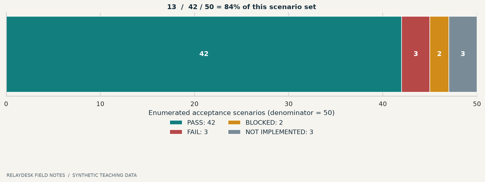
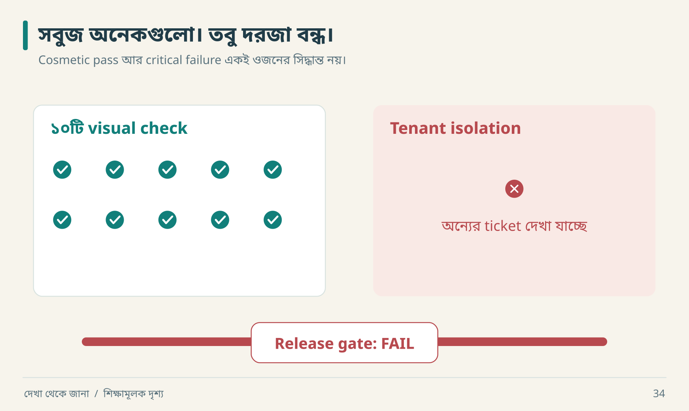

# ২১ · কতটা হলো: সৎ হিসাবের ভাষা

“আমরা ৯৯% done।” নীরা জিজ্ঞেস করল, “৯৯ কিসের মধ্যে? শেষ ১% কি button shadow, নাকি tenant isolation?” একই percentage-এর business অর্থ অনেক আলাদা।

## তিনটি আলাদা খাতা

| খাতা | Status উদাহরণ | কী বোঝায় |
|---|---|---|
| Evidence | observed, inferred, unknown | claim কোথা থেকে এসেছে |
| Implementation | implemented, partial, not implemented | code/feature-এর অবস্থা |
| Verification | pass, fail, blocked, not run | নির্দিষ্ট scenario-এর execution |

মূল লেখার milestone status—`VERIFIED`, `PARTIALLY VERIFIED`, `IMPLEMENTED, UNVERIFIED`, `ASSUMED`, `BLOCKED`, `NOT IMPLEMENTED`—summary-তে রাখা যায়। তবে test result-এর `FAIL`-কে `UNKNOWN` লিখে লুকাবে না। Agreed **out of scope** item-কে failed implementation হিসেবেও গুনবে না; exclusion আলাদা report করবে।

## Denominator হাতে হিসাব



```text
Defined acceptance scenarios = 50
PASS = 42; FAIL = 3; BLOCKED = 2; NOT IMPLEMENTED = 3
Coverage of defined set = 42 / 50 = 84%
Executed set = 45; pass within executed set = 42 / 45 ≈ 93.33%
```

দুটো ratio ভিন্ন প্রশ্নের উত্তর দেয়। দ্বিতীয়টি বললে nonexecuted পাঁচটির অবস্থাও জানাতে হবে। কোনোটিই পুরো অজানা software-এর “৮৪%/৯৩% exact clone” প্রমাণ করে না। Chart-এর সংখ্যা teaching example; lab-এর ১৪টি test result নয়।

## Release gate aggregate-এর ওপরে



এই board দেখে আর একটি মোট percentage হিসাব করার দরকার নেই। লাল ঘরটি অন্য workspace-এর data leak। আগে সেটি ঠিক হবে; দশটি সবুজ button check তার গুরুত্ব কমাচ্ছে না।

| Scenario | Critical? | Result | সিদ্ধান্ত |
|---|---|---|---|
| Create reload | হ্যাঁ | pass | এই condition verified |
| Tenant isolation | হ্যাঁ | fail | release gate failed |
| Hover animation | না | pass | cosmetic match |

একশটি cosmetic pass একটি data leak cancel করতে পারে না। Weighted score ব্যবহার করলে weight ও critical gates প্রকাশ করতে হবে; score দিয়ে explicit failure ঢেকে রাখা যাবে না।

## একটি সৎ milestone report

```text
Scope: create/read/assignment; export excluded by agreement
Verified: create persistence, sequential replay
Failed: stale assignment overwrites current assignee
Blocked: reference offline; new UI capture unavailable
Unknown: original queue vendor
Accepted difference: safer workspace authorization
Next actions:
1. stale write conflict fix
2. rerun concurrent assignment + regression
3. reference access এলে UI comparison
```

Unknown queue vendor critical blocker নাও হতে পারে, যদি behavior contract পূরণ করা যায়। কিন্তু unresolved stale write integrity issue release আটকে দিতে পারে। Completion judgment হলো requirement ও risk-এর বিচার।

## কখন থামবে

Agreed journey ও critical invariant-এর evidence আছে; necessary operational checks হয়েছে; remaining differences প্রকাশিত; responsible decision-maker scope ও residual risk জানেন—তখন milestone শেষ হতে পারে। অসীম investigation নয়; আবার সময় শেষকে verification বলা নয়।

**নিজে করো—Q21:** ৪২/৫০ এবং ৪২/৪৫—কোন বাক্যে কোন ratio ব্যবহার করবে? [উত্তর](../appendices/B-workbook.md)।

<!-- book-navigation -->

---

[← চালু হয়েছে থেকে চালিয়ে রাখা](../chapters/20-production.md) · [সূচি](../README.md) · [৩০ দিনের কাজভিত্তিক অনুশীলন →](../chapters/22-practice-plan.md)
