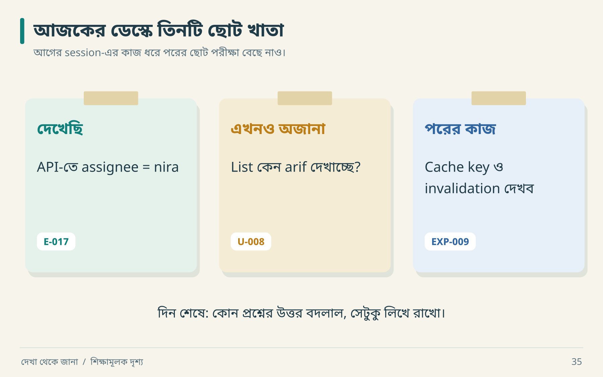

# ২৩ · প্রতিদিনের ছোট engineering সভা

সকালবেলা agent-কে “continue” বললে সে গতকালের সবচেয়ে গুরুত্বপূর্ণ unresolved বিষয় ধরবে—এমন নিশ্চয়তা নেই। একটি ছোট handoff file অনেক দীর্ঘ prompt-এর চেয়ে কাজে আসতে পারে।

## কাজ শুরুর পাঁচ প্রশ্ন



আজ সকালে এই তিনটি নোটই যথেষ্ট শুরু। দুপুরে যদি missing invalidation পাওয়া যায়, মাঝের নোটে উত্তর বসবে; ডানের নোট হবে “fix-এর পরে list + reload test”। এভাবেই handoff বদলাতে থাকে।

1. **জানা:** কোন claim evidence-backed?
2. **অজানা:** কোন uncertainty ভুল হলে সবচেয়ে বেশি ক্ষতি?
3. **পরের কাজ:** experiment, implementation, নাকি verification?
4. **শেষের শর্ত:** কী result পেলে এই task done?
5. **হিসাবের জায়গা:** কোন artifact update হবে?

## একই দিনের dry run

| সময় | Finding | সিদ্ধান্ত |
|---|---|---|
| ০৯:০০ | list stale হওয়ার অভিযোগ | reproduce before refactor |
| ০৯:২০ | API নতুন assignee দেয় | server write failure কম সম্ভাব্য |
| ০৯:৩৫ | list cache পুরোনো | mutation/cache path inspect |
| ১০:১০ | missing invalidation confirmed | ছোট fix |
| ১০:৩০ | regression pass | discrepancy verified |
| ১০:৪০ | concurrent update অদেখা | নতুন unknown, আলাদা task |

শেষ row-টি গুরুত্বপূর্ণ। একটি bug fix হওয়ার পরে “সব assignment safe” বলা scope বাড়িয়ে দেওয়া।

## Useful handoff

```text
Current outcome: assignment list/details consistency
Verified: normal update + reload
Changed: cache invalidation in mutation success path
Actual tests: command এবং saved report path
Still unknown: two simultaneous assignees changing same ticket
Next: version conflict scenario; expected result লিখে শুরু করো
Do not assume: original uses the same cache library
```

## সপ্তাহের শেষে ছোট review

যে tool call নতুন evidence দিচ্ছে না, তা বন্ধ করো। যে assumption design-কে নিয়ন্ত্রণ করছে, তা experiment বা ADR দিয়ে পরিষ্কার করো। যে fixture real integration সেজে আছে, তাকে আলাদা চিহ্নিত করো। যে test বারবার flaky, তার timing, isolation ও oracle পরীক্ষা করো। শুধু retry দিয়ে green করা diagnosis নয়।

আত্মবিশ্বাস নয়, uncertainty কমার ইতিহাস দেখো। আজ একটি গুরুত্বপূর্ণ ভুল ধারণা বাদ দিতে পারলে সেটিও progress।

**নিজে করো—Q23:** “আজ অনেক code লিখেছি” বাক্যটি তিনটি evidence-backed progress statement-এ বদলাও। [উত্তর](../appendices/B-workbook.md)।

<!-- book-navigation -->

---

[← ৩০ দিনের কাজভিত্তিক অনুশীলন](../chapters/22-practice-plan.md) · [সূচি](../README.md) · [মাঠের খাতা: ২৫টি স্মরণসূত্র →](../chapters/24-field-guide.md)
