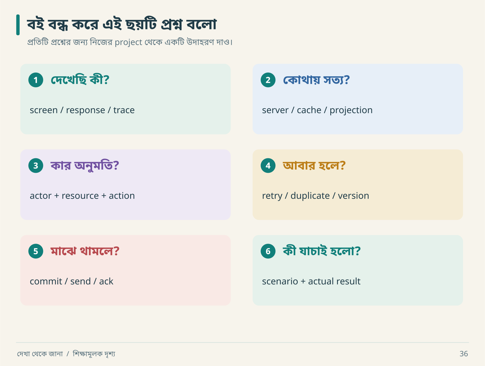

# ২৪ · মাঠের খাতা: ২৫টি স্মরণসূত্র

## দেখার পাঁচটি নিয়ম

একটি পরিচিত app-এর একটি button বেছে নাও। ছয়টি card ধরে তার গল্প বলো। কোথাও উত্তর আটকে গেলে সেটিই তোমার পরের প্রশ্ন। নিচের ২৫টি নিয়ম চাইলে পরে reference হিসেবে খুলবে।

| # | স্মরণসূত্র | Agent-কে প্রশ্ন |
|---:|---|---|
| ১ | Screenshot সাক্ষী, পূর্ণ specification নয় | কোন state capture করা হয়নি? |
| ২ | Header একটি চিহ্ন | এটি origin-এর evidence কি? |
| ৩ | Observation-এর context আছে | version, actor, environment কী? |
| ৪ | Unknown-ও কাজের বস্তু | পরের পরীক্ষা কী? |
| ৫ | Confidence-এর ভিত্তি চাই | alternative explanation কী? |

## Model করার পাঁচটি নিয়ম

| # | স্মরণসূত্র | Agent-কে প্রশ্ন |
|---:|---|---|
| ৬ | Page list-এর নিচে journey | failure/recovery কোথায়? |
| ৭ | State transition মানে নিয়ম | forbidden transition কী? |
| ৮ | Data copy-এর owner আলাদা | source of truth কোনটি? |
| ৯ | Delete-এর পরে ছায়া থাকে | cache/index/attachment কী হবে? |
| ১০ | Architecture-এর কারণ চাই | কোন requirement এই component চায়? |

## নির্মাণের পাঁচটি নিয়ম

| # | স্মরণসূত্র | Agent-কে প্রশ্ন |
|---:|---|---|
| ১১ | Rewrite-এর আগে baseline | কোন existing behavior রাখতে হবে? |
| ১২ | ছোট সম্পূর্ণ slice | durable user outcome কোথায়? |
| ১৩ | UI disable server guarantee নয় | alternate client retry করলে? |
| ১৪ | Timeout মানে ফল অজানা হতে পারে | operation reconcile হবে কীভাবে? |
| ১৫ | Outbox সব gap বন্ধ করে না | send-এর পরে crash হলে? |

## যাচাইয়ের পাঁচটি নিয়ম

| # | স্মরণসূত্র | Agent-কে প্রশ্ন |
|---:|---|---|
| ১৬ | Login permission নয় | actor-resource-action test আছে? |
| ১৭ | Mock-এর label থাকবে | কোন integration বাস্তব? |
| ১৮ | Expected বদলে bug লুকিও না | oracle কোথা থেকে এসেছে? |
| ১৯ | এক run সব interleaving নয় | concurrency-এর সীমা কী? |
| ২০ | Average-এর বাইরে মানুষ আছে | distribution ও errors কী? |

## রিপোর্টের পাঁচটি নিয়ম

| # | স্মরণসূত্র | Agent-কে প্রশ্ন |
|---:|---|---|
| ২১ | Config মানে exercised নয় | restore চালানো হয়েছে? |
| ২২ | Percentage-এর denominator চাই | কোন enumerated set? |
| ২৩ | Critical failure average-এ হারায় না | release gate pass? |
| ২৪ | Persistent artifacts shared memory | পরের agent কোথা থেকে শুরু করবে? |
| ২৫ | Completion একটি যুক্তিসহ দাবি | scope, result, remaining risk কী? |

## শেষ দৃশ্য

কয়েক সপ্তাহ পরে আবার রাত ২টা ১৭। আরিফের screen-এ এবারও সুন্দর app। কিন্তু পাশে evidence ledger, executed report আর তিনটি unresolved question আছে। নীরা জিজ্ঞেস করল, “সব জানো?”

আরিফ বলল, “না। তবে কোনটা দেখেছি, কোনটা ধরে নিয়েছি, কোনটা পরীক্ষা করেছি, আর কোনটা জানি না—সেগুলো আলাদা করতে পারি।”

নীরা খাতা বন্ধ করল। “তাহলে কাল প্রথমে কোনটা?” আরিফ একটি প্রশ্নে দাগ দিল: provider ফিরে এলে pending notification পাঠানো হচ্ছে কি না। আজকের কাজ সেখানেই শেষ।

**নিজে করো—Q24:** বই বন্ধ করে নিজের পাঁচটি নিয়ম লেখো। প্রতিটির জন্য একটি ভুল implementation এবং একটি ধরার পরীক্ষা বলো। [মূল্যায়নের নির্দেশনা](../appendices/B-workbook.md)।

<!-- book-navigation -->

---

[← প্রতিদিনের ছোট engineering সভা](../chapters/23-daily-loop.md) · [সূচি](../README.md) · [বাংলা–ইংরেজি ধারণার অভিধান →](../appendices/A-glossary.md)
